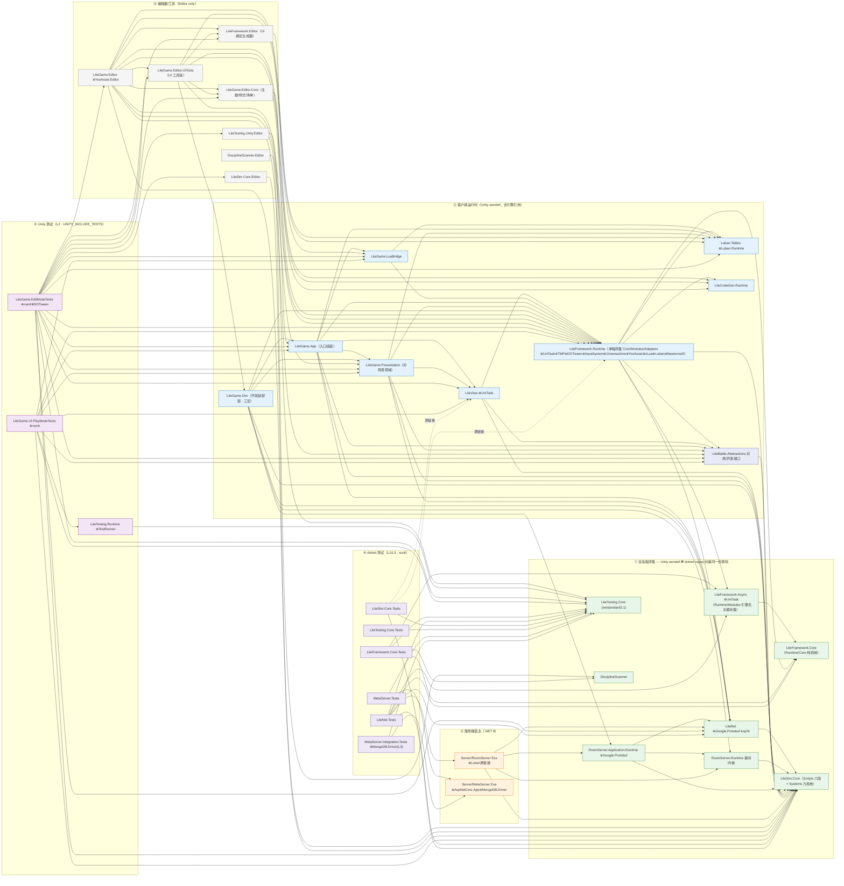

# 程序集引用图

> 双端（Unity 客户端 + dotnet 服务端）**全量程序集引用关系**，含测试与编辑器档位。
> 口径时点：2026-10-03 实测——`Tests.slnx` 16 工程 + `Assets/` asmdef + 各双轨 csproj 的 `references` / `ProjectReference`；双轨程序集（asmdef ⇄ csproj 共编同一份源码）合并为单节点，两侧引用已核对一致。2026-10-27 复核增量：`LiteGame.DevLocalServer`、`LiteGame.DevTool` 两节点并入 `LiteGame.Dev`（开发装配层，三宏约束）；`LiteView → LiteFramework.Abstractions`、`LiteFramework.Abstractions → LiteSim.Core` 两条边新增，`LiteFramework.Runtime → LiteView`、`LiteGame.App → LiteGame.Dev` 两条边删除。**2026-10-29 端口分层**：`LiteFramework.Abstractions` 拆二——框架通用端口留在原程序集且不再引任何 `Lite*` 实现/`LiteSim.Core`（`IContentLocationCatalog`；同批收尾把带 `UniTask` 签名的 `IConfigTableSource` 归位 `LiteFramework.Async`，`Abstractions` 转 `references: []`）；对局与开发端口（`IBattleView`/`IBattleReadModel`/`IInputService`/`IIntentSource`/`IDevSession`）迁入新中立契约件 `LiteBattle.Abstractions → LiteSim.Core`。同批删除已不存在的 `LiteFramework.Network.Kcp` 节点（该适配器 2026-10-11 并入 `LiteNet`/`LiteFramework.Runtime`，KCP 实现住 `LiteNet/Core/Transport`）。**2026-10-29 结构拆分批**：`LiteGame.App/Presentation` 外提 `LiteGame.Presentation`；`LiteGame.App/Presentation` 外提 `LiteGame.Presentation`；`LiteGame.Editor` 拆出 `LiteGame.Editor.Core`（主题/样式/清单）与 `LiteGame.Editor.UiTools`（UI 工具链）。
> 本图只回答"谁引谁"，是**程序集引用关系的唯一权威**（[代码地图](代码地图.md) §3 为自研主线速览、[01 项目总览](../项目说明/01-项目总览.md) §5 为分层概览，均以本图为准）；"是什么/去哪改"归 [代码地图](代码地图.md)，设计动机归 `Docs/设计文档/`。

## 图

## 图例

RoomServer 源链接 `Assets/LiteFramework/Runtime/Adapters/Luban/SimConfigMapper.cs`，只共编无 Unity/UniTask 依赖的数值映射文件，不引用 `LiteFramework.Runtime` 程序集。该映射把战斗/移动/实体三表组合为 `CombatValues`；程序集连线保持原样。

- `A --> B`：A 引用 B（asmdef `references` / csproj `ProjectReference`）。
- `⊕`：程序集外依赖——NuGet（UniTask 2.5.11 / Google.Protobuf 3.36.1 / MongoDB.Driver 3.12.0 / xunit 2.9.2）、UPM 包（YooAsset、Cinemachine、Unity.InputSystem、Unity.TextMeshPro、Luban.Runtime、UnityEngine.TestRunner）、Vendor（kcp2k、Google.Protobuf DLL、DOTween、nunit.framework.dll）、框架引用（Microsoft.AspNetCore.App）。
- 虚线：**源链接共编**（`<Compile Include>` 链入源文件，非程序集引用）——`LiteSim.Core.Tests` 链入 `LiteView/Core/ViewTransformMath.cs`、`LiteFramework/Runtime/Modules/Input/*.cs` 与 `LiteBattle/Abstractions/Input/*.cs`（三件契约 + 输入服务本体，共五件）；`Server/RoomServer` 链入 Luban Runtime 与 `GameData/Generated`（图内以 `⊕Luban源链接` 标注）。

## 要点

- **双轨程序集（① 组）**：Unity（asmdef）与 dotnet（csproj）编译**同一份源码**——`LiteFramework.Core`（Runtime/Core）与 `LiteFramework.Async`（Runtime/Modules 引擎无关模块集）、`LiteSim.Core`、`LiteNet`、`RoomServer.Runtime/Application.Runtime`、`LiteTesting.Core`、`DisciplineScanner`；dotnet 侧供 `Tests.slnx`/服务端宿主/CI，Unity 侧供编辑器与 Player。
- **两端唯一的代码级汇合点**：`LiteSim.Core / LiteNet / RoomServer.Runtime / RoomServer.Application.Runtime`——`Server/RoomServer`（.NET 宿主）与 `LiteGame.Dev`（Unity 内嵌本地服件住 `Dev/LocalServer/`）共编同一份源码，协议单源（`Assets/LiteNet` csproj 注释红线：服务器侧另写消息结构物理上不可能）。
- **`Server/MetaServer` 是零引用孤岛**：无 ProjectReference，仅 `Microsoft.AspNetCore.App` 框架引用 + `MongoDB.Driver`；与客户端**无程序集连线**，只存在运行时 HTTP 关系（`LiteFramework.Runtime` 内的 UnityWebRequest 为资源候选拉取通用面）。
- **`LiteNet → LiteSim.Core` 是有意方向**（协议层打包 Sim 输入/槽位结构体）；房间内核 R11 红线反向隔离：`RoomServer.Runtime` 只引 `LiteSim.Core`（禁 proto/LiteNet/IO/时钟，纪律扫描 `DisciplineScannerTests` 打红）。
- **`LiteFramework.Async` 是唯一保留 UniTask 的框架双轨件**（S2 契约边界：Core 零第三方零引擎）；框架侧 Unity 程序集已合并为 `LiteFramework.Runtime`（Core/Modules/Adapters 三段）+ `LiteFramework.Editor`（UI 绑定生成器，原 `LiteCodeGen.Editor`）。`Core` 的零引擎/零第三方由目录级守卫（`ClientAsmdefAllowlistTests.框架Core与SimCore不得依赖Unity`）替代 asmdef 判据。
- **`autoReferenced:false` 的程序集**（Platform.Unity、LiteBattle.Abstractions、Dev、RoomServer 双件、Testing 全家、Scanner 全家、Game.Editor、两套 Unity 用例）不会被 Assembly-CSharp 隐式引用——图中连线即全部引用方，无隐藏边。
- **`LiteBattle.Abstractions` 是 View 与 Client 共同依赖的中立契约件**（对局/开发端口：`IBattleView`/`IBattleReadModel`/`IInputService`/`IIntentSource`/`IDevSession`）：命名**不带** `LiteFramework.`/`LiteGame.` 前缀——否则 `LiteView → LiteFramework.*` 与 `LiteFramework.* → LiteGame.*` 两条硬边必有一条被破坏。它只引 `LiteSim.Core`，不引任何实现程序集；命名空间 `LiteBattle`（2026-10-29 命名空间收口）。
- **命名空间约定**：框架侧统一 `LiteFramework`（Runtime 内按 `Core`/`Modules/<服务>`/`Adapters/<第三方>` 分子命名空间；UI 模块＝`LiteFramework.UI`）；框架模块保留各自领域命名空间（`LiteView`/`LiteSim`/`LiteNet`/`RoomServer`）；契约件 `LiteBattle.Abstractions`＝`LiteBattle`；产品侧 `LiteGame.*` 保持 `LiteGame`（2026-10-29 收口，`LiteClient` 命名空间退役——见[术语规范 §6.5](../设计文档/架构/术语规范.md#65-程序集名与命名空间解耦约定)）。

## 未入图（仓库内存在、但无任何引用方）

`UnityGameFramework.Runtime/Editor`（旧框架遗留）、`MagicaCloth2.*`、`Sirenix.OdinInspector.*`、`UniRx.*`、`CombatGirlsCharacterPack` 的 Unity ToonShader——vendored 三方/遗留件，改前先确认归属（见[代码地图](代码地图.md) §2）。

## 维护

结构性改动（新增程序集、改引用、改装配序）后**当批同步本图**，与[代码地图](代码地图.md)同一纪律；核对命令：`rg '"references"' Assets -g '*.asmdef'` 与 `rg 'ProjectReference' Tests Server Assets -g '*.csproj'`。
