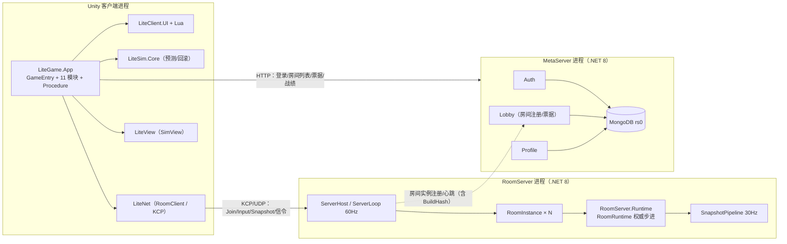
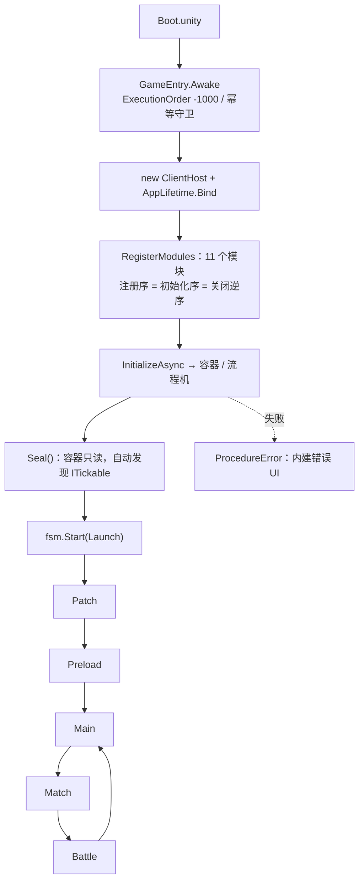
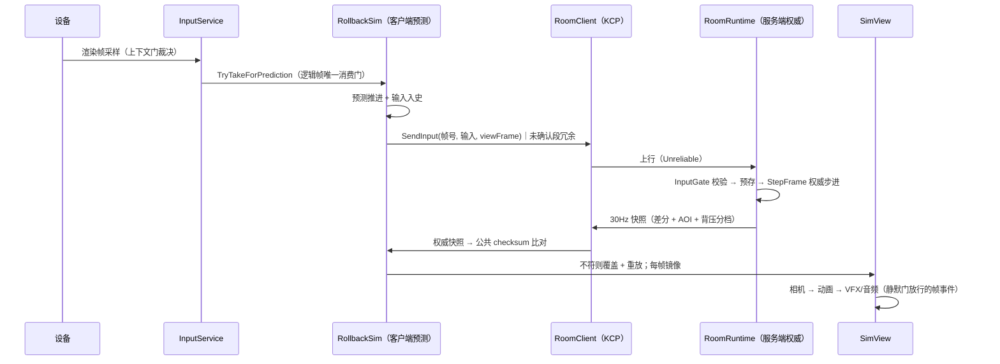

# 02 · 总体架构与程序集分层

> **本章回答**：项目的分层原则是什么、程序集如何单向依赖、三个进程与两个共编源集如何分工、一次启动与一局对战如何串起来、关键架构决策各自付了什么代价。
> **上游权威**：[程序集引用图](../开发导航/程序集引用图.md)是引用关系的唯一权威；[客户端总设计](../设计文档/架构/商业级通用客户端框架总设计.md)、[服务端总设计](../设计文档/架构/商业级通用服务端框架总设计.md)裁决目标架构。本章是"把图读懂"的说明。
> **口径**：2026-10-22 工作区；装配序以 `GameEntry.RegisterModules` 为准。

## 1. 五条架构原则

| 原则 | 含义 | 机制化落点 |
|---|---|---|
| **零引擎内核** | 判定、协议、房间内核不引用 UnityEngine，可被 dotnet 直接编译与测试 | asmdef `noEngineReferences: true`；`LiteFramework.Core` `references: []` |
| **单向依赖** | 上层认识下层，下层不认识上层；产品认识框架，框架不反向认识产品 | asmdef 引用图 + R12 适配器边界扫描 + `LiteClient.*` 禁引 `LiteGame.*` |
| **装配序即依赖图** | 模块只能消费更早模块经 `ClientContext.Put/Require` 提供的产物，不靠容器反射查找 | `GameEntry.RegisterModules` 的 11 行链式注册；同型唯一 |
| **单一写者** | 导航、UI 开关、时钟暂停、房间状态等只允许一个组件写 | `UINavigationController`、`GameClock.Paused` 仅调试器写、`RoomRuntime` 唯一持 Sim |
| **共编单源** | 判定/协议/内核只存在一份源码，双端编译同一份 | asmdef ⇄ csproj 双轨 + 源链接（`<Compile Include>`） |

这五条不是口号：每条都有对应的构建约束或扫描规则，违反会在 L1/L2 打红（详见第 09 章）。

## 2. 四层依赖与程序集矩阵

```text
┌─ 装配层 ────────────────────────────────────────────────────────────┐
│ LiteGame.App（GameEntry / Bootstrap 11 模块 / Procedure 流程机）      │
│ LiteGame.DevTool（DevHUD / 调试控制台）  LiteGame.Editor（工具 Hub）  │
└───────────────▲─────────────────────────────────────────────────────┘
                │ 只允许装配层认识全部下层
┌─ 域层 / 适配器 ─────────────────────────────────────────────────────┐
│ LiteClient.Runtime · LiteClient.UI · LiteGame.LuaBridge             │
│ LiteClient.Platform.Unity / Content.YooAsset / Network.Kcp /        │
│ Scripting.XLua / Serialization.Luban · LiteCodeGen · DevLocalServer │
└───────────────▲─────────────────────────────────────────────────────┘
                │
┌─ Unity 基础层 ──────────────────────────────────────────────────────┐
│ LiteFramework.Unity（AppLifetime/池/场景）· LiteView · Abstractions │
└───────────────▲─────────────────────────────────────────────────────┘
                │
┌─ 零引擎层 ──────────────────────────────────────────────────────────┐
│ LiteFramework.Core · LiteFramework.Async(UniTask) · LiteSim.Core    │
│ LiteNet · RoomServer.Runtime · RoomServer.Application.Runtime       │
│ LiteTesting.Core · DisciplineScanner                                │
└─────────────────────────────────────────────────────────────────────┘
```

### 2.1 自研主线程序集

| 程序集 | 角色 | 关键类型（示例） | 主要依赖 |
|---|---|---|---|
| `LiteFramework.Core` | 框架内核，零引擎零第三方 | `ServiceContainer`、`ClientScope`、`EventCenter`、`CommandCenter`、`StageMachine`、`ObjectPool`、`FileSys`、`GameClock`、`ActivationTransactionStore` | 无 |
| `LiteFramework.Async` | 宿主与异步编排（唯一引 UniTask 的框架件） | `ClientHost`、`IClientModule`、`PatchCoordinator`、`SharedLoadCoordinator` | Core + UniTask |
| `LiteFramework.Unity` | Unity 平台桥 | `AppLifetime`、`GameObjectPool`、`ISceneService`、`INetworkService` | Core/Async + UnityEngine |
| `LiteSim.Core` | 确定性判定 | `SimStep`、`FrameDriver`、`SimWorldState`、`SimChecksum`、`RollbackSim`、`SimMath`、`CombatValues` | Core |
| `LiteNet` | 协议与传输 | `PacketCodec`、`InputPacker`、`SnapshotDiffer/Codec/Reassembler`、`AoiFilter`、`RoomClient`、`KcpTransportClient` | Core/Sim + kcp2k/Protobuf |
| `RoomServer.Runtime` | 权威房间内核（纯化） | `RoomRuntime`、`InputGate`、`MatchStateMachine`、`CombatEventWindow`、`LagCompensator` | Sim |
| `RoomServer.Application.Runtime` | 房间编排（允许协议） | `SnapshotPipeline`、`SessionManager`、`JoinTicket` 验签 | Runtime + LiteNet |
| `LiteClient.Abstractions` | 客户端端口 | `IConfigTableSource` 等 | Core/Async |
| `LiteClient.Runtime` | 会话/输入/战斗上下文 | `BattleClient`、`BattleContext`、`InputService`、`IntentGate`、`PublicCombatFeed` | Core/Async/Net/Sim/View |
| `LiteClient.UI` | UI 运行时 | `UIService`、`UINavigationController`、`UIModalStack`、`UIBindIndex` | Core/Async + uGUI/DOTween/TMP |
| `LiteView` | 表现层 | `SimView`、`EntityViewMap`、`CharacterLocomotionDriver`、`VfxService`、`AudioService` | Core/Sim/Net |
| `LiteGame.App` | 产品装配与流程 | `GameEntry`、11 个 Module、`Procedure*`、`Presentation/*` | 几乎全部客户端程序集 |
| `LiteGame.LuaBridge` | Lua 桥 | `Bridge` 四门面、`LuaBehaviourAdapter`、`RegistryFiller` | UI/XLua/Luban |
| `LiteGame.DevLocalServer` | 进程内本地服 | `LocalServerTransport` | RoomServer 双件 + LiteNet |

> 完整 52 个 asmdef 与全部边：见 [程序集引用图](../开发导航/程序集引用图.md)；上表只列自研主线。

### 2.2 双轨共编：一份源码的三种编法

```text
Assets/LiteSim/Core/Scripts/SimStep.cs
   ├─ Unity 侧：LiteSim.Core.asmdef  → 编辑器 / Player / EditMode / PlayMode
   ├─ dotnet 侧：LiteSim.Core.csproj → Tests.slnx（L1/L3）/ Server 宿主引用
   └─ 源链接：RoomServer.csproj <Compile Include=...>（少量共享文件，如 SimConfigMapper.cs）
```

- **asmdef 与 csproj 编译同一份源码**，产物分别进 `Library/` 与 `.dotnet/`；严禁在 `Assets/` 下落 `bin/obj`（Unity 会当插件导入并触发 CS1704）。
- **源链接**只用于"不能整包引用"的共享文件（如服务端所需的 Luban 映射），在 csproj 中显式 `<Compile Include>`，因此这类文件也在 BuildHash 闭包内。
- 代价：新增程序集要同时改 asmdef、csproj、`Tests.slnx`、`ScanTargets.cs`、代码地图；收益是**判定代码不可能两端各写一份**。

## 3. 进程拓扑：三个进程，两个源集



- **两个共编源集**：`LiteSim.Core`（判定）被客户端、RoomServer 宿主、dotnet 测试共同编译；`RoomServer.Runtime`（房间内核）由宿主与 dotnet 测试共编，客户端只有开发档 `DevLocalServer` 引用。`LiteNet` 的协议与打包解包同样两端共用。
- **Meta 是零引用孤岛**：与客户端无程序集连线，只通过 HTTP 交互；与 RoomServer 也没有 ProjectReference，靠运行时注册/票据约定协作。
- **进程内本地服**：开发档位可用 `LocalServerTransport` 在 Unity 进程里跑真 `RoomRuntime`（自动补位开局），便于无网开发与 L3 用例；release 恒走真 KCP。

## 4. 客户端启动与生命周期



**11 个模块的分工**（`Assets/LiteGame/App/Bootstrap/`，一件一文件）：

| # | 模块 | 提供 |
|---|---|---|
| ① | `PlatformInfrastructureModule` | 本地持久化 + 日志（先于一切 IO） |
| ② | `ContentModule` | `IContentService`（配置/Lua 字节与资产租约来源） |
| ③ | `SettingsModule` | 玩家偏好（UI/音频注册时就要读） |
| ④ | `ClocksModule` | World/UI 双轨时钟 + 事件中心 |
| ⑤ | `SchedulersModule` | 时序执行（依赖 ④） |
| ⑥ | `LuaHostModule` | XLua 宿主（同 GameObject 组件） |
| ⑦ | `ConfigModule` | 表投影数据源（依赖 ② 的租约通道） |
| ⑧ | `UiServiceModule` | UI 服务装配（依赖 ②⑥⑦） |
| ⑨ | `PresentationModule` | 表现域 + 相机服务（依赖 ②④） |
| ⑩ | `InputModule` | 输入服务（设备源；瞄准相机取自 ⑨） |
| ⑪ | `ContainerModule` | 容器与流程机（消费以上全部，装配根最后一段） |

**关闭链**：`AppLifetime.OnDestroy` → 刷新钩子 → **逆序模块关闭** → 根 Scope 释放（无遗留）；编辑器关闭 Domain Reload 时由 `GameEntry.ResetForEditorReload` 等复位点清理静态状态，避免二次 Play 引导死锁。

**流程机**：`Launch → Patch → Preload → Main → Match → Battle`，任一阶段失败进 `Error`（终态）。`Main` 做启动落点决策（登录页/大厅页/不开页），**不加载对局场景**；对局场景组（`BattleRig` + 地图）在 `Match/Battle` 按需加载、离场卸载。

## 5. 一局对战的数据流



这条链的四个关键接缝在第 05/06 章展开：**输入唯一消费门**、**公共 checksum 和解**、**快照 jitter buffer**、**回滚期事件静默门**。

## 6. 关键架构决策与代价

| 决策 | 理由 | 代价 | 守卫 |
|---|---|---|---|
| **判定逻辑双端共编 + 房间内核纯化** | 服务器权威 + 客户端预测必须逐位一致；房间内核必须能在 L1 纯测 | 内核不能碰引擎/IO/proto；构建需双轨 | R11 纯化扫描、BuildHash 握手（判定面）、L1 IEEE 基线 |
| **状态同步 + 预测回滚**（而非帧同步） | 服务器权威、抗作弊、状态可按 AOI 裁剪（为中途加入/观战留模型空间，当前未实现） | 带宽与快照复杂度高；和解需衰减与静默门 | 公共/全量 checksum 双口径、背压分档、AOI |
| **自研整数数学**（`SimMath` software sqrt） | 跨平台/跨运行时逐位一致，禁 FMA/超越函数 | 性能与可读性成本；需 IEEE 对账工具 | R1/R2/R3 扫描、`IeeeProbe`、边界用例 |
| **uGUI + XLua + 绑定生成** | 美术可独立制作 prefab，页面逻辑可热更 | 两语言调试、绑定/注册表流水线复杂 | 视觉单一来源扫描、UI 工具链校验、Lua 沙箱 |
| **Meta 模块化单体** | 早期运维简单、事务边界清晰 | 单进程扩展上限；后续拆分需保持契约 | 端口/契约分层、Outbox 幂等、迁移版本化 |
| **规范门禁化** | 评审记忆不可靠，红线必须可执行 | 前期工具投入大、误报需维护豁免 | L0～L4、R1～R13、Doc lint、CI 矩阵 |

## 7. 目录地图（一级）

| 路径 | 是什么 |
|---|---|
| `Assets/LiteFramework` | 框架本体：`Scripts/Core`（零引擎）、`Scripts/Async`（宿主/热更编排）、`Scripts/Unity`（平台桥） |
| `Assets/LiteSim` | `Core`＝确定性判定（两端共编）；`Core/Editor`＝IEEE 对账/烘焙/三角表生成 |
| `Assets/LiteNet` | 协议单源、打包解包纯函数、KCP 传输、房间客户端 |
| `Assets/RoomServer` | 权威房间内核：`Runtime`（纯化）+ `Application`（快照/会话编排） |
| `Assets/LiteClient` | 客户端框架侧：`Runtime`、`UI`、`Abstractions`、五个适配器 |
| `Assets/LiteGame` | 产品侧：`App`（装配/流程/表现驱动/调试）、`LuaBridge`、`Lua`、`DevTool`、`DevLocalServer`、`Editor` |
| `Assets/LiteView` | 表现层：SimView/实体映射/动画驱动/VFX/音频/相机端口 |
| `Assets/ShareResource` | 进包共享资源：UI 页面/控件模板、字体、特效、角色 prefab |
| `Assets/GameData` | Luban 产物：`Config/*.bytes`（两端同读）+ `Generated`（读取代码） |
| `Assets/Scenes` | `Boot`（启动）、`BattleRig` + `Arena01`/`TrainingGround`（对局场景组） |
| `Server/RoomServer`、`Server/MetaServer` | .NET 8 宿主：组合根、入站路由、房间实例、Meta 模块 |
| `scripts` | 全 Python 工具：`gate`/`codegen`/`content`/`build`/`deploy`/`pipeline` |
| `Luban` | 表源（10 张业务表 + 地图 + 元表）、`gen.bat`、Defines |
| `Docs` | 设计/进度/说明/导航/工具链/环境/审计/归档 |

## 8. 架构约束如何变成机制

| 约束 | 机制 | 违规后果 |
|---|---|---|
| 内核不得碰引擎/IO/时钟/proto | asmdef `noEngineReferences` + R11 扫描 | L1 红（`DisciplineScannerTests`） |
| 判定不得用超越函数/FMA/float 等值 | R1/R2/R3 扫描 + IEEE 基线用例 | L1 红 |
| 框架不得反向依赖产品 | asmdef 引用 + R12 边界扫描 | 编译失败/L1 红 |
| 两端判定代码一致 | BuildHash 生成器 + Join 握手 | 出包门禁拦截 / 进房被拒 |
| UI 视觉单一来源 | `VisualConstructionScanner` + EditMode 正/负例 | L2 红 |
| 文档索引与链接有效 | `doc-lint.py`（D1～D7） | Doc 门禁红 |

> 这解释了一个常见疑问：为什么项目里"规矩"这么多？因为每一条规矩都对应过一次真实事故，且都被改造成了可执行检查——**注释提醒不算机制**。

---

**上一章**：[01 · 项目定位与技术栈](01-项目定位与技术栈.md) ｜ **下一章**：[03 · 客户端框架与运行时](03-客户端框架与运行时.md)
