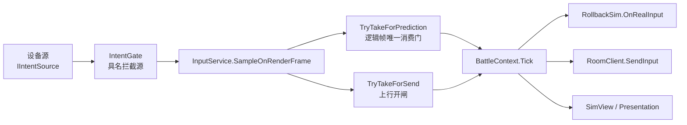

# 03 · 客户端框架与运行时

> **本章回答**：`ClientHost` 如何接管一次启动/关闭、12 个模块如何装配、容器与作用域如何管所有权、时钟/事件/命令/状态机/池各自解决什么问题、会话与输入如何接到判定与网络。
> **上游权威**：[商业级通用客户端框架总设计](../设计文档/架构/商业级通用客户端框架总设计.md) §4～§12；客户端程序整体设计串讲见 [项目说明/03](../项目说明/03-技术细节-客户端.md)。本章按"设计意图 + 代码事实"重写，不复制 API 表。
> **口径**：2026-10-22 工作区；`ClientHost` 在 `LiteFramework.Async`，不在 `Core`。

## 1. 分层：谁持有生命周期，谁只做适配

```text
Unity 场景
  └─ GameEntry（MonoBehaviour，唯一引导适配器，ExecutionOrder -1000）
       ├─ ClientHost（真正的启动/关闭持有者，纯 C#）
       │    ├─ IClientModule × 12（按注册序初始化、逆序关闭）
       │    ├─ ClientContext（模块产物交换：Put/Require）
       │    └─ ClientScope（根作用域，取消与释放的级联源）
       ├─ AppLifetime（Unity 平台桥：Pause/Focus/LowMemory/Quit）
       └─ ServiceContainer（装配器，Seal 后只读）
```

**关键分工**：

- `GameEntry` 只做三件事：建 Host、注册模块、把 Unity 帧/生命周期事件喂进去。它保留一个 `s_booted` 幂等标记，防止重复引导。
- `ClientHost` 不依赖 UnityEngine，因此 **L1 可以用假事件测试完整的启动/关闭/失败回滚语义**。
- `AppLifetime` 是唯一把 Unity 平台消息翻译成 Host 订阅的地方；Host 只持回调集合。

## 2. `ClientHost`：生命周期的四条硬语义

`Assets/LiteFramework/Scripts/Async/ClientHost.cs`：

| 语义 | 行为 | 为什么重要 |
|---|---|---|
| **注册序 = 初始化序 = 关闭逆序** | `AddModule` 只允许在启动前调用；启动后拒绝（`InvalidOperationException`） | 依赖图由装配方显式表达，Host 不推断；关闭时后建者先释放 |
| **失败只回滚已成功部分** | 记录 `_initializedCount`，初始化失败时只关闭 `0..count-1` | 不会去关闭一个从未成功初始化的模块 |
| **单模块关闭失败不阻断其余** | 异常聚合上报，不向外抛 | 退出路径必须尽力而为，避免一个坏模块拖垮整个关闭链 |
| **退出前刷新钩子** | `AddPreShutdownFlush` 按登记序执行（设置/存档/遥测/最后日志），单钩子失败不阻断 | 把"最后写盘"从模块关闭中解耦，顺序可控 |

平台事件（Pause/Focus/LowMemory/Quit 意图）经订阅方法转发；Quit 是**意图**而非直接退出，由流程机决定是否放行。编辑器关闭 Domain Reload 时，`ResetForEditorReload` 负责清理静态状态，避免二次 Play 死锁。

## 3. 模块与 `ClientContext`：不用字典做服务定位

每个模块实现 `IClientModule`（`Name` / `InitializeAsync` / `ShutdownAsync`），只通过 `ClientContext.Put<T>(product)` 与 `Require<T>()` 交换产物：

- **同型唯一**：同一类型只能 Put 一次，重复即装配错误；
- **编译期可见**：消费方 `Require<T>()` 拿到强类型产物，不写字符串键；
- **失败显性**：缺产物直接抛，不在运行期"找不到服务返回 null"。

12 个模块的注册序就是依赖图（见第 02 章 §4）：平台基础设施 → 开发会话 → 内容 → 设置 → 时钟 → 调度 → Lua → 配置 → UI → 表现 → 输入 → 容器/流程机。`ContainerModule` 是装配根的最后一段：它消费前面全部产物，构建 `ServiceContainer`、`Seal()`、建流程机，然后交给 `ProcedureLaunch`。

## 4. 容器：构造注入、预检、冻结

`Assets/LiteFramework/Scripts/Core/DI/ServiceContainer.cs`：

| 能力 | 说明 |
|---|---|
| 构造注入 | 注册接口→实现或工厂；解析时按构造函数依赖递归构造（可选显式依赖声明） |
| 声明图预检 | Seal 前检查缺失依赖/循环依赖，把装配错误提前到启动期 |
| 注册冻结 | `Seal()` 之后只读；运行期再注册直接失败 |
| 帧驱动序 | Seal 时自动发现 `ITickable`，按显式顺序形成 `Tickables`，由 `GameEntry.Update` 单点驱动 |
| 诊断面 | 自动发现 `IModuleStats`，供 DevHUD/调试内核读取 |
| 所有权 | 容器挂在自己的 `ClientScope` 上；`ServiceOwnership.Borrowed/Owned` 决定是否随容器释放 |
| 父子容器 | 子容器向父域读 Singleton，自己只持有本域实例；用于 Account/Match 等短生命周期域 |

**为什么不用反射服务定位**：反射查找会把"缺依赖"推迟到运行期某次调用；构造注入 + 预检把错误提前到启动，且 AOT 下可控（需要保留的构造类型进保留清单）。

## 5. 作用域与租约：五层树 + LIFO

`ClientScope` 是取消、释放与租约的轻量底座（`Assets/LiteFramework/Scripts/Core/Hosting/ClientScope.cs`）：

```text
Root
 └─ Account（登录会话）
      └─ Match（一局匹配/房间连接）
           ├─ Scene（对局场景组：BattleRig + 地图）
           └─ UI（界面实例与页面级资源）
```

- **取消级联**：子 Scope 的 CTS 链接父 Token，父取消必然级联；子 Dispose 不影响父（所有权单向）。
- **LIFO 释放**：`Register` 登记的可释放资源按登记逆序释放（后建者可能依赖先建者）。
- **异常聚合**：单项释放失败不阻断其余，失败收集在 `DisposeFailures`。
- **已死作用域拒绝登记**：释放后再 `Register` 会就地释放并抛 `ObjectDisposedException`——这是错误契约的一部分（见 §9）。
- **租约**：资源以 `AssetLease<T>` 归还，作用域关闭即级联释放；视图侧另有 `PrefabLeaseCache` 按作用域缓存，避免重复加载同一 prefab。

## 6. 时钟与调度：单一缩放源

`GameClock`（`Core/Clock/GameClock.cs`）是全项目唯一的时间缩放实现：

```csharp
ScaledDelta = Paused ? 0 : realDelta * TimeScale;   // realDelta 先被 MaxDelta=0.1 钳制
```

- **WorldClock / UIClock** 两个实例，分别驱动逻辑调度、时间轴、DOTween 的 Manual 轨（`UiAnimationClock`）。
- **Unity `Time.timeScale` 恒为 1**：只允许一个缩放源，避免"0.2 × 0.2 = 0.04"的双缩放事故。
- **单帧 delta 钳制 0.1s**：加载/Hitch 的尖峰不会让定时器集体到期或动画跳变。
- **重要边界**：流程机与对局推进**不消费** `ScaledDelta`（`StageMachine` 由 `GameEntry.Update` 直接喂 unscaled delta，`RollbackSim` 用传入的真实帧间隔）。因此把 WorldClock 置暂停只冻结走 `IGameClock` 的消费者，**不冻结流程与对局**；要"真冻结对局"得在流程/对局侧另行裁决。

调度侧由 `GameScheduler` / `LogicScheduler` / `TimelineRunner` 组成：逻辑调度走逻辑帧，表现时间轴走 UIClock，二者不互相等待。

## 7. 事件中心与命令中心：两套不同的"解耦"

| 件 | 模型 | 适用 | 关键能力 |
|---|---|---|---|
| `EventCenter` / `EventChannel<T>` | **通知**：发生了某事，谁关心谁订阅 | 跨模块副作用、表现事件 | 优先级派发、延迟派发、有界队列、发布拦截链 |
| `CommandCenter` | **意图**：请求执行一个动作并要结果 | GM/调试、玩家操作、需要审计/撤销的动作 | 类型化注册-执行-结果、排队/异步、拦截器、撤销重做、权限门、审计环 |

两者的区别常被误用：**事件不该承担"必须成功"的语义**（订阅者可缺席）；**命令不该用来做广播**（有唯一处理者与结果）。项目里 UI 开关走导航（命令式），帧事件走事件中心，就是按这个边界分的。

## 8. 状态机：三机体 + 抢占 + 层级

`Core/Fsm/` 提供四件：

| 类型 | 形态 | 典型用途 |
|---|---|---|
| `StageMachine` | 扁平、显式迁移表 | 启动流程（Launch→Patch→…→Error） |
| `PreemptiveStageMachine` | 可被高优先级状态抢占、可恢复 | 暂停/模态/错误态压栈 |
| `HierarchicalStageMachine` | 父子状态、子状态继承父的迁移 | 对局/角色等有层次的行为 |
| `PreemptiveHierarchicalStageMachine` | 上述两者组合 | 复杂交互态（如受击打断瞄准） |

配套：`TransitionTable`（迁移声明）、`FsmCapture`（快照/恢复）、`StageGraphDiagnostics`（图诊断）、`FsmAudit`（迁移审计）。设计取舍是**显式迁移表**而非"每个状态自己决定去哪"：迁移关系可被静态检查、可被审计，避免状态爆炸后无法推理。

## 9. 池、IO、日志与错误契约

| 件 | 机制 | 使用边界 |
|---|---|---|
| `ObjectPool<T>` | 泛型对象池，`IPoolable` 回调，按 key 分桶 | 视图/特效等高频创建 |
| `ReferencePool` | 引用类型池（`IReference`） | 短生命周期数据对象 |
| `CollectionPool<,>` | List/Dictionary/HashSet 复用 | 热路径零分配 |
| `FileSys` | 全项目唯一 IO 门面（路径 + 读写 + JSON） | 禁止旁路 `File.*` |
| `Log` / `LogTag` / `ILogSink` | 统一日志门面 + 标签 + 可注入 sink | 禁止 `Console.WriteLine`/`Debug.Log` 直写 |
| 错误契约 | 已关闭服务再调用抛 `ObjectDisposedException`；程序员错误 fail-fast；内容问题 `Log.Warning` + 默认值降级 | 同层姊妹服务同契约 |

`SafeCall` / `SubscriptionBag` / `DelegatedDisposable` 是配套的所有权工具：订阅集中退订、回调异常隔离、委托释放。`MainThreadDispatcher` 负责把后台完成切回主线程。

> **未接线提醒**：`ClientErrorRecovery`（错误分类→恢复动作）、`ConfigSnapshotPublishExtensions.PublishAsync`、`IDiagRecordSink` 等已实现但当前无生产消费点；`SharedLoadCoordinator` 已由 `YooAssetContentService` 内部使用，`LocalizationService` 已由 `UiServiceModule` 懒建装配——旧文档的"未接线"说法对这两件已过时。详见第 11 章。

## 10. 会话、输入与战斗上下文



- **设备源**：`NewInputIntentSource` 统一键鼠/触屏，输出 Move/Aim/Fire 意图；Action 资产驻留装配根，不随对局重建。
- **拦截裁决**：`IntentGate` 用具名拦截源（如 `ui.modal`、控制台）统一裁决，并报告"是谁拦的"；UI 打开/调试控制台会登记拦截，关闭释放。
- **采样与消费分离**：渲染帧只采样，逻辑帧只消费一次（`TryTakeForPrediction`）；同一份输入既预测又上行（`TryTakeForSend`），避免"预测用了、上行丢了"。
- **战斗上下文**：`BattleContext` 持会话、Sim、上行与表现编排；`BattleClient` 管连接与房间会话；`PublicCombatFeed` 提供去重后的公共战斗事件（远端枪口/命中表现消费）。

## 11. 表现域的生命周期

表现域不是"一堆 MonoBehaviour"，而是按作用域管理的服务集合：

- `SceneScope` 负责对局场景组（`BattleRig` + 地图）的加载/卸载与**迟到加载代次检查**（切场景后旧回调到达不得复活旧对象）。
- `EntityScope` 负责实体视图的创建/归还，重复归还幂等。
- `AudioService` 用分域时钟（对局暂停/离场即停），`VfxService` 有句柄制播放、挂点隔离、预算与关闭真取消。
- 表现服务之间**不互调**：动画不认识 VFX，VFX 不认识音频；跨域由 `ProcedureBattle`/表现编排件接线。

## 12. 本章要点与常见误解

1. **`ClientHost` 不是单例**：它由 `GameEntry` 创建并持有；静态状态只留编辑器重载复位点。
2. **模块注册顺序不是"随便排的"**：它就是你唯一能表达的依赖图，改序等于改依赖。
3. **容器 Seal 之后不可注册**：对局期不再注册 Tickable，对局由阶段生命周期驱动，天然随离场停止。
4. **WorldClock 暂停 ≠ 游戏暂停**：它只冻结 `IGameClock` 消费者；流程与对局推进不读它。
5. **"已实现"不等于"已接线"**：本项目的诊断/错误恢复有若干件属于前者，读代码时要看调用点（同时注意反向陷阱：旧文档说"未接线"的件可能已经接线）。

---

**上一章**：[02 · 总体架构与程序集分层](02-总体架构与程序集分层.md) ｜ **下一章**：[04 · UI 系统与 Lua 脚本层](04-UI系统与Lua脚本层.md)
