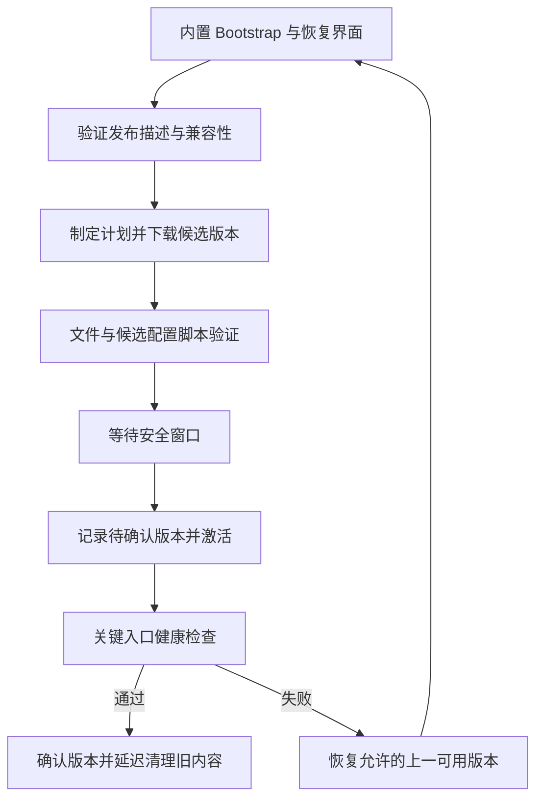

# 热更与内容发布专项设计

> 状态：现行专项设计；内容事务主链已装配，真实发布、灰度与真机矩阵尚待实施
> 版本：1.0
> 更新日期：2026-10-01
> 适用范围：资源、配置与热更程序集的交付与激活，客户端恢复、双端兼容、灰度撤回和发布验收
> Owner：客户端架构与发布工程；UI/页面逻辑、配置、服务端与质量 Owner 共同负责各自接缝
> 依赖：ClientHost/Scope、ContentService/AssetLease、Luban 生成链、页面逻辑与 UI API 生成链、HybridCLR 装载、房间配置生命周期、构建与签名环境
> 状态约定：第 2 节记录当前进度；其余为目标契约，不表示类型、服务或自动化已实现。

## 1. 定位与边界

保留 YooAsset 与 Luban 的同源生成。先完成“可下载、可验证、启动或安全窗口激活、失败可恢复”的内容更新闭环，再按消费者扩展运行中生效能力。C# 热更由 HybridCLR 承接，候选段为 `code/` 下的 hot 程序集（范围见 §3 三档；AOT/hot 分界、身份与回滚见[§3.1](#ch-aot-hot-boundary)）。

本文是热更范围、内容版本、配置与程序集发布事务及回退的专项入口。[客户端总设计](../../架构/商业级通用客户端框架总设计.md)负责跨域架构，[服务端总设计](../../架构/商业级通用服务端框架总设计.md)负责房间与部署，[UI 系统总设计](../UI系统/UI系统总设计.md)负责页面操作与输入，[数值专项](../../游戏玩法/玩法数值与Luban配置专项设计.md)负责 schema 和数值归属。相关主设计以本文为热更契约的唯一细化来源，不保留互相竞争的目标规则。

内容发布的设计裁决：

- 必须验证完整发布、激活、健康确认、恢复与撤回；开发工具不作为生产证据。
- 首版正式发布在冷启动或安全窗口重建环境；同环境局部更新是受限能力。
- 先构建和验证候选集合；失败保留完整旧版本，不发布半套内容。
- 算法、指令语义、协议和安全代码走应用/服务端发布；已有 schema 和指令集内的数值可双端发布，仅新对局采用。
- 区分构建身份、协议/Sim 兼容、玩法数据、表现内容；严格握手不得放松。
- 运行时从已验证候选快照建立数据身份；不能只上报 Player 内旧常量。
- 文件提交、运行时激活、健康确认各有状态；进程中断后必须从持久记录恢复。
- 回退同时检查安全撤销、App/UI API/schema/存档与服务端兼容，禁止回到不允许的版本。
- 目标配置、生成/注入、IL2CPP、兼容和发布验收都必须有证据；未声明能力不能开放。

## 2. 当前进度

内容事务（`PatchRunner` → `PatchCoordinator` → `ProcedurePatch`）已接入启动主链，信任锚已内置首版发布公钥，候选配置与程序集探针已接入健康确认；真实签名候选的发布→接受→激活、灰度与真机矩阵尚待实施。证据见[热更内容校验](../../../施工进度/热更与内容线.md#ch1-热更内容校验)。

### 2.1 已落地的关键契约（代码为准）

| 项 | 实际值 | 落点 |
|---|---|---|
| 编排阶段枚举 | `PatchPhase { Idle, Recovering, PrecheckingSpace, Fetching, Verifying, PendingActivation, Activating, HealthChecking, Confirmed, Failed }` | `LiteFramework/Runtime/Services/Content/PatchCoordinator.cs` |
| **职责分层** | `PatchRunner` 是**薄编排**（取候选→`ReleaseManifestValidator` 信任门→生效窗口→交协调器），**不是状态机**；状态机是 `PatchCoordinator` | `LiteFramework/Runtime/Services/Content/PatchRunner.cs` |
| 发布布局单源 | 候选根 `content/candidate`；受控前缀 `config/`、`code/`、`bundle/`（无 `lua/`）；候选包根 `content/candidate/bundle`；程序集名 = 剥 `code/` 前缀与目录、去 `.dll`（`CodeAssemblyNameOf`） | `ReleaseLayout.cs` |
| 健康探针 | `candidate-config`（`CandidateConfigHealthProbe`，文件存在/非空）、`candidate-config-tables`（`ConfigCandidateHealthProbe`，全量表建表 + `ConfigTableValidator` 语义）、`code-assemblies`（`CodeAssembliesHealthProbe`，`code/` 段程序集可读且为 PE）、`entry-assets`（`AssetsHealthProbe`，走运行时同一条租约通道**加载**当前代次入口）。Lua 探针与 `bridge-capabilities` 探针已随 Lua 面退出删除；`candidate-entry-files` 已退役 | `CandidateConfigHealthProbe.cs`、`AssetsHealthProbe.cs`、`Adapters/Luban/ConfigCandidateHealthProbe.cs`、`CodeAssembliesHealthProbe.cs` |
| 磁盘余量实现与生产选型 | `DriveInfoSpaceProbe`（桌面精确）／`WriteProbeDiskSpaceProbe`（写探针下界，默认 cap 512MB）；返回 −1 表示不可知，空间预检 fail-closed。**生产装配使用 `WriteProbeDiskSpaceProbe`**（IL2CPP Player 的 DriveInfo 不可用） | `DriveInfoSpaceProbe.cs`、`WriteProbeDiskSpaceProbe.cs`、`ContentSegment.cs` |
| 激活记录 | `ActivationRecord`：`ConfirmedReleaseId`（初值 `builtin`）/`ConfirmedVersion`/`ConfirmedRevision`/`PendingReleaseId`/`PendingState`/`RecoveryAttempts`/`LastFailure`/`RecordSequence`/`TransactionId`/`Integrity`；落盘 `activation.json`，结构版本仅认 `1`（不认识 = 不可信 → 回 builtin） | `Core/Hosting/ActivationTransactionStore.cs`、`FileActivationRecordIO.cs` |
| 依赖闸门 | `Dependencies` 必须"已确认**或正在本次在途**"——否则 A→B 两包同批下载会互锁死锁 | `PatchCoordinator.FindUnmetDependency` |
| 失败分类 | `DownloadFailureKind { None, TransientNetwork, SourceUnavailable, FileMissing, LengthMismatch, DigestMismatch, ReadError, InsufficientSpace, UnexpectedFile, DuplicateFile, Canceled }` | `Packages/com.litegame.framework/Runtime/Services/Content/Abstractions/Activation/DownloadFailureKind.cs` |
| 候选预算 | `ReleaseBudget{ MaxFileCount=4096, MaxFileBytes=512MB, MaxTotalBytes=4GB, MaxPathDepth=16 }` | `ReleaseManifestValidator.cs` |
| 信封格式 | `{"manifest":{…},"signature":"<base64>"}`；签名覆盖 `manifest` 节点的 UTF-8 **紧凑表达字节**。生产适配器保留 `Formatting.None` 与原节点对象映射规则，不把空白原文或类型化清单重新序列化后用于验签 | `SignedManifestEnvelope.cs`、`IJsonNode`、`Adapters/Newtonsoft/NewtonsoftJsonCodec.cs` |
| JSON 边界 | 内容探针与本地/HTTP 信封提供者只注入 `IJsonCodec`；节点负责紧凑输出与对象投影，严格网络反序列化规则保持独立。替换实现须通过固定签名字节与现有真签名夹具 | `CandidateConfigHealthProbe`、`FileSystemCandidateProvider`、`HttpCandidateProvider` |
| 候选包根判定 | `CandidateBundleRootResolver.IsCandidateBundleReady`：①已确认 ReleaseId ≠ `builtin` ②`<候选包根>/<包名>.version` 存在 | `CandidateBundleRootResolver.cs` |
| 临时文件布局 | `<候选根>/.tmp/<releaseId>/<相对路径>`；`CleanupTempAsync` **按端口契约不抛** | `HttpCandidateFetcher.cs` |
| CDN 配置 | `ContentCdnConfig{ BaseUrl="", OfferPath="candidate.json", TimeoutSeconds=30 }`；命令行 `-content.cdnUrl` / `-content.cdnOfferPath` / `-content.cdnTimeout`（支持 `-k=v` 与 `-k v` 两形态） | `ContentDeployConfig.cs` |
| HTTP 结果语义 | **404 = 空提案**；畸形信封 = 空提案；**网络错/5xx/超时 = 抛**（不伪装成"无候选"）；文件级 4xx → `FileMissing`（确定性），5xx/0 → `TransientNetwork`（可重试换源） | `HttpCandidateProvider.cs`、`HttpCandidateFetcher.cs` |
| 信任锚 | 内置 1 条：`release-key-2026-09-26`，RSA-2048，e=65537；`ProbeCount==0` 时全候选 fail-closed | `ContentTrustAnchors.cs`、`TrustedKeyStore.cs` |
| 版本兼容维度（**实际 6 维**） | `ReleaseCompatibility{ AppVersion, BridgeApiVersion, ProtocolVersion, SimVersion, ConfigSchemaVersion, SaveSchemaVersion }`；另有清单级 `RequiredCapabilities`（可选字符串数组，签名覆盖；空 = 不声明）；Lua 门面退出后无消费者，属保留的协议字段（历史名）。`BridgeApiVersion` 现义为“要求的 UI API 版本下限”（0 = 不限）。**尚无** `AssetCompatibility`／`GameplayDigest`／`CatalogDigest`／`ContentVersion` 字段——下表这些行是目标态 | `Content/Abstractions/Release/ReleaseManifest.cs` |

### 2.2 已知安全缺口（如实登记）

- **`ActivationRecord.ConfirmedRevision` 未并入完整性摘要**（并进去会改变既有记录摘要 → 全部失效）。故该字段**不受完整性保护**，反回退只"提高拒绝门槛"、**不是安全边界**——重放防护由签名与发布修订单调性共同承担。
- **`File.Replace` 的 fsync/掉电语义与杀进程中断矩阵未验证**（需真机）。
- **`ConfigService` 自声明未实现项**：运行态重发布（热更安全窗口）、Release 归属、对局固定快照——**均未实现**，勿按已交付叙述。**数值面守卫已落（批 E）**：`CombatConfigDigest` 扩面为**判定面表字节 + 本局规则位**（覆盖面单源 = `TableLayout.JudgmentDomains/JudgmentFiles`——新表落域即入面；表现/内容表含 `tbanimationprofile` 不计入，属单端热更面），`StartGame.ConfigHash`/`ReconnectResponse.ConfigHash` 由客户端 `BattleContext.OnStartGame` 按**本地装载字节**复算比对（不等 = 拒局 + Error 留痕），判定数值已移出 `gen-build-hash.py` 编译期闭包（数据面守卫单点归运行期摘要；生成读码面 `Assets/GameData/Generated` 仍在闭包内）。⇒ §3 表"武器、动作、技能参数｜有条件支持双端数据发布"的通道与守卫齐备：**改值不改结构可两端热更不出包**（须同批：服务端换 `.bytes` 重启 + 客户端内容候选；漏更/回退一端 = 客户端拒局），结构变更（加列/加表 → 生成 C# 变化）仍必须应用/服务端发布。发布顺序见 §11。
- **模块名对照**（§4 表的左列是**目标模块名**，代码中对应物如下）：`ReleaseCatalog/CompatibilityPolicy` → `ReleaseManifestValidator`；`ActivationStore/RecoveryPolicy` → `ActivationTransactionStore`；`ReleasePipeline` → `scripts/content/{gen-candidate,publish-candidate}.ps1`；`UpdateCapabilityPolicy` → 尚无类型；`ContentScope` → 尚无类型（`ContentGeneration` 是键身份，非作用域）。

## 3. 热更范围与生效策略

“支持下载”不等于“允许立即替换正在使用的数据”。每个发布项必须声明类别、依赖、平台策略与生效窗口，不能由调用方临时推断。

| 内容 | 当前目标范围 | 生效约束 |
| --- | --- | --- |
| 图片、音频、模型、动画、VFX、场景资源 | 支持内容发布 | 新实例/新场景采用；旧使用者保留旧资源租约 |
| UI Prefab、布局、文本和本地化 | 支持 | 已有组件/序列化结构与绑定契约兼容；页面重建或明确刷新策略生效 |
| 页面逻辑、表现与非权威流程（C# 页） | 随内容发布 | 逻辑件在 `code/` 段的 hot 程序集里于启动/安全窗口装载，表现资源走 `bundle/`；不即时替换任意闭包 |
| 展示配置、入口、功能开关 | 支持受控配置 | 有 schema/权限/过期及默认行为；不把客户端开关当服务端资格或奖励事实 |
| 武器、动作、技能参数与已有指令组合 | 有条件支持双端数据发布 | 已有 schema/Sim 能力可解释，验证通过，新对局固定新快照；禁止局中修改 |
| 新 C# 类型、新 UI API 能力、schema 变更 | 默认需要应用/服务端发布 | 只有已发布兼容能力明确覆盖的变更才能走内容路径；不是扩展名决定 |
| C# 行为的修补与玩法层热更 | **手段：HybridCLR 9.0.3 hot 程序集**（`code/` 段） | 热更面＝`LiteSim`/`LiteSync`/`LiteGame.*`（不含 Unity 序列化载体）；`LiteNet` 留 AOT；`KernelHash` 不一致拒进房；旧房排空、新版本只对新房生效。边界/身份/回滚见[§3.1](#ch-aot-hot-boundary) |
| Sim 算法、protobuf 语义、安全验证、原生插件 | 不走本内容热更主线 | 版本化应用/服务端部署和兼容迁移 |
| DevReload、UIPatch、诊断执行脚本 | 开发专用 | 构建与资源收集同时隔离，不作为生产候选内容 |

**档位定义（与上表配套）**：① **热更面**——单端可变（资源/文案/表值、经表登记 + 资源收集组新增的页面/内容/策略，**以及 HybridCLR hot 程序集**：`LiteSim`/`LiteSync`/`LiteGame.*`），走内容候选 + 启动/安全窗口激活；② **数据面**——判定数值（两端必须同值），表 bytes 双端发布 + 运行期摘要校验（**守卫已落**：`CombatConfigDigest` 判定面表字节 + 本局规则位，客户端 `StartGame.ConfigHash` 校验点，见 §2.2）；③ **永不出面（AOT 稳定层）**——`LiteNet`（传输/协议/安全/Join 握手）、`LiteGame.Bootstrap`、`LiteFramework`、Luban/第三方、Unity 序列化载体（双端共源或"坏了必须能恢复"），变更 = 应用/服务端发布。**边界原则：能改判定行为与内容，不能改 AOT 面与传输/握手；加 C# 结构（组件/序列化字段/宿主 API 签名）= 应用发布。**

首版生效策略为 `NextLaunch`、`SafeWindow`、`NextMatch`；`LiveRefresh` 仅允许已证明无状态/依赖隔离的展示配置，单独登记消费者。对局期间可下载候选资源，但不得替换 Match 使用的配置、表现依赖或资源代次。

平台与渠道维护 `UpdateCapabilityPolicy`，声明允许的数据/资源/脚本能力和禁止项。解释器、IL2CPP、AssetBundle 或 HybridCLR 的技术能力不自动等于商店允许范围；每次发版按届时官方政策与渠道配置核对，不能把调试或换扩展名作为规避方式。本文不承诺任意下载代码可通过审核。

### 3.1 AOT/hot 分界与双哈希

§3 的三档回答“哪些内容可以走热更”；本节回答它的程序集形态：**分界线画在哪、两侧各装什么、怎么证明两端跑的是同一份判定代码**。分界不按“框架 / 产品”——那是编译期方向；判定内核一旦可换，方向边界就升级为**构建期分区**：AOT 侧不得出现任何指向 hot 侧的编译边。

#### 3.1.1 分界判据

| 侧 | 装什么 | 判据 |
| --- | --- | --- |
| **AOT（随包）** | `LiteFramework`（一个程序集：`Core` / `Services` / `Adapters` / `Hosting` 是它下面的目录与命名空间，不是四个程序集；目标吸收 `LiteCodeGen.Runtime`）、`LiteNet`（`Proto` / `Protocol` / `Transport` / `Security`，含 kcp2k）、`LiteGame.Bootstrap`（薄引导：场景入口、致命错误面、入口装载）、Unity 载体（MonoBehaviour、`AppLifetime`、相机 Rig）、`Luban.Runtime`（Luban 读码面，随包编译）、第三方 | 被场景 / prefab 序列化引用；绑定引擎或平台；或是“坏了必须能恢复”的传输与握手 |
| **hot（`code/` 内容包）** | `LiteSim`、`LiteSync`、`LiteGame`（产品层：组合根、`Modules.*`、契约包、`Adapters.*` 的纯 C# 部分；目标吸收 `Luban.Tables`）、`Luban.Tables`（`Assets/GameData/Generated`；现役独立 hot 件） | 纯 C#；零 Unity 序列化载体；且被判定面或产品面消费 |

- **`LiteNet` 不进 hot**：hot 可以引用 AOT，`LiteSync` 用 `LiteNet` 不受影响；但传输 / 信封 / 加密 / Join 握手是“热更坏了就连不上、也下不了修复”的最后一段，只有留在 AOT 才可恢复。协议变更靠 proto 演进 + 版本准入，不靠热更传输层。
- **精确 hot 集合不进文档，由引用图算出**：任何 AOT→hot 的编译边只有两种处置——该 AOT 件迁 hot，或把类型 / 接口拆到 AOT 侧。文档复制引用图即分叉，分叉后的清单没人敢信。
- **引导期错误面留 AOT**：装载失败时还没有 hot 代码可执行，恢复入口不能依赖候选内容。
- **程序集形态**：**不在此写死数字**——玩家侧运行时与逐件清单以[路线图 §2.2](../../架构/客户端架构重构演进路线图.md) 与[规范 02 §1.14](../../../规范/02-代码与修改规范.md) 为准（目标：AOT `LiteFramework` / `LiteNet` / `LiteGame.Bootstrap`；hot `LiteGame` / `LiteSim` / `LiteSync`；另 `Dev` 不进发布包、不参与分区）；**现役另有 `LiteCodeGen.Runtime`（AOT）与 `Luban.Tables`（hot）两件独立程序集**；编辑器程序件（`LiteFramework.Editor` / `LiteGame.Editor` / `LiteCodeGen.Editor`）不打包、不计入运行时程序集数，第三方程序件同不计入。

#### 3.1.2 `IHotEntry`：唯一值得新增的接口

`IHotEntry`（AOT 定义、hot 实现）：`Initialize(ClientHost)` / `Shutdown()`。

- AOT 的引导只做“**装载 + 调用**”：建宿主、把 hot 程序集集合装进运行上下文、调用入口；它不认识任何模块类型，不枚举段，不拼页面 id。
- 参数只取 AOT 侧已存在的宿主类型，不引入“模块清单 / 段列表”这类只为热更服务的第二套描述——那等于把模块类型信息搬回 AOT。
- 除 `IHotEntry` 外不为热更新增业务接口：AOT ↔ hot 的业务调用面按 H4 单源，不按功能各开一个口。

#### 3.1.3 双哈希与准入

| 哈希/校验 | 算法 | 是否跨端比较 | 用途 |
| --- | --- | --- | --- |
| `KernelHash` | **hot 源集归一摘要**（与现役 `BuildHash` 同一算法：源码归一，注释/空白不计） | **是，必须相等** | Join/Reconnect 准入；不等＝拒进房，不降级 |
| `BaseHash` | **AOT 构建产物清单摘要**（构建期算一次 → 编进 AOT 常量；客户端不重算，见下条） | **否** | 判定客户端上报的 `BaseHash` 是否在 hot 包的 `requiredBase` **列表**内 |
| 装载完整性校验 | 逐文件 **SHA-256** 对照签名发布清单中的值 | **否** | 本机自检“装载的字节就是发布的那份” |

- **为什么不能把三者合成一个哈希**：Unity/IL2CPP（或 Mono）编出的 dll 与 .NET 编出的 dll **字节永不相同**，所以任何“字节哈希跨端比较”都会判成永不相等；而 `BaseHash` 覆盖场景 / prefab / 引擎生成代码 / 第三方 DLL，**没有源码可归一**，所以它也不能用源集摘要。三件事、三个比对范围：源集归一 → 跨端准入；产物清单 → 本机兼容约束；逐文件字节 → 本机自检。
- **客户端不自己复算 `KernelHash`**：客户端拿不到服务端源码；跨端相等靠这条链——**发布侧对同一源集算一次 → 写入签名发布清单 → 本机用清单逐文件 SHA-256 校验落盘字节**，客户端报清单值，**不是**客户端独立复算源集摘要。
- **`BaseHash` 谁算、写哪、要不要重算**：**构建期**对 AOT 程序集与其必要载体算**一次** → **编进 AOT 常量**（不是运行期现算）→ **客户端不重算**，启动与 Join 只读该常量并上报。三句缺一不可：运行期现算与发布侧产物清单不同源，客户端也没有算它所需的输入。
- **`BaseHash` 不要求两侧相等**：AOT 随应用更新，只要客户端上报的 `BaseHash` 仍在 hot 包声明的 `requiredBase` 列表内，旧 `KernelHash` 仍可放行；不在列表 = 提示更新，不“猜着能跑”。
- **`requiredBase` 是 `BaseHash` 列表，不是单值**：hot 包在发布清单里声明**可接受的 `BaseHash` 列表**（单值哈希表达不了“兼容 1.2.0～1.2.3”这类区间），随发布清单下发；服务端用客户端上报的 `BaseHash` 判定是否**在列表内**；候选阶段不在列表即拒收，不放到进房时才暴露。
- **服务端同源**：RoomServer 与 hot 包由同一源集、同一流水线产出；`CodeSetId` 标识这一次的 hot 集合，`KernelHash` 钉住它与服务端构建来自同一 commit。

**与现役实现的差量**（现役形态见 §2；以下为设计对实现的要求）：

1. 身份常量：现役是单一 `BuildHash`（`BuildHash.g.cs` 里一份共享源集摘要；另有一份 Meta 构建身份作为独立目标）。本设计要求拆成两个目标——AOT 侧 `BaseHash` 与 hot 侧 `KernelHash`；`buildHash` 的严格门禁语义不因拆分而放松（§5）；算法按 §3.1.3 的表分开——`KernelHash` 沿用现役源码归一算法，`BaseHash` 改为 AOT 构建产物清单摘要，拆分不只改覆盖集合。
2. 线上字段：`JoinRequest.build_hash` 与 `ReconnectResponse.build_hash` 是单一字段。Join 与重连握手须各携带 `baseHash` + `kernelHash`；字段只增不改、不重编号（§5）。
3. 候选兼容：发布清单须增 `requiredBase`（**`BaseHash` 列表**，见 §3.1.3），与 `ProtocolVersion` / `SimVersion` 同档比较（§2.1、§5）。
4. 内容身份：`ContentIdentity` 增 `CodeSetId` 与 `BaseHash`（§5.1 的三层身份投影点不变）；`CombatConfigDigest` 的比对只在 `KernelHash` 相同时生效（H1）。

#### 3.1.4 五条规则 H1–H5

| # | 规则 | 判据 / 理由 |
| --- | --- | --- |
| **H1** | **判定面可热更，但必须两端锁步**：`KernelHash` 不一致拒绝进房；校验和只在同版本间比较 | 确定性由“同源码”保证，升级为“同版本 + Join 准入”保证；跨版本比 checksum 没有意义 |
| **H2** | **AOT 不引用 hot**，只认 `IHotEntry` 与框架端口 | 反向引用一换版本就断链；AOT 编译集不得包含 hot asmdef（守卫 AR3） |
| **H3** | **hot 程序集不含 Unity 序列化载体**（MonoBehaviour / ScriptableObject / 被场景或 prefab 引用） | 这些类型必须编译期存在；载体形状的变更不是内容热更能救的 |
| **H4** | **hot→AOT 调用面单源 + 版本**：AOT API 清单（沿用 `UIApiManifest` 机制）+ hot 包声明所需 base | 否则 AOT 一次重构就打断线上内容；清单 + 版本 + 候选下限是同一套机制 |
| **H5** | **裁剪与 AOT 泛型引用按职责分档**：`link.xml` 保留面 + 构建期生成 `AOTGenericReferences` | hot 用到的泛型实例化必须在 AOT 侧生成过，否则运行期 `ExecutionEngineException` |

#### 3.1.5 三条风险与节奏约束

| 风险 | 说明 | 设计判据 / 退路 |
| --- | --- | --- |
| 解释执行开销 | hot 程序集走 IL 解释器，判定 tick 可能是 AOT 的数倍 | 内核热更上量前必须有真实对局（满席 + bot）的帧耗时数据；不可接受则退到“数学 AOT + 规则 hot”——那会重新引入出包需求，属要用数据裁决的岔路，不是默认档 |
| AOT 泛型与反射 | 判定与 DI 都用泛型与构造反射（`ServiceContainer`）；hot 侧用到而未生成的实例化会运行期炸 | H5 的生成器须覆盖内核 + 产品的泛型面，不能只覆盖走过的路径；浮点 / 整数语义一致性归 §16 的双端用例 |
| 版本爆炸 | 每个 base 版本都要配套 hot 包；旧 hot 包在新 base 上必须被拒 | `requiredBase` 比较 + 发布清单按 base 归档；不为省一个包而放宽成“应该能跑” |

**节奏约束**（设计口径，不是排期）：

- 只改 hot 侧的判定 / 规则修复走内容发布（服务端发布 + 客户端补丁），不需要商店过审；但**两端仍锁步**——服务端不换 Kernel，新 hot 包进不了房。hot 化买到的是“免过审”，不是“跳过服务端发布”。
- 协议变更默认不做多版本并存：房间级强制同版本；确需灰度 / 回滚时用服务端双窗口（另行裁决），不靠客户端并行两版 hot。
- AOT 侧的任何改动（框架、`LiteNet`、`LiteGame.Bootstrap`、Unity 载体）都不是热更——它就是一次应用发布，`BaseHash` 随之变化。

#### 3.1.6 旧房与回滚

**房间级锁版本**：一局对局在其生命周期内固定 `KernelHash`（与配置快照同一口径，§11）。

服务端：

- 发布新 Kernel 即进入 draining：**停止接受新房**，旧房按旧版本跑完（超时按既有排空时限收尾）；**进程重启后新房才用新 Kernel**。
- 同进程不并行两版 Sim：Unity 端与 .NET 端都不引入 `AssemblyLoadContext` 双版本——两版判定同进程共存会同时污染静态面与浮点 / 整数语义。
- 发布目录 A/B 双份，回滚 = 切回旧目录并重启任务，与既有部署 / GM 流程同源。

客户端：

- Join 以**服务端当前** `KernelHash` 为准：客户端比自己旧 → 提示更新；比服务端新 → 服务端拒进房。
- 重连沿用本局 `KernelHash`，期间发布不改该局版本（重连必须回到原房间配置，不静默升级，§11）。

回滚：

- 客户端双槽 `current` / `previous` + **内置兜底**（首包内置与 AOT 同版本的 hot 包）：激活失败、启动探针失败或装载异常 → 回退上一槽；两槽都不可用 → 用内置兜底启动到错误面，**不允许“起不来”**。槽位与 §8 的激活事务记录同一口径（`ActivationRecord`），不新开第二套状态机。
- 回退目标同样过 `requiredBase` 检查（与 §12 回退前检查是同一道门）。

归档 / 回放：

- `KernelHash` + `CodeSetId` 一并记录；**跨版本不比较 checksum**（H1）。

## 4. 模块职责与目标目录

| 模块 | 输入 | 输出/职责 |
| --- | --- | --- |
| `LiteGame.Bootstrap` 壳/PatchCoordinator | 内置策略、渠道、当前事务记录 | 启动恢复、更新状态机、安全窗口与错误 UI；不依赖待更新的候选内容 |
| ReleaseCatalog/CompatibilityPolicy | 已验签发布描述、Player 能力、服务端要求 | 接受/拒绝候选与稳定原因码、下载计划 |
| ContentService/YooAssetAdapter | 固定版本目录与加载请求 | 下载/加载/缓存、AssetLease、SceneLease、ContentScope |
| ContentGeneration | 同一 Release 的目录、脚本、配置与依赖 | 不可变内容身份及其所有者，固定版本加载入口 |
| HotUpdateLoader/ConfigSnapshotService | 已验证候选文件与能力契约 | hot 程序集装载、候选快照定义、健康结果与释放 |
| ActivationStore/RecoveryPolicy | 事务阶段、候选和确认版本 | 持久提交记录、恢复决定、回退/修复/升级路径 |
| ReleasePipeline | 受控源码、schema、资产与构建配置 | 不可变产物、签名描述、兼容矩阵、灰度与撤回记录 |

目录约定：启动编排在 `LiteGame/Modules/Procedure/SubModules/StagesSubModule`（Launch/Patch/Preload/Main/Error/Match/Battle 等流程，**无 Bootstrap 阶段**——旧稿的 Bootstrap 已由 Launch 承担），内容实现在 `Packages/com.litegame.framework/Runtime/Adapters/` 下按后端分包——`Content.YooAsset`（资源）；游戏表装载 `Serialization/Luban` 与 `ConfigService` 住 `Assets/LiteGame/Adapters/Luban/`；hot 程序集唯一装载点在 `Assets/LiteGame/Bootstrap/HotUpdateLoader.cs`；页面逻辑件在 `Assets/LiteGame/Modules/UI/Pages/Screens/`（基类 `PageLogicBase`）；可复用协议/存储接口随消费者提取至 LiteFramework 的合适层。先分文件和依赖，不能让 Sim 引入 YooAsset、HybridCLR 或 Unity。资源加载实现在 `YooAssetContentService`（`IContentService` 端口），业务不直接依赖 YooAsset。

## 5. 版本、兼容与摘要

沿用客户端总设计的版本元组，补足缺少的兼容维度；这些字段组成一份发布身份，不由每个模块各拼版本串。

| 维度 | 目标含义 |
| --- | --- |
| ReleaseId / ContentVersion | 一次不可变内容发布及其依赖闭包，不分别读取“最新配置/Prefab/程序集” |
| AppVersion / BuildId | 安装包与构建证据身份；声明接受的 App 范围及平台 |
| AssetCompatibility | Unity/目标平台、资源构建与序列化能力范围；新组件类型必须已在 Player 中存在 |
| BridgeApiVersion / Capabilities | 候选可依赖的客户端 C# 能力集合：UI API 版本下限（`BridgeApiVersion`，历史名）与 AOT 生成能力；`Capabilities` 为保留的协议字段 |
| ProtocolVersion / SimVersion | 信封/协议与判定算法、布局、指令语义兼容 |
| ConfigSchema / GameplayDigest | 解析方式与该局全部玩法参数/动作指令的规范化身份 |
| CatalogDigest / ScriptDigest | 资源目录与脚本依赖集合的完整性身份 |
| SaveSchema | 本地持久数据兼容及回退约束 |
| CodeSetId / BaseHash / KernelHash | 这一次 hot 程序集集合的身份与它所依赖的 AOT 版本；`KernelHash` 是 Join/重连准入判据（算法与比对范围见[§3.1.3](#ch-aot-hot-boundary)） |

摘要分两层：文件完整性对实际原始字节计算完整 SHA-256；语义摘要对双端解析的玩法数据按同一规范计算。代码集身份（`BaseHash`/`KernelHash`）**不在这两层里**——`KernelHash` 按 hot 源集归一摘要计算（与现役 `BuildHash` 同算法），`BaseHash` 是 AOT 构建产物清单摘要，只做准入与兼容约束；它与逐文件字节完整性（本机自检）是不同的事，不合并（见[§3.1.3](#ch-aot-hot-boundary)）。binary/JSON/表读码等生成物来自同一源，但文件摘要各不相同，不能逐字节互相比对。

规范化必须版本化：固定字段/表/id 排序、类型、字符串编码、整数宽度、浮点表示、缺省/缺失规则与 schema 标识；拒绝不允许的非有限值，规定负零等语义。二进制文件不做 CRLF 替换。文本归一化仅限明确声明的文本源码身份，不与下载文件完整性算法混用。

buildHash 是代码/协议/表产物的严格构建门禁，不得直接删除或放宽；统一版本身份在其之上叠加，不得先放松检查。目标约束：

- 增加统一版本描述、运行时玩法摘要与发布兼容测试。
- 服务端/客户端按协议单源增加可演进字段及能力协商；不重用旧字段号，不改变 uint32 configHash 语义。
- 新 Join、房间初始化、重连、归档同时检查 Protocol/Sim/Gameplay 身份；至少携带完整摘要，或服务端认可且与完整摘要绑定的不可变 ID。摘要是兼容依据，不是客户端可信证明或认证手段。
- 兼容矩阵和双端测试通过后，表现内容才可独立发布、玩法数据才可供新房间采用；旧客户端仍按原严格规则路由或拒绝。

32 位 CombatConfigDigest 结果仅用于协议诊断路径，不作为完整发布身份或抗篡改依据。固定字节序和不同运行环境一致性属于摘要测试；不能依赖平台隐式整数转换语义。

### 5.1 统一身份上下文（IdentityContext）

- **三层身份**：`BuildIdentity`（构建哈希两枚：`BaseHash` + `KernelHash`（见[§3.1.3](#ch-aot-hot-boundary)）、App 版本、平台/渠道、UI API 版本）、`ContentIdentity`（ReleaseId/代次/修订、`CodeSetId`、`BaseHash`、玩法基摘要、根位移摘要；目录/脚本摘要待发布描述补字段）、`SchemaIdentity`（协议/Sim/配置/存档 schema 版本，0 = 未声明）。
- **单一构造点**：组合根（`IdentityModule`）构造 `IdentityContext`，再投影为握手用 `HandshakeIdentity`、内容校验用 `ContentIdentity`、对局用 `MatchIdentity` 与诊断身份；业务代码不得各自拼 `BuildHash`/`ConfigHash`/`SourceHash`。
- **不替代 buildHash**：`BuildHash` 仍是代码/协议/表产物的严格构建门禁；`IdentityContext` 在其上叠加，不放松任何现有检查。
- **能力来源**：`PlayerCapabilities` 由 `BuildIdentity` 统一填充（构建期常量 + 运行时平台事实；AppVersion/平台/渠道/UI API/协议/Sim/配置/存档轴），不接受运行时可变来源。`CapabilityMode` 只有 `Enforce`（真实值逐轴比较）与 `Off`（能力位未接入的显式关闭）两种合法形态；本版保持 `Off`，与内容发布侧同批发布时切 `Enforce`，并以对照测试钉住现有清单的接受/拒绝结果不变。
- **版本测试**：身份快照（同输入同输出）、握手两端一致性、内容接受/拒绝对照、能力 `Off`/`Enforce` 判定一致性；`IdentityContext` 之外的业务代码直引上述 hash 由架构守卫拦截。

## 6. 发布描述与信任边界

发布描述至少含 schemaVersion、releaseId、单调发布修订、目标平台/渠道、兼容维度、依赖、文件路径/长度/摘要、创建/到期策略、keyId/signature、激活策略与安全撤销信息。文件路径只能落在受控候选目录内，拒绝越界、重复、非法规范化路径和超预算长度/数量。

采用成熟签名实现和确定的签名字节编码；客户端只带信任公钥，私钥由受控发布签名环境持有。必须定义根信任、密钥轮换/撤销、元数据重放/过期、防版本混装和失去在线新鲜度信息时的策略；若采用 TUF 等更新框架，按所用版本完整实现其验证规则，不能只借用名称。

- HTTPS 与文件 Hash 不能替代发布者签名；签名正确也不代表内容兼容或业务正确。
- 先验证描述的结构/预算与签名，再依据可信描述计划下载；文件通过完整性校验后才进入资源/配置/程序集的解析与装载。
- 反回退校验与运营回退分别处理：运营通过新的受信发布修订授权使用仍允许的旧内容，不接受攻击者重放旧清单。
- 缓存已知可用版本可按产品策略离线启动；无可信新鲜度时不得把“未能检查”当作“确定最新”。安全撤销与服务端准入要求仍可阻止联网对局。
- 客户端时钟回拨、长时间离线、密钥轮换失败和描述过期必须有测试与明确结果，不能仅依赖本地系统日期断言安全。

签名、路径约束、能力边界和基本恢复属首次远程激活前的必需项；G4 负责扩展观测与覆盖。

## 7. 下载、候选校验与容量

只下载固定 Release 的不可变文件。YooAsset 负责其擅长的下载与加载实现，项目负责可信发布描述、事务代次与激活决策。不能把加载最新 manifest 直接视为更新已提交。

| 项目 | 约束与失败行为 |
| --- | --- |
| 下载并发/重试 | 按平台配置上限、超时、指数退避及可取消等待；区分暂态网络错误与签名/兼容错误 |
| 多源切换 | 各源必须提供同一摘要文件；记录源与失败阶段，不从不同 Release 拼包 |
| 断点续传 | 验证临时文件的 Release/长度/摘要归属；完成后全文件校验，不能只信已传字节计数 |
| 空间预检 | 计入候选、临时/解压峰值、保留版本及余量；不足时保留可用版本并提示清理/取消 |
| 清单/脚本容量 | 限制文件数、单文件/总字节、依赖深度和候选内存；同步 require 的依赖必须完整预载 |
| 候选校验 | schema、外键、资源键、程序集可读性与清单摘要、Prefab 绑定、UI API 与版本兼容均通过 |
| 进度/取消 | 字节、阶段、速率、错误码可观测；取消等待不等于底层任务已停止，迟到结果不得激活 |

下载通道由部署配置选择（配置面 = 命令行参数 `-content.cdnUrl` / `-content.cdnOfferPath` / `-content.cdnTimeout`，发布渠道由构建流水线注入）：配置基址后信封与文件**同基址**走 HTTP——信封 `{baseUrl}/{offerPath}`（发布指针，不随 ReleaseId 变），文件 `{baseUrl}/{releaseId}/{path}`；未配置基址 = 本地信封通道（无网络依赖，离线开发形态）。基址**不是信任边界**：任何来源的信封必过验签、文件必过摘要复算，被污染的基址只能造成下载失败或验签拒绝。结果语义：HTTP 404 与畸形信封 = 无候选（以已确认版本继续启动）；网络错误/5xx/超时 = 确定错误态留档待重试——不得把"未能检查"当作"确定最新"。逐文件来源经下载计划（DownloadPlan）选定：单源 = 同源重试，多源 = 轮转换源，各源必须提供同一摘要文件。

同一激活域只允许一个提交者。下载可以合并请求，取消单个等待者不取消其他所有者仍需要的共享任务。候选代次失效后，下层完成只做归属清理；更新器退出不留无限重试或无界队列。

## 8. 激活、健康确认与中断恢复

磁盘记录至少区分 `Confirmed`、`Candidate`、`PendingActivation` 和失败原因/尝试次数。状态记录与文件清单带完整性保护、序号和可诊断事务 ID。原子提交需由平台存储适配实现并测试写盘、中断、重命名和恢复，不能把普通覆盖写文件称为原子事务。

安全窗口要求：停止接受受影响的新操作，退出相关 Match/Scene/UI Scope，取消在途请求，解除旧页面逻辑回调与资源引用。首版不具备版本并存证明时，释放旧运行时后使用候选重建；不能在存活 YooAsset 包上任意替换目录并声称旧资源仍安全。

| 中断/失败阶段 | 下一次启动的确定行为 |
| --- | --- |
| 下载或候选校验中 | Confirmed 不变；清理/恢复属于该候选的临时文件 |
| PendingActivation 已持久化、运行时尚未健康 | 根据记录尝试一次受控恢复或回退；次数有上限，禁止无限重启 |
| 正式配置/程序集/入口健康检查失败 | 标记候选不可用，从允许的 Confirmed 版本重建，不使用半成品 |
| 健康检查通过但确认记录写入失败 | 不声称已确认；下一次按 PendingActivation 恢复，不能提前清理旧版本 |
| Confirmed 已提交、旧目录未清理 | 继续新版本，延后清理无引用目录；不因多余旧文件回退 |

健康确认至少覆盖候选 ConfigSnapshot、`code/` 段 hot 程序集、关键 UI/入口及其资源。Offline 初始化标记或 BootstrapError 可达仅证明启动/恢复路径，不满足新内容健康要求。业务网络暂时不可达与内容初始化失败分别处理；Login/交易请求不得作为可能重复执行的内容探针。

启动健康与后续稳定性分层：短期启动检查负责确认；后续崩溃、内容错误率和严重资源失败由灰度监控决定停止扩量或撤回。用户正常杀进程、切后台不等同于确定崩溃，恢复策略以事务阶段和有界尝试为依据。

## 9. 内容代次、租约与缓存

ContentGeneration 持有固定资源目录、脚本集合、配置快照及依赖 ID。加载/缓存键至少包含资源类型、location 和 generation；旧 Scope 继续从自己的 generation 加载，不能查全局 Current 得到新资源。

- `AssetLease<T>` 持有底层句柄；实例、对象池或共享缓存明确持有它，最后使用者释放后才允许卸载相关依赖。
- Scene、UI、实体、VFX、Audio、动画资源统一进入所属 Scope；[动画专项](../动画/动画模块专项设计.md)与 UI 的 Owner/代次规则继续适用。
- 候选失败按所有权释放候选租约，不清空当前可用内容。旧版本保留策略与引用计数共同决定清理资格。
- **受控缓存清理（恢复动作）**：只清下载产物（候选根 `content/candidate` 的 `config/code/bundle`），内置包根不动；顺序固定＝先释放内容运行时（YooAsset 句柄归零）→ 删候选根 → 激活记录回退 builtin（`ActivationTransactionStore.RollbackToBuiltin`，记录与磁盘一致）。幂等、取消无副作用；下一次启动以内置内容确定可用，再按发布通道重新取候选。
- 低内存先释放无引用缓存和多余池实例；不能为凑空间删除仍在使用的版本或唯一允许的恢复版本。
- Byte[]/string 的复制数据可在明确提取完成后释放源资产；Unity 对象的租约不能用“已经返回对象”代替。
- 多版本并存是需验证的后端能力，不是接口承诺即可成立。首版不能证明时限定冷启动/完整释放后的安全窗口切换。

## 10. 内容发布与能力兼容

首版正式更新选择整套 hot 程序集及依赖在启动/安全窗口装载。DevReload、同环境重填和 UIPatch 继续作为独立开发入口，不提供生产任意代码执行、任意模块路径或远程命令执行面。

候选阶段：从固定文件清单构建不可变程序集集合 → 检查程序集可读性（PE/摘要）、依赖与装载顺序、UI API 与版本兼容 → 在受控验证环境检查页面登记与入口 → 验证通过后等待激活。验证环境不得打开正式 UI、订阅正式事件、发业务网络请求或写存档。候选校验不能宣称任意程序集静态构造副作用可回滚。

正式激活：停止新请求 → 取消并等待旧展示/任务收尾 → 释放计时器、事件订阅、页面服务引用与缓存 → 卸载旧 hot 程序集上下文 → 用已验证集合装载正式上下文 → 健康检查 → 放行。失败从保留版本重建；旧上下文中的类型实例不能进入新上下文，候选上下文也不跨激活复用。

- `BridgeApiVersion` 与 AOT 能力覆盖方法签名、语义、委托、IL2CPP/AOT 适配与裁剪保留；新程序集引用旧包不存在的能力必须在装载前拒绝。
- 程序集使用固定名清单与显式装载顺序，不拼未经验证的路径；程序集名、目录归一化与重复项需校验。
- 能力字段是声明设计，不自动构成沙箱；还需收口反射、文件/网络/系统库、动态加载与调试入口。签名代码仍要有错误熔断、内存与执行预算。
- 运行状态恢复使用版本化、白名单 DTO；不序列化程序集类型实例或整个装载上下文。账户、库存与对局事实从对应权威服务重建。

### 10.1 能力字段的代码现状

§10 第一条的机制现在只余**版本下限比较**：`ReleaseCompatibility.BridgeApiVersion` 是“要求的 UI API 版本下限”（历史字段名），`RequiredCapabilities` 是保留的协议字段。`bridge-capabilities` 探针与 `BridgeCapabilitySet` 已随 Lua 桥删除，不再有“清单要求 ↔ 本包能力”的逐项比对。

| 项 | 代码事实 | 位置 |
| --- | --- | --- |
| 版本下限字段 | `ReleaseCompatibility.BridgeApiVersion`：要求的 UI API 版本下限（0 = 不限）；与 UI API 清单生成的 `UIApiManifest.ApiVersion` 仍是两个独立事实源 | `Content/Abstractions/Release/ReleaseManifest.cs`、`ReleaseManifestValidator.cs` |
| 保留能力字段 | `ReleaseManifest.RequiredCapabilities`：可选字符串数组，签名覆盖；Lua 门面退出后无消费者，只为旧发布描述兼容 | `Content/Abstractions/Release/ReleaseManifest.cs` |
| 健康探针 | `candidate-config`、`candidate-config-tables`、`code-assemblies`（`code/` 段程序集可读且为 PE）、`entry-assets`；能力探针已随 Lua 桥退出 | `Content/Health/`、`Adapters/Luban/ConfigCandidateHealthProbe.cs` |
| 装配（当前） | `ContentSegment` 把 `CandidateConfigHealthProbe`、配置表探针与可选 `CodeAssembliesHealthProbe` 挂进 `CompositeHealthCheck`；入口资产探针单独登记 | `Modules/Composition/Segments/Content/ContentSegment.cs` |

结论：候选的“执行前拒绝”现在由 `code-assemblies` 的可读性判定与 `BridgeApiVersion` 下限比较承担，不再有按能力键逐项比对的探针；“版本号自动覆盖能力集合”仍是后续项。

### 10.2 页面逻辑与内容消费现状

- **页面逻辑为 C#**：`Assets/LiteGame/Modules/UI/Pages/Screens/<域>/Page_<Name>Logic.cs`，基类 `PageLogicBase`（`OnInit`/`OnShow`/`OnUpdate`/`OnPause`/`OnCover`/`OnReveal`/`OnHide`，`Services` 为 `PageServices`）；prefab 根挂实现 `IUIFormLogic` 的组件。解析/扫描单源是 `UIPageLogicScanner`，校验规则 `ui.page-logic`（有逻辑件 ⇒ prefab 根必须挂载体；重复实现报错；模板页豁免）。
- **页面寻址**：`PageIds.g.cs`（int 常量，与 `UIPageCatalog.g.cs` 同源同次生成）；`PageFlow` 只用 int。`UIPageCatalog.g.cs` 由 `#uiform`（5 列：id/prefab/layer/full_screen）+ `UIPageManifest` + 契约生成。
- **运行时目录字段**：`PageDefinition` = `Id`/`Name`/`Location`/`Layer`/`FullScreen`/`CacheStrategy`（6 项）；`LuaPath` 与 `IPageDirectory.Resolve(string)` 已删除。
- **页面数据与服务**：强类型 `IUIData`；`PageServices` 提供 `Meta`（`IMetaSession`）/`Room`（`IRoomView`）/`Maps`（`IMapProvider`）/`Nav`（`UINavigationController`）/`Settings`（`ISettingsPagePort`），由组合根 `AppComposition.BindPageServices`/`BindProductSettings` 产出；`RoomBridge` 住 `Assets/LiteGame/App/PageServices/`（实现 `IRoomSessionBridge` + `IRoomView`），设置页只经 `Ctx.Settings` 读写（实现 `ProductSettingsAdapter`）。
- **表**：`#uiform` 5 列、`#strategy` 为 id/name、`#contententry` 为 id/name，三表均无 Lua 列；`LuaKeys` 已由 `PageIds` 取代。原 Lua 面的定位与迁移顺序见[Lua 退出专项设计](../../架构/Lua退出专项设计.md)。

同环境局部更新只在满足模块纯度、候选程序集与资源代次隔离、完整依赖闭包、无旧类型实例/订阅串用、旧配置/资源同代持有及失败恢复测试后开放。已有页面保留旧逻辑时，也必须保留它的依赖版本；只清一层索引或只换一个程序集不满足条件。

## 11. ConfigSnapshot 与双端发布

配置字段清单由 Luban/schema 生成。候选先解析与验证，再构造不可变 Snapshot；包括生成物、数据摘要和资源引用校验。所有失败均发生在发布 Current 和应用 Sim 参数之前；禁止先发布可变表引用再执行可能失败的关键校验。

表现配置与玩法配置按消费者区分身份，但仍由 Release 固定其相互依赖。Snapshot 带 schema、来源 Release、GameplayDigest 和定义集合；读取方固定快照，不能从可变全局字段逐项拼出混合版本。

Room/Match 创建时持有不可变玩法配置。Sim 消费不含 Unity/Luban 依赖的只读数值/定义，配置放在执行上下文而非每帧复制进状态快照；重放/归档记录可找回该配置的 ID 和完整摘要。对局配置依赖必须整体一致：所有系统与初始状态构造同时取用快照，不能保留一半静态读点。

双端发布顺序：服务端先具备候选 schema/Sim 能力与数据并验证 → 客户端兼容内容可获取 → 准入/匹配启用新版本 → 新房间固定新快照 → 旧房间排空后回收旧数据。旧客户端路由至仍支持的房间或明确要求更新；重连必须回到原房间配置，不能静默升级该局。

数据更改不能新增当前 Sim 不认识的指令或改变协议字段解释。schema/算法更新走独立应用/服务端升级和迁移；安全紧急下线旧房间由运营/服务端流程决定，不靠客户端局中换表纠正。

## 12. 回退、存档与错误恢复

回退前检查目标未被安全撤销、与 App/UI API/SaveSchema 兼容、必需文件可用，以及服务端是否仍接受该版本。没有合法回退目标时进入内置恢复/应用升级入口，不无限回退到更旧版本。

存档采用事务写、备份和明确迁移策略；不可逆迁移会限制可回退范围。可回退内容须能读取已提交存档，或有受控备份恢复与用户数据处理策略。回退内容不回滚服务器库存、支付、订单和结算，不补播会重复提交事实的初始化操作。

| 错误类别 | 处理 |
| --- | --- |
| 暂态网络/CDN | 有界重试/切源、保留下载进度、允许取消 |
| 候选损坏/解析失败 | 隔离该候选、保留旧版本、按策略修复或撤回 |
| App/UI API/schema 不兼容 | 不激活，提示应用更新或等待兼容版本 |
| 签名/撤销/描述非法 | 拒绝候选并记录；不通过反复重试或忽略验证绕过 |
| 空间/内存不足 | 清无引用受控缓存或取消更新，不能破坏可用/恢复版本 |
| 激活/健康失败 | 回退允许版本或进入恢复态；记录阶段、事务与错误码 |

ErrorRecovery 保留内置 UI，提供适用的重试、回退、修复缓存、诊断导出、升级和退出；离线运行仅在产品与版本策略允许时提供。错误界面自身不能依赖故障候选的字体、程序集或 Prefab。

本作的恢复矩阵：Transient→有界重试；Recoverable→有界重试（耗尽/无法重试 → 清受控缓存后阻断，重启见效）；Compatibility→阻断提示更新；Security→导出诊断后阻断；Fatal→导出并安全退出。**离线模式不提供**（在线对局；单机训练只在 `LiteGame.Adapters.Dev`），凭证失效走账号重入单点回登录页，不以“离线继续”掩盖鉴权失败。

## 13. 构建、灰度与发布证据

发布流水线必须落实 BuildProfile 的平台、后端、宏、资源模式、渠道和签名，比较期望值与实际生效值；不能只存在 JSON 字段。生成步骤、依赖锁定、资源收集与裁剪结果进入产物。

1. 冻结源码/schema/资产与工具链，生成 UI API（绑定/转发/清单）、配置、协议和摘要。
2. 验证资源/模块清单、兼容矩阵、开发内容排除与预算，执行对应测试。
3. 构建 Player/Server 与内容产物，签名并记录可追溯身份。
4. 上传不可变目录并验证所有文件可获取；最后发布渠道描述，禁止部分文件未就绪先切入口。
5. 固定分组进行内部/小比例/扩量发布，以下载、激活、启动、内容错误与资源失败指标设停止条件。
6. 撤回通过受信新修订与服务端准入协调；保留支持窗口内客户端、旧房间和回退仍需要的内容。

产物至少包含版本/依赖清单、构建实际配置、签名元数据、文件与玩法摘要、兼容矩阵、测试与故障恢复结果、符号/日志映射、发布/撤回记录。生产私钥和凭据不进入仓库或客户端。桌面/移动渠道分开验收；HOTFIX_ENABLE、UIPatch 等按声明能力纳入排除或审计门禁。

## 14. 目标能力与验收判据

| 优先级/归属 | 工作 | 完成判据 |
| --- | --- | --- |
| G1 前置：版本与策略 | 补 Release/能力/生效窗口契约和兼容拒绝码 | 同一内容闭包可验证；不支持更新执行前拒绝 |
| G1：内容服务/异步适配（AssetService 已退役） | 重构为可注入内容服务、租约、共享加载、取消/代次和后端适配 | 旧实例不被提前卸载；取消与迟到结果不发布新版本 |
| G1：ConfigService | 重构生成清单、候选验证与不可变 Snapshot | 失败不改变 Current；跨表与数值负例通过 |
| G1：hot 程序集装载 | 重构候选程序集校验、装载顺序与正式激活路径 | 装载失败不部分上线；旧引用全部可追溯清理 |
| G1：启动/恢复 | 补 PatchCoordinator、事务存储、内置恢复与 Host 更新 | 下载到确认各阶段中断后结果确定，上一可用版本能恢复 |
| G1→G2：CombatConfig/版本握手 | 重构对局配置，分离代码/玩法/表现身份并迁移协议 | 新旧房间隔离，Join/重连/归档一致 |
| 首次远程激活前 | 补签名、信任、路径/预算和 UI API 能力约束 | 不可信、不兼容或超预算候选不可执行 |
| G4/G5：发布工程 | 补灰度、撤回、真机矩阵、长期观测与故障演练 | 发布与回退均有实际产物及指标证据 |

保留 YooAsset、Luban 同源生成、内置错误入口和规范化摘要。单一内容更新器：不并行维护第二套下载系统。**C# 热更手段裁决**：接入 **HybridCLR 9.0.3**——热更面＝`LiteSim`/`LiteSync`/`LiteGame.*`（纯 C#、零 Unity 序列化载体）；`LiteNet`（传输/协议/安全/握手）、`LiteGame.Bootstrap`、框架与 Unity 壳留 AOT；身份用 `BaseHash`（AOT 构建产物清单摘要）+ `KernelHash`（hot 源集归一摘要），Join 要求 `KernelHash` 相等；**装载完整性是第三件事（逐文件 SHA-256、本机自检），不进 Join**（[§3.1.3](#ch-aot-hot-boundary)）；旧房排空、双槽 + 内置兜底回滚；判定 checksum 仅在同 `KernelHash` 间比较。完整分界、H1–H5 规则与旧房/回滚口径见[§3.1](#ch-aot-hot-boundary)。页面与表现的热更由 hot 程序集（`code/`）与资源包（`bundle/`）承担；Lua 运行宿主、`lua/` 段与 xLua 预埋面已退出，迁移事实与验收判据见[Lua 退出专项设计](../../架构/Lua退出专项设计.md)。

## 15. 预算、观测与性能

每个平台配置下载并发/重试、候选文件/脚本总量、内存和磁盘余量、历史保留数量/期限、健康检查时限与最大失败尝试。没有目标包规模与设备数据时不虚构固定毫秒或成功率；G1 用故障夹具证明有界，G2/G4 用真实包与设备设基线。

观测至少记录 Release/Build/Gameplay 身份、当前/候选/确认代次、事务阶段、源、下载字节、耗时、错误码、激活/回退次数和租约计数。日志关联更新事务与对局但不上传 token/密钥。后台/网络切换/低内存继续遵守取消和恢复契约；通知回调不得每帧分配大量字符串。

## 16. 测试矩阵与商业验收

| 层级 | 场景 | 必须结果 |
| --- | --- | --- |
| L0 | 构建配置、开发文件排除、生成一致性、发布清单/依赖静态检查 | 缺文件、重复路径、未声明能力或旧生成物阻断发布 |
| L1 | 版本策略、摘要、事务恢复表、取消/代次、纯快照验证 | 顺序/并发/失败结果确定；binary 原始字节与语义摘要分离 |
| L2 EditMode | 实际资源/配置/程序集/Prefab/schema 校验负例 | 拒绝可定位到版本、资产、模块与字段 |
| L2 PlayMode | 真 YooAsset 与 hot 程序集装载、租约与 UI/场景/池化、安全窗口 | 不混用版本、旧回调无效、清理回基线；候选无业务副作用 |
| L3 | 无头房间、双端配置/握手/重连/归档和发布服务协议 | 新旧局配置隔离、错版本拒绝、版本路由和撤回可验证 |
| Player/L4 | 实际平台文件系统、IL2CPP、杀进程、弱网/低存储、升级/回退 | 可恢复可回退；性能与保留预算满足目标设备基线 |

最低故障矩阵：每个事务持久点前后终止进程；描述重放/篡改/过期；文件截断和缺失；下载/加载取消与迟到回调；程序集损坏/装载失败及预算耗尽；配置外键/非法数值；不兼容 UI API/Prefab/schema；旧资源仍在池中时清缓存；内容激活失败、确认写盘失败；重连遇版本更新；存档已迁移后请求回退。

发布候选需要同时证明正常启动与故障恢复；“出现 BootstrapError 也算冒烟通过”仅可用于恢复能力用例，正常发布成功用例必须进入定义的业务健康入口。无头 L3 不替代真资源/程序集与视觉验证。至少执行一次真实发布、灰度停止和撤回演练，报告带设备/版本/产物/退出码。

## 17. 交付与验收接缝

按 G 接缝推进：G0 复用既有构建/Offline/错误 UI 能力并核对宏、渠道与实际配置；G1 完成版本与生效契约、资源租约、候选配置与程序集、激活记录及恢复，首个远程候选必须验签与能力校验；G1→G2 对局配置依赖、握手、重连与归档一致落地，保持旧协议严格检查；G4/G5 补齐发布控制面、密钥轮换/撤销、灰度监控、真机升级与演练。按需分包、局部内容更新或扩展热更面在有明确价值后单独给出兼容、回退、平台与资源预算。

排序与状态见[待办总览](../../../待办总览.md)，施工证据见[进度索引](../../../施工进度/README.md)；设计文档不记录完成状态。