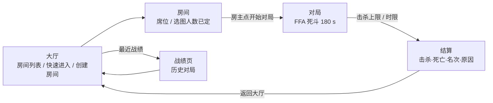

# 玩法策划总设计

> 状态：现行总设计（玩家可见玩法口径）
> 版本：1.0
> 更新日期：2026-10-29
> 适用范围：从进入大厅到结算回到大厅的完整一局——模式、操作、战斗规则、数值、地图、房间、结算，以及后续内容节奏
> 定位：回答"玩家玩什么、怎么玩、为什么再来一局"，并给出**现行形态**（现在打开游戏能玩到的）与**目标形态**（要做成什么样）两套口径
> 不做的事：不裁决机制实现（Sim 系统顺序、回滚、快照、协议归《游戏业务系统总设计》《状态同步专项设计》《[联机同步残差收敛专项设计](../网络/联机同步残差收敛专项设计.md)》）；不裁表机制与数值归属（归《[玩法数值与Luban配置专项设计](玩法数值与Luban配置专项设计.md)》）；不记施工证据（归 `Docs/施工进度/`）；不裁美术资源选型（归《[战斗美术资源参考](战斗美术资源参考.md)》）
> 冲突裁决：**玩家可见规则、模式、节奏以本文为准**；机制实现、协议、数据链以对应系统设计为准；**数值以 Luban 表为唯一权威**（本文数值是快照，改数值只改表，不回改本文）；本文与代码不一致时以代码为准，并同批修正本文
> 关联：《[游戏业务系统总设计](游戏业务系统总设计.md)》·《[联机战斗演示专项设计](联机战斗演示专项设计.md)》·《[玩法数值与Luban配置专项设计](玩法数值与Luban配置专项设计.md)》·《[地图数据专项设计](地图数据专项设计.md)》·《[命中反馈与伤害数字专项设计](命中反馈与伤害数字专项设计.md)》·《[UI 系统总设计](../客户端/UI系统/UI系统总设计.md)》·《[云侧部署与联机测试](../../说明/12-云侧部署与联机测试.md)》

## 0. 一页速览

- **一句话**：军事风第三人称越肩射击，8 人以内 FFA 死斗，3 分钟或 20 杀先到，步枪 + 霰弹枪两把 hitscan 武器（霰弹枪待切枪接线），爆头 ×2。
- **一局的样子**：大厅选图选人数开房（或快速进入）→ 房主点「开始对局」→ 屏心准心开打 → 死亡 3 秒后复活 → 时限到或有人达成击杀上限 → 结算看击杀/死亡/名次 → 回大厅再来一局。
- **三个关键数字**：TTK **0.4～0.8 s**；死亡到再战 **3 s**；一局 **180 s**。
- **四条支柱**：看得清（越肩视角 + 屏心准心 + 明确命中反馈）、打得爽（低 TTK、爆头高回报、霰弹贴脸爆头一枪）、再来一局（短局、快复活、结算即出）、可扩展（新内容只进表、不重写判定）。
- **现在最该做的三件事**（详见 §6）：① 切枪接线——判定与数据都在，但玩家侧没有输入入口，霰弹枪在正式对局不可达；② 击杀目标按房规模分档——2 人房 20 杀在 3 分钟内不可达，实际永远由时限结束；③ 团队死斗落地——模式多样性的第一层，设计口径已齐，判定结构不用动。

**读法**：§3 是**现行形态**（现在就能玩到的），§4 是**目标形态**（要做的），不要把 §4 当现状引用；§5 给数值公式与调参入口，§6 给批次与验收，§7 是需要拍板的决策清单。

## 1. 设计支柱与验收判据

| # | 支柱 | 玩家应该感受到 | 可验证判据 |
|---:|---|---|---|
| 1 | **看得清** | 视角稳定、准心可信、打中/没打中一眼分明 | 屏心准心与弹道同源（AimPoint 单口径）；命中/爆头/着墙/被击杀各有独立反馈；第三人称掩体遮挡下"看到的"与"打得到的"偏差可解释 |
| 2 | **打得爽** | 出手快、反馈重、爆头有回报 | 步枪身体 TTK 0.7～0.9 s、爆头 0.35～0.45 s；霰弹枪贴脸爆头可一枪毙命；每次命中都有飘字/特效/音效，爆头单独一档 |
| 3 | **再来一局** | 输了不憋屈、赢了想继续 | 一局 ≤3 分钟；死亡惩罚 3 s；结算一屏看完、一键回大厅；战绩可回看 |
| 4 | **可扩展** | 新武器、新地图、新技能不要求玩家重学 | 新内容只进表与资源，不改判定主干；模式差异走规则参数与阵营位，不复制第二套战斗 |

**反目标**（明确不做）：不做复杂背包与负重、不做局内经济、不做影响枪法的属性成长、不做跨局数值膨胀。首版体验胜负由枪法、走位与信息决定。

## 2. 核心循环

### 2.1 大循环



### 2.2 局内循环

```text
出生（2 s 保护）→ 找目标 → 交火（0.3~0.8 s 决出）→ 击杀 / 被杀
      ↑                                      │
      └──────────── 复活（3 s）←──────────────┘
```

- **先手优势**：hitscan 无弹道飞行，先看到先开火通常先死一人；信息（视野、声音、击杀播报）与走位比跟枪更重要。
- **死亡不是终点**：3 s 复活 + 2 s 保护，一局内可反复投入，鼓励主动进攻而不是蹲守。
- **击杀上限只对领先者有意义**：它给"碾压局"一个提前结束的出口，避免垃圾时间。

### 2.3 一局的时间账（估算，按 8 人房）

| 项 | 数值 | 说明 |
|---|---:|---|
| 一局时长 | 180 s | 10800 逻辑帧 |
| 单条命存活 | 15～25 s | 8 人房交火密度下 |
| 死亡惩罚 | 3 s | 复活延迟 |
| 一局生命数 | 6～10 次 | 由存活时长与复活延迟推算 |
| 平均击杀间隔 | 6～10 s | 找目标 + 交火；20 杀需要 ≈9 s/杀 |
| 2 人房达成 20 杀 | 基本不可达 | 唯一对手 3 s 复活 + 重新找人，时限先到 |

> 结论：**20 杀是 6～8 人房的目标，不是 2 人房的目标**。这是 §6 P0 里"击杀目标分档"的直接依据。

### 2.4 首局体验指标（设计目标）

| 时点 | 目标 | 现状对照 |
|---|---|---|
| 进大厅 10 s 内 | 能看懂"怎么开一局"（创建/快速进入/列表） | 快速进入 + 创建房间 + 房间列表 + 选图选人数已就位 ✅ |
| 进对局 15 s 内 | 看到第一个敌人 | 56 m 内场 + 16 点出生，通常 ✅ |
| 30 s 内 | 完成第一次交火 | ✅；TTK 0.3～0.8 s，交火短促 |
| 首局 90 s 内 | 拿到第一杀（新手） | 需教学/训练场支撑 ⚠️ |
| 首局结束 | 能说出"为什么输/赢"（名次、击杀、结束原因） | 结算页已有；缺"对局时间"与"再来一局" ⚠️ |

## 3. 现行形态（可玩基线）

> 本节只描述"现在打开游戏能玩到什么"。每条都能在代码、Luban 表或房间配置里找到单源；数值为快照，权威在表。

> **一次完整体验（示意）**：游客进入大厅，看到一间「R-7K3M9 · arena01 1/4」→ 点行进房 → 房主点「开始对局」→ 落点在中庭外侧，屏心准心对着一只箱子 → 右键举枪、左键点射，白字飘起，第 7 发对面倒下，播报「玩家 2 ▸ 玩家 3」→ 3 秒后自己在另一角复活，带 2 秒保护角标 → ……3 分钟到，结算页：击杀 9 / 死亡 7 / 第 2 名 / 时间到 → 回大厅再开一局。

### 3.1 一局全流程（玩家视角）

| 步 | 玩家看到什么 | 系统在做什么 |
|---:|---|---|
| 1 | 登录页，游客一键进入 | 换取访问令牌，进入大厅 |
| 2 | 大厅：房间列表（房号·地图、人数 x/y，约 1 s 刷新）、快速进入、创建房间、最近战绩、设置 | 房间列表来自 Meta 心跳投影；创建房间由服务端出号并签发进房票据 |
| 3 | 创建房间时可下拉选**地图**与**人数**（2/4/6/8） | 选图/人数随票据盖章，房间端建房时校验（缺图/越界拒建） |
| 4 | 房间页：房号、席位名单（在线/连接中）、等待人数、房主专属「开始对局」、离开 | 席位变化实时广播；**满员不会自动开局**，开局唯一入口是房主 |
| 5 | 载入对局：地图 + HUD（准心、血条、弹药、排行榜、击杀播报、网络） | 客户端按 JoinAck 的房规模定容预测世界；服务端 60 Hz 步进、30 Hz 快照 |
| 6 | 对局中：移动、瞄准、开火、换弹、死亡复活、看排行榜与击杀播报 | 服务器权威判定；客户端只预测移动/朝向；命中/伤害/死亡等服务器事实 |
| 7 | 结束：结算页（本机击杀/死亡/名次 + 结束原因 + 全房排行） | 冻结本局结果、写结算 Outbox、Meta 落库 |
| 8 | 返回大厅；「最近战绩」可回看历史（时间/击杀/结束原因） | 战绩查询走 Meta `/matches` |

### 3.2 视角与操作

**现行视角是第三人称越肩自由视角**：鼠标驱动相机 yaw（360°）与 pitch（限位 ±80°）；准心**钉在屏幕中心**；瞄准点 = 屏心射线与世界的交点（先求实体圆柱、未命中落地面，超程按射程截断）。指针在对局中锁定，光标隐藏。

| 操作 | 键位 | 说明 |
|---|---|---|
| 移动 | W / A / S / D | 相机相对（屏幕前后左右）；相机 yaw 由视角决定 |
| 视角 | 鼠标移动 | 第三人称越肩；yaw 360°、pitch ±80°；灵敏度与肩偏属表现参数 |
| 瞄准（ADS） | 鼠标右键 | 举枪：散布收窄（瞄准态 = 表值）、移动限速 2.5 m/s、镜头切瞄准机位 |
| 开火 | 鼠标左键 | 步枪按住连发；霰弹枪每次点击一发 |
| 换弹 | R | 手动换弹；打空自动换弹；换弹期间不可开火、不可取消 |
| 切枪 | — | **玩家侧无输入入口**（判定与数据齐备，见 §3.12） |
| 退出对局 | 右上角设置 → 退出对局 | 返回大厅 |

> **口径注**：TPS 越肩是**正式口径**；瞄准/命中/相机细节以《[第三人称越肩射击方案专项设计](第三人称越肩射击方案专项设计.md)》为权威，玩家可见操作与规则以本节为准。旧《固定斜视角射击方案专项设计》已退役（其 AimPoint 单口径与判定链由新文继承）。

### 3.3 移动

| 项 | 现行值 | 说明 |
|---|---:|---|
| 常态速度 | 5 m/s | 2.5D XZ 平面；水平合速度代码兜底上限 25 m/s |
| 射击语境速度 | 2.5 m/s | 瞄准中 ∨ 开火帧 ∨ 开火驻留窗内（窗 60 帧 = 1 s） |
| 重力 | 20 m/s² | 仅用于落地/高度积分，无跳跃操作 |
| 跳跃 / 下蹲 / 冲刺 / 滑铲 | 无 | 移动表有这些列，判定未消费；按键 Shift 的 Dash 未接线 |
| 碰撞 | 圆柱 vs 圆/盒障碍 | 推出式去障碍；贴墙自然滑行；无穿透、无爬升 |

**手感要点**：开火后 1 秒内被限速到 2.5 m/s，这是"边打边冲"被压住的来源——鼓励打一套、退一步，而不是按住左键冲脸。瞄准态同时收窄散布，形成"站定对枪更强、移动更安全"的取舍。

### 3.4 射击与命中

| 项 | 规则 |
|---|---|
| 弹道 | hitscan（无飞行时间），服务器权威；回溯窗口 16 帧（≈267 ms）补偿延迟 |
| 射程 | 步枪 100 m；霰弹枪 30 m；超出不判定 |
| 散布 | 锥形随机偏转；表值 = **瞄准态**最大偏转角，腰射 ×4（步枪 1.2°→4.8°，霰弹 3°→12°） |
| 遮挡 | 子弹**不穿墙**：射线先到障碍即截停（只出着墙反馈，不结算伤害）；与实体并列时实体优先 |
| 命中体 | 双柱：身体柱 半径 0.45 m、高 1.8 m；爆头柱 半径 0.15 m、从 1.449 m 到 1.8 m |
| 爆头判定 | 准心点水平落在目标命中柱内（≤0.45 m）且准心高度 ≥ 1.449 m → 伤害 ×2；**判据锚准心高度，不锚弹丸交点高度**（瞄头时散射弹丸也按爆头算） |
| 伤害浮动 | 每次命中 ±1（表 `damage_spread`） |
| 伤害来源 | 仅武器；手雷/环境/跌落等伤害未开放 |
| 命中反馈 | 伤害飘字（普通/爆头两档）、受击点特效（爆头放大）、着墙特效、开火音/命中音/死亡音；**无命中标记（准心闪白）** |

### 3.5 武器

| 武器 | 模式 | 单发伤害 | 射速 | 弹匣 / 备弹 | 换弹 | 射程 | 散布（瞄准 / 腰射） | 弹丸 | 切枪 | 备注 |
|---|---|---|---:|---:|---:|---:|---|---:|---:|---|
| 突击步枪 | 全自动 | 16（±1） | 480 RPM（8 帧/发） | 30 / 90 | 132 帧（2.2 s） | 100 m | 1.2° / 4.8° | 1 | 30 帧 | 按住连发；打空自动换弹 |
| 霰弹枪 | 半自动 | 8（±1）× 8 弹丸 | 75 RPM（48 帧/发） | 8 / 24 | 168 帧（2.8 s） | 30 m | 3° / 12° | 8 | 40 帧 | 每次点击一发；贴脸爆头可一枪 |

**TTK 速查**（首发起算，弹丸全中假设）：

| 场景 | 结果 |
|---|---|
| 步枪打身体 | 7 发 = **0.80 s**（16×7=112） |
| 步枪打爆头 | 4 发 = **0.40 s**（32×4=128） |
| 霰弹枪贴脸身体 | 2 发 = **0.80 s**（64×2=128） |
| 霰弹枪贴脸爆头 | **1 发**（≥7 弹丸命中，16×7=112） |

**现状边界**：出生只装备槽 0 的步枪；槽 1 的霰弹枪在表、判定与切枪状态机里都齐备，但客户端输入面只上报开火/瞄准/换弹三个位，**没有切枪键**——正式对局里玩家实际只能用步枪。这是当前最大的"内容存在但不可达"缺口。

### 3.6 生存与复活

| 项 | 现行值 | 说明 |
|---|---:|---|
| 生命 | 100 | 无护甲、无治疗 |
| 死亡 | HP 归零 | 保留席位/实体 Id/K/D；尸体槽位保留 3 s（同复活延迟） |
| 复活延迟 | 3 s（180 帧） | 到帧在**未被占用**的出生点中确定性选点 |
| 出生保护 | 2 s（120 帧） | 保护期内不可被伤害；**成功开火立即取消** |
| 开局保护 | **无** | 开局按种子确定性落点，`InvulnerableUntilFrame` 为 0（见 §6 P0） |
| 出生点 | 每图 16 个 | 复活避开存活玩家与同帧其他复活者；全占则退化为全体可用 |
| 击杀归属 | 合法击杀记 1 杀 | 自杀、环境伤害只记死亡 |

### 3.7 对局规则

| 规则 | 现行值 |
|---|---|
| 模式 | FFA 死斗（除自己外所有人都是敌人，无友伤概念） |
| 规模 | 2 / 4 / 6 / 8 人（创建时选）；服务端模板 `standard`(2) / `four`(4) / `eight`(8) / `sandbox`(无限制) |
| 时限 | 180 s（10800 帧）；0 = 不限时 |
| 击杀上限 | 20；0 = 不限 |
| 结束判定 | 任一玩家击杀达到上限 →「击杀达成」；计时归零 →「时间到」；同帧优先击杀上限 |
| 平局 | 最高击杀并列 → 平局（无胜者） |
| 名次 | 击杀降序 → 实体 Id 升序；并列同名次 |
| 结束后的状态 | 停止步进/伤害/计分/复活；冻结本局结果；可靠下发结束 |

**沙盒房**（云端测试房模板 `sandbox`）：隐藏、不限时、无击杀上限、复活 1 s、**不结算**——用于联调与演示，不是玩法模式。

### 3.8 地图

| 地图 | 内场尺寸 | 掩体 | 出生点 | 定位 |
|---|---|---|---:|---:|---|
| `arena01`（首图） | 56 × 56 m | 52 件（围墙 4 + 中庭 12 + 象限 20 + 中轴 8 + 外围 8） | 16 | 四向旋转对称；掩体三档高度；中近距离交战；出生点距最近掩体 ≥8 m |
| `training_ground` | 100 × 100 m | 8 件 | 16 | 开阔场地；远距离对枪、练枪与调参 |

地图判定几何与出生点由场景烘焙成两端共享数据（`tbmap`），视觉网格不参与判定；世界边界即内场边缘，越界钳制。

### 3.9 房间与开房

| 项 | 现行规则 |
|---|---|
| 开房者 | 首入座者 = 房主；房主位随进房回执下发 |
| 开局 | **唯一入口是房主点「开始对局」**；满员不自动开；未满员也可开（缺席席位按空输入） |
| 房规模 | 创建时选 2/4/6/8；房间端校验上界（内核容量 32，实际按 8 人设计） |
| 选图 | 创建时选；快速进入不带参数（按服务端默认房） |
| 对局中 | 拒绝新玩家加入 |
| 房主离开 | 自动转移给席位号最小的在座玩家；旧房主重连不夺回 |
| 断线 | 席位保留、可重连；恢复完成重新广播席位快照 |
| 离开 | 房间页「离开」或对局内设置「退出对局」→ 回大厅 |

### 3.10 反馈与 HUD

| 元素 | 现行内容 | 备注 |
|---|---|---|
| 准心 | 屏幕中心；腰射/ADS 双形态；随散布张开、连发临时张开、后坐上跳 | 无命中标记 |
| 血条 | 生命条 + 数值 | 满值取表 `initial_hp` |
| 弹药 | 当前弹匣 / 备弹；换弹中提示 | 未装备显示 `--`，备弹段收起 |
| 排行榜 | 8 格：名次/名字/击杀，自己高亮；团队比分位预留（FFA 隐藏） | 名字为占位「玩家 k」 |
| 死亡/复活 | 中央复活倒计时 + 阵亡提示；保护期角标 | 无死亡回放/击杀镜头 |
| 击杀播报 | 全局、多条堆叠：击杀者 + 武器图标 + 被击杀者 | 图标来自表 `icon` |
| 网络 | RTT 与丢包千分比 | 应用层探针 |
| 设置 | 对局内入口（退出对局） | — |
| **不在 HUD** | **对局剩余时间、击杀目标进度**、小地图/罗盘、技能栏数据（占位）、队友/敌人世界血条 | 见 §6 P0 |

**表现件**：枪口火光、弹着特效、伤害飘字、着墙弹孔/火花、开火/命中/死亡音效、瞄准激光（仅本地玩家，纯表现，不参与判定）、第三人称上身前倾/举枪姿态。

### 3.11 结算与战绩

| 面 | 内容 |
|---|---|
| 结算页 | 本机：结束原因（击杀达成/时间到/异常结束）、击杀、死亡、名次；全房排行：名次/玩家/击杀/阵亡（并列同名次） |
| 战绩页 | 最近对局：时间、击杀、结束原因 |
| 奖励 | **无**。结算奖励换算恒为 0，不产出经验/货币/物品 |
| 账号资产 | 无库存、无配装、无货币；玩家名是「玩家 k」占位 |

### 3.12 现行未开放清单

> 这一栏是"读者不要误以为有"的清单，也是 §4 目标形态的输入。

| 面 | 状态 | 说明 |
|---|---|---|
| 切枪 / 第二把武器 | 判定与数据齐备，**玩家侧无入口** | 客户端只上报开火/瞄准/换弹；霰弹枪在正式对局不可达 |
| 技能（冲刺 / AOE / 护盾） | 仅设计 | 动作槽位、输入位已预留；无系统实现 |
| 局内道具 / 拾取 | 仅表 | `tbitemconfig` 7 件在表；无刷新、拾取、使用、手雷投掷 |
| 团队模式 | 仅字段 | 比赛状态有 `Team`/`Score` 预留位；无阵营位、分队、队伍计分、友伤、出生半区 |
| 观战 / 中途加入 / 回放 | 未开放 | 对局中拒绝加入；无观战视角 |
| 成长 / 经济 / 任务 / 成就 | 未开放 | 无经验、等级、货币、皮肤 |
| 排位 / 分段匹配 | 未开放 | 只有房间列表与快速进入（Meta 按容量分配） |
| 小地图 / 罗盘 / 敌我标记 | 未开放 | — |
| 局内文字/语音/快捷标记 | 未开放 | — |
| 命中标记、受击方向指示、屏幕震动 | 未开放 | 命中反馈靠飘字/特效/音效 |
| 训练场独立模式 | 未开放 | 训练场可作为地图开房，但没有靶场流程与无限弹默认 |
| 对局剩余时间显示 | 未开放 | 玩家只能靠感觉判断终局（§6 P0） |
| 开局出生保护 | 未开放 | 只对复活生效 |

### 3.13 调参与沙盒能力（策划工具）

| 能力 | 入口 | 用途 |
|---|---|---|
| 本地测试房 | 开发入口（单人 + 站桩假人补位，自动开局） | 无服务器也能跑通一整局 |
| 测试模式开关 | GM 面板 / 开发控制台 | 全房免死（默认开）、无限子弹、瞄准激光、伤害数字、自动爆头、爆头区可视化、定点传送、假人冻结/无限血 |
| 武器试验参数 | GM 面板 | 伤害覆写、射速覆写（rpm）——不进联机身份、不可重放 |
| 爆头带 / 爆头柱 | 烘焙工具箱 / 测试模式滑杆 | 拖带导出 `HeadBake`（下沿比例 + 柱半径） |
| 准心 / 持枪 / 视角调参 | GM 面板 | 准心张开/后坐、持枪偏移、视角手感；定档后写回表源 |
| 云端测试房 | 编辑器 GM 页 / GM 端点 | `sandbox` 模板：隐藏、不限时、无击杀上限、不结算 |
| 弱网注入 | 调试面板 | 传输层延迟/丢包/抖动，验回溯与和解 |

## 4. 目标形态

> 本节是设计，不是现状。每项都注明与现行结构的关系，避免"看起来要重写判定"。

### 4.1 模式矩阵

| 模式 | 人数 | 胜负 | 与现行结构的关系 | 阶段 |
|---|---|---|---|---|
| FFA 死斗 | 2～8 | 击杀上限 / 时限；并列平局 | 现行 | 现行 |
| 团队死斗 | 4～8（2v2 / 3v3 / 4v4） | 队伍目标击杀 / 时限 | 新增逐玩家阵营位 + 队伍计分；判定/同步主干不变 | P1 |
| 训练场 | 1～4 | 无胜负 | 复用现有地图与沙盒房；加无限弹、靶子、伤害统计面板 | P1 |
| 沙盒 / GM 测试房 | 1～8 | 无胜负、不结算 | 现行 | 现行（开发面） |

**模式纪律**：一个模式只允许在"规则参数 + 阵营位 + 出生过滤 + HUD 投影"上有差异；伤害、命中、武器、复活、快照结构必须共用一套。任何"为模式复制一份战斗系统"的方案直接否决。

### 4.2 团队死斗（P1 主目标）

**规则提案**（与《[游戏业务系统总设计](游戏业务系统总设计.md)》§4.1 的团队模式口径一致，补玩家可见细节）：

| 项 | 提案 | 理由 |
|---|---|---|
| 分队 | 进房后按席位奇偶/蛇形确定性分两队；房主可交换 | 确定性、可重连；不引入随机 |
| 目标 | 队伍击杀 30（4v4）/ 20（3v3 及以下），或 5 分钟 | 比"单玩家 20 杀"更适合团队节奏 |
| 友伤 | 默认**关**；可配置开 | 降低路人局挫败；开友伤作为硬核房选项 |
| 出生 | 南北半区过滤（首图四点旋转对称，两侧等价）；跨中轴点按席位归属 | 避免开局对脸；与地图对称性一致 |
| 相机 | 每队固定朝向：南队朝北、北队朝南（屏幕上方恒为敌方） | 消除阵营间视角不公平；FFA 不镜像 |
| 复活 | 同现行 3 s + 2 s 保护 | 不改节奏 |
| 胜负 | 先到目标击杀或时限到；平局按总击杀，再平则平局 | 与 FFA 一致的裁决顺序 |
| HUD | 启用预留的团队比分位；击杀播报带队伍色 | 现有 HUD 已留位 |

**实现边界**：需要新增**逐玩家公共阵营位**（进快照/checksum/重连）、开局分队、队伍计分/友伤过滤、出生点半区过滤、客户端相机镜像。判定数学（命中/伤害/爆头/回溯）零改动。

**风险**：固定朝向要求小地图/罗盘/方位类 UI 全部相机相对；没有这些 UI 时，玩家对"哪边是敌方"的感知依赖击杀播报与出生位置，需在 P1 一并补方位提示。

### 4.3 武器与配装

| 项 | 目标 | 说明 |
|---|---|---|
| 切枪 | **P0**：1/2 直选 + 滚轮循环；切枪 30/40 帧不可开火；弹药与节拍延续 | 让霰弹枪真正进入对局；这是"两把武器"承诺的兑现 |
| 出生配装 | P1：主武器二选一（步枪 / 霰弹枪）；副武器后置 | 不做局外库存也能先做"开局选择" |
| 武器池 | P1：第三把——半自动精确步枪（高伤、低射速、开镜精度） | 覆盖中远距离；仍走 hitscan 与同一套散布/爆头 |
| 后坐/连发散布 | P2：判定面连发递增（现只有准心表现） | 给"压枪"留技术上限；需表列与确定性随机 |
| 弹药补给 | P2：击杀回补或地图弹药点 | 现行备弹耗尽后无恢复手段，长局会"空枪干瞪眼" |
| 武器差异 | 每把枪必须有明确的交战距离与节奏差异 | 避免"步枪全面优于霰弹"的数值塌陷 |

### 4.4 技能（P1，与射击共用主动作槽）

沿用《游戏业务系统总设计》§6.3 的三件套，键位建议 **Q / E / F**（输入位 Skill1～3 已预留）：

| 技能 | 目标数值 | 作用 | 设计注意 |
|---|---|---|---|
| 冲刺 Dash | 12 帧位移、4 m、CD 180 帧 | 进/退场、躲手雷 | **建议取消"前 12 帧无敌"**，改为减伤或纯位移——无敌冲刺会压过枪法 |
| 范围爆破 AOE | 前摇 30 帧、半径 4 m、伤害 40、CD 300 帧 | 逼走位、清角落 | 前摇必须可读（地面预警），否则挫败 |
| 能量护盾 Shield | 前摇 12 帧、护盾 60、持续 180 帧、CD 360 帧 | 换血、掩护队友 | 护盾与 HP 分开显示（HUD 已留护盾位） |

**纪律**：技能不预测、结果等服务器；技能不改变"枪法主导"——单技能收益不得超过一次精准爆头。

### 4.5 局内道具（P2）

表里已有 7 件，建议首发 4 件、其余 3 件后置：

| 道具 | 关键数值（表） | 首发 | 说明 |
|---|---|---:|---|
| 医疗包 | 回复 50 HP，使用 1.5 s | ✅ | 拉长生存、鼓励脱离交火 |
| 护盾电池 | 护盾 25，使用 1 s | ✅ | 与护盾技能同一条资源 |
| 手雷 | 80 伤害、5 m 半径、0.5 衰减 | ✅ | 逼掩体、清点 |
| EMP | 6 m、3 s | ✅ | 反技能/反护盾（依赖技能上线） |
| 雷达 | 40 m、8 s | ⬜ | 信息类，需小地图配合 |
| 钩爪 | 30 m | ⬜ | 垂直机动，与"无跳跃"的现行移动冲突大 |
| 传送器 | 20 m | ⬜ | 强位移，需单独评估 |

**拾取/使用规则**：地面刷新（间隔/上限见表），靠近按 E 拾取（携带上限见表），快捷栏使用（有使用耗时，受击可打断）；私有面只给本人，地面实体按 AOI 广播。

### 4.6 地图与关卡

| 目标 | 规格 |
|---|---|
| 图池 | 3 张：`arena01`（中近距）、`training_ground`（开阔）、**第三张 CQB**（室内/掩体密集，交战距离 ≤15 m） |
| 尺寸 | 内场 40～60 m；边界即墙，无跌落 |
| 掩体 | 40～60 件；高度三档（低掩体 ≤1 m、半身 1.2～1.4 m、全高 ≥2 m）；低掩体密度决定 TPS 视角的"偷看"强度 |
| 出生点 | 16 个；距最近掩体 ≥8 m；团队模式按半区过滤 |
| 对称性 | 四点旋转对称（保证两队等价）；跨中轴点归属单独裁决 |
| 性能 | 判定件只烘焙碰撞代理，视觉件不进判定 |

**TPS 专属注意**：相机在角色后上方，低掩体可能"看得到、打不到"或"躲得住、看得见"。建议：**低掩体不得成为"只露相机不露身体"的免费观察位**——以掩体高度 ≤ 相机高度的一半为上限，或让低掩体阻挡视线（后置）。

### 4.7 节奏与时长目标

| 指标 | 目标带 | 现行 |
|---|---|---|
| 步枪身体 TTK | 0.7～0.9 s | 0.80 s ✅ |
| 步枪爆头 TTK | 0.35～0.45 s | 0.40 s ✅ |
| 霰弹贴脸 TTK | 0.4～0.8 s | 0.80 s（两枪）/ 一发（爆头）✅ |
| 远距离 TTK | >1 s，鼓励接近 | 步枪 100 m 内恒定，无距离衰减 ⚠️ |
| 死亡惩罚 | 2～4 s | 3 s ✅ |
| 一局 | 150～240 s | 180 s ✅ |
| 击杀目标 | 按人数分档 | 固定 20 ⚠️ |
| 开局保护 | 1～2 s | 无 ⚠️ |

**击杀目标分档提案**：2 人 **8**、4 人 **12**、6 人 **16**、8 人 **20**（或统一改为"目标分数 100，击杀 5 分/爆头 8 分"——后置，先做分档）。

### 4.8 结算与成长

| 阶段 | 内容 | 说明 |
|---|---|---|
| P0 | 结算页加「再来一局」、本局时长、结束原因已有 | 降低"回大厅再点一次"的摩擦 |
| P1 | 战绩补全：命中率、爆头率、最长连杀 | 需要服务端统计字段（Sim 已有事件，可在结算侧汇总） |
| P2 | 账号等级/经验：击杀、胜负、时长换算；战绩累计（总局数/KDA/胜率） | 只做展示与解锁，不做影响枪法的属性 |
| P3 | 赛季/任务/成就、外观经济 | 依赖 Profile 与支付/库存，后置 |

**不做**：局内货币、抽卡、影响数值的付费成长。

## 5. 数值与调参口径

### 5.1 权威链

```text
Luban 表源（xlsx）
  → 双端同读一份 .bytes（客户端 ConfigService / 服务端 ServerTableLoader）
  → 判定面表字节 + 本局规则位 → CombatConfigDigest（联机身份）
  → Sim 经参数接收实例（不读静态读口）
```

- 改数值 = 改表 + 重生成；本文数值只是快照。
- 判定面表（武器/战斗数值/移动/实体/地图等）进联机身份摘要；表现表（准心、文案、UI）不进。
- 时间一律整数帧：`帧 = ceil(秒 × 60)`。

### 5.2 关键公式

| 量 | 公式 | 例 |
|---|---|---|
| 射速间隔（帧） | `ceil(60 × 60 / rpm)` | 480 RPM → 8 帧（0.133 s）；75 RPM → 48 帧（0.8 s） |
| TTK | `(击杀所需发数 − 1) × 射速间隔` | 步枪身体 7 发 → 6×8 帧 = 0.80 s |
| 腰射散布 | `表值 spread × 4` | 步枪 1.2° → 4.8° |
| 爆头伤害 | `dmg << 1`（×2） | 16 → 32（±1 浮动在倍率前应用） |
| 击杀所需发数 | `ceil(100 / 单发期望伤害)` | 16 → 7；32 → 4 |
| 射击语境限速窗 | `fire_stance_frames` = 60 帧 | 开火后 1 s 内 2.5 m/s |
| 回溯窗口 | 16 帧 | ≈267 ms，覆盖 150 ms RTT + 抖动 |

### 5.3 现行数值快照

> 权威在表；本表供策划阅读与评审，改数值不回改本表。

| 表 | 关键值 |
|---|---|
| `tbentityconfig` | 默认角色 HP 100 |
| `tbcombatnum` | 移速 5 m/s；瞄准移速 2.5 m/s；射程 100 m；基础伤害 25（未装备兜底）；伤害浮动 ±1；射击窗 60 帧 |
| `tbmovementconfig` | 走 2.5 / 跑 5 / 冲刺 7.5 / 重力 20 / 跳跃 8（**仅重力被判定消费**） |
| `tbweapon` | 步枪 16 伤 / 480 RPM / 30+90 / 132 帧 / 100 m / 1.2° / 1 弹丸 / 30 帧切枪；霰弹 8 伤 ×8 / 75 RPM / 8+24 / 168 帧 / 30 m / 3° / 40 帧切枪 |
| `tbcrosshair` | 步枪满张 1.6、每发 +0.05、上限 2.0、后坐 4 px；霰弹 1.8 / +0.25 / 2.2 / 12 px |
| `tbitemconfig` | 医疗 50 / 护盾 25 / 手雷 80·5 m / EMP 6 m·3 s / 雷达 40 m·8 s / 钩爪 30 m / 传送 20 m |
| `tbmap` | arena01 56×56（52 掩体/16 点）；training_ground 100×100（8 掩体/16 点） |
| 房间配置 | 180 s / 20 杀 / 3 s 复活 / 2 s 保护；sandbox 无限时无限杀、1 s 复活 |

### 5.4 调参面

| 想调 | 去哪 | 生效 |
|---|---|---|
| 伤害/射速/弹匣/换弹/射程/散布 | 改表 `tbweapon` | 重生成后进联机身份；两端同更 |
| 移速/HP/射击窗 | `tbcombatnum` / `tbentityconfig` | 同上 |
| 时限/击杀上限/复活/保护 | 房间模板配置（服务端） | 重启房间服；只作用于新建房 |
| 准心/后坐/持枪 | `tbcrosshair` 或 GM 面板定档 | 表现面，不进判定 |
| 爆头带 | 烘焙工具箱导出 `HeadBake` | 进判定，需两端同版 |
| 临时试验（不落表） | GM 面板：伤害/射速/爆头带/准心滑杆 | 当次对局；不进摘要、不可重放 |

## 6. 版本路线与验收

> 批次只排依赖，不承诺工期；每项以"可验收的玩家可见结果"收口。

### P0 · 把现有可玩性补完整

| # | 内容 | 验收判据 |
|---:|---|---|
| 1 | **切枪接线**：1/2 直选 + 滚轮；切枪期间不可开火；弹药延续 | 对局中可切到霰弹枪；切枪 30/40 帧内开火被拒；切回步枪弹药不重置 |
| 2 | **击杀目标按人数分档**：2/4/6/8 → 8/12/16/20 | 2 人房 8 杀即结束；结算原因仍为「击杀达成」 |
| 3 | **开局出生保护**：与复活同为 2 s，开火取消 | 开局 2 s 内不可被伤害；开火立刻可被击杀 |
| 4 | **对局条 HUD**：剩余时间 mm:ss + 击杀进度 x/上限 | 终局前玩家能预判结束；击杀进度与排行榜一致 |
| 5 | **结算「再来一局」**：回同一房/直接再开 | 一键回到房间或新局，不再强制回大厅 |
| 6 | 命中标记（准心反馈） | 命中瞬间准心可见反馈；爆头与普通不同 |
| 7 | **TTK 实机定档**：480 RPM 下 7 发 0.80 s / 爆头 4 发 0.40 s | 2/4 人房各打 10 局：平均交火时长与击杀间隔落在目标带；对枪"来得及反应"；偏慢则回调 540 RPM |

### P1 · 模式与技能

| # | 内容 | 验收判据 |
|---:|---|---|
| 1 | **团队死斗**：阵营位、确定性分队、队伍计分、友伤开关、出生半区、相机朝向 | 4v4 可完整打完；友伤默认关；重连后阵营不变；两队出生不越半区 |
| 2 | **三技能**：冲刺/AOE/护盾 | CD/前摇/持续两端一致；回滚/重连不重复消耗；HUD 冷却与服务器误差 ≤1 帧 |
| 3 | **训练场模式**：无限弹、靶子、伤害统计 | 单人可进入；可测 TTK/爆头/散布 |
| 4 | 第三把武器（半自动精确步枪） | 中远距离有明确优势区间；不破坏步枪定位 |

### P2 · 内容与成长

| # | 内容 | 验收判据 |
|---:|---|---|
| 1 | 局内道具 4 件（医疗/护盾/手雷/EMP） | 刷新/拾取/使用/私有面正确；断线重连后背包一致 |
| 2 | 第三张 CQB 地图 | 交战距离 ≤15 m；掩体密度与出生安全达标 |
| 3 | 等级/经验、战绩累计 | 结算产出经验；战绩页可查累计 KDA/胜率 |
| 4 | 队伍 UI：队伍色名牌、队伍播报、方位提示 | 团队模式下敌我一眼可辨 |

### P3 · 长线

观战/回放、排位与赛季、社交（好友/聊天/公会）、外观经济。均依赖 Profile/资产与运营面，不在首个可玩版本内。

## 7. 待裁决（需要拍板）

| # | 问题 | 选项 | 建议 |
|---:|---|---|---|
| D1 | 首发主推模式 | A. 继续 FFA；B. 直接上团队死斗 | **A + P1 团队**：先把 FFA 的枪感与切枪做扎实，再上团队 |
| D2 | 切枪键位 | A. 1/2 + 滚轮；B. Q 循环 | **A**：直选无歧义，滚轮符合 FPS 直觉 |
| D3 | 击杀目标 | A. 固定 20；B. 按人数分档；C. 目标分数 | **B**：改动最小、验收面清楚；C 后置 |
| D4 | 团队友伤 | A. 关；B. 开；C. 房间选项 | **C**：默认关、可开，兼顾路人与硬核 |
| D5 | 冲刺是否无敌 | A. 保留 12 帧无敌；B. 改减伤；C. 纯位移 | **B/C**：无敌冲刺会压过枪法 |
| D6 | 道具首发范围 | A. 4 件；B. 7 件全上 | **A**：钩爪/传送与"无跳跃"移动冲突，需单独设计 |
| D7 | 一局时长 | A. 180 s；B. 240 s；C. 按时限分档 | **A**：短局是"再来一局"的前提；分档会稀释节奏 |
| D8 | 成长/经济 | A. 首版只做等级与战绩；B. 首版上货币/皮肤 | **A**：经济需要 Profile/支付/审计，后置 |

> **D9（视角口径）已定**：TPS 越肩，见《[第三人称越肩射击方案专项设计](第三人称越肩射击方案专项设计.md)》；旧固定斜视角稿退役。其余 D1～D8 待拍板。

## 8. 已知风险与边界

| # | 风险 | 影响 | 处置 |
|---:|---|---|---|
| 1 | **霰弹枪不可达**：切枪无输入入口 | 表里的第二把武器在正式对局是死内容；"两把枪"的卖点不成立 | P0-1 接线；接线前所有平衡讨论都应以"只有步枪"为前提 |
| 2 | **20 杀在 2 人房不可达** | 2 人局永远打到时限，击杀上限形同虚设 | P0-2 分档 |
| 3 | **无对局时间显示** | 终局突兀；玩家无法规划"最后一波" | P0-4 HUD |
| 4 | **无命中标记** | 低 TTK 下"打没打中"依赖飘字/音效，近战对枪反馈偏弱 | P0-6 |
| 5 | **无开局保护** | 开局落点被架枪，首秒体验差 | P0-3 |
| 6 | **TPS 掩体偷看** | 低掩体可"只露相机不露身体"，攻方吃亏 | §4.6 掩体高度纪律；后续可做视线遮挡 |
| 7 | **TTK 拉长后霰弹相对收益上升** | 步枪 0.80 s 才杀一人，霰弹贴脸爆头仍一枪；近距离交战会向霰弹倾斜 | 实机复测霰弹胜率/交火距离分布；必要时把霰弹爆头一枪的门槛收紧到"全弹丸命中"或加距离衰减 |
| 8 | **玩家名占位、无账号资产** | 社交与成长无从谈起；结算名单是"玩家 1/2/3" | 依赖 Profile（G3），玩法侧先接受 |
| 9 | **8 人 / 弱网未验** | 8 人房与 150 ms/10% 丢包矩阵没有验收证据，平衡数据只覆盖 2～4 人 | P1 前补一次 8 人基线；数值调整以实测为准 |
| 10 | **无经济/奖励** | 结算只有数字，缺少"再来一局"的外部动机 | 先靠节奏与枪感；成长见 P2 |

## 9. 维护

- 本文只描述**现行形态**与**目标形态**，不记批次与日期；施工证据归 `Docs/施工进度/`。
- 数值变更：先改表，再同步本文 §3.5 / §5.3 的快照；两侧不一致时以表为准。
- 模式/规则变更：先改本文 §3.7 / §4，再改代码与房间配置，最后回写本文——不允许代码先行、文档滞后。
- 视角/相机变更：同步本文 §3.2，并检查《第三人称越肩射击方案专项设计》的口径说明。
