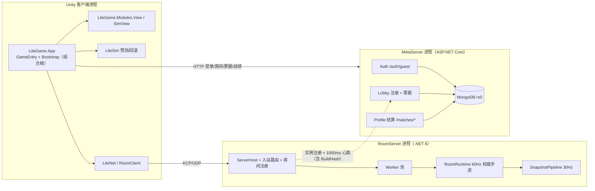

# 02 架构总览与程序集分层

> **定位**：说明分层原则、程序集怎么单向依赖、三个进程与两个共编源集如何分工、一次启动与一局对战如何串起来。
> **权威边界**：不裁决目标架构（归 [设计文档](../设计文档/README.md)）、不记批次（归 [施工进度](../施工进度/README.md)）。
> **来源**：合并自旧稿《02 总体流程》《02 总体架构与程序集分层》与《程序集引用图》（旧路径已删，映射见 [说明索引](README.md)）。
> **关联**：[01 项目定位与技术栈](01-项目定位与技术栈.md) · [03 客户端框架与运行时](03-客户端框架与运行时.md) · [04 服务端与房间内核](04-服务端与房间内核.md) · [05 Sim 与战斗判定](05-Sim与战斗判定.md) · [06 联机同步与网络协议](06-联机同步与网络协议.md) · [14 代码地图与根目录](14-代码地图与根目录.md) · [客户端总设计](../设计文档/架构/商业级通用客户端框架总设计.md) · [服务端总设计](../设计文档/架构/商业级通用服务端框架总设计.md) · [共享代码范围专项设计](../设计文档/架构/客户端与服务端共享代码范围专项设计.md)

## 1. 五条分层原则

| 原则 | 含义 | 机制化落点 |
|---|---|---|
| **零引擎内核** | 判定、协议、房间内核不引用 UnityEngine，可被 dotnet 直接编译与测试 | asmdef `noEngineReferences: true`（`LiteSim`、`LiteNet`、`RoomServer.Runtime`、`RoomServer.Application.Runtime`、`LiteGame.Core`、`LiteTesting.Core`、`DisciplineScanner`）；`LiteFramework.Core` 的 csproj 零 `PackageReference` |
| **单向依赖** | 上层认识下层，下层不认识上层；产品认识框架，框架不反向认识产品 | asmdef 引用图 + R12 适配器边界扫描；框架件不引 `LiteGame.*` |
| **装配序即依赖图** | 模块只能消费更早模块经 `ModuleContext.Put/Require` 提供的产物，不靠容器反射查找 | `GameEntry.RegisterModules` 的 13 段链式注册；关闭顺序＝注册逆序 |
| **单一写者** | 导航、UI 开关、时钟暂停、房间状态各只有一个写者 | `UINavigationController` 写 UI 开关；`GameClock.Paused` 只由调试器写；`RoomRuntime` 唯一持 Sim |
| **共编单源** | 判定/协议/内核只存在一份源码，双端编译同一份文件 | asmdef ⇄ csproj 双轨 + 源链接（`<Compile Include>`） |

## 2. 程序集分层

### 2.1 四层依赖

```text
[装配层]      LiteGame.App（组合根）· LiteGame.Editor(+.Core/.UiTools)
[产品域层]    LiteGame.Core · LiteGame.Modules（含 .Battle/.View/.Presentation）
                 · LiteGame.Adapters.Unity · LiteGame.Adapters.Dev · LiteGame.Adapters.LuaBridge
[框架层]      LiteFramework.Runtime（Core/Modules/Adapters 三段）· LiteFramework.Editor
                 · LiteCodeGen.Runtime
[零引擎层]     LiteFramework.Core · LiteFramework.Async(UniTask) · LiteSim · LiteNet
                 · RoomServer.Runtime · RoomServer.Application.Runtime
                 · LiteTesting.Core · DisciplineScanner
```

**读图须知一处不一致**：`LiteFramework` 在 Unity 里是**单程序集**（`Assets/LiteFramework/Runtime/LiteFramework.Runtime.asmdef`，涵盖 Core/Modules/Adapters 三段），dotnet 侧才拆成 `LiteFramework.Core`、`LiteFramework.Async`；故"Core 零引擎零第三方"在 Unity 侧由目录级守卫（`ClientAsmdefAllowlistTests.框架Core与SimCore不得依赖Unity`）承担，dotnet 侧由空 `PackageReference` 锁范围。

### 2.2 自研程序集

| 程序集 | 角色 | 关键类型（示例） | 主要依赖 |
|---|---|---|---|
| `LiteFramework.Core`（dotnet 双轨） | 框架内核，零引擎零第三方 | `ServiceContainer`、`ClientScope`、`EventBus`、`CommandCenter`、`StageMachine`、`ReferencePoolService`、`FileSystem`、`GameClock`、`Log` | 无 |
| `LiteFramework.Async`（dotnet 双轨） | 宿主与异步编排，dotnet 双轨件中唯一带 UniTask 的框架件 | `ClientHost`、`IClientModule`、`ModuleContext`、`PatchCoordinator`、`SharedLoadCoordinator`、`IConfigTableSource` | Core + UniTask |
| `LiteFramework.Runtime`（Unity） | 框架单程序集：Core/Modules/Adapters 同编 | 上述两件全部类型 + `AppLifetime`、`GameObjectPool`、`UIService`、`UINavigationController`、`InputService`、`PatchRunner` | LiteNet、LiteSim、LiteCodeGen.Runtime + UniTask/YooAsset/xLua/Luban/DOTween/TMP/InputSystem/Cinemachine |
| `LiteFramework.Editor` | UI 绑定生成器（Editor-only） | 绑定扫描与代码生成 | LiteCodeGen.Runtime |
| `LiteGame.Core` | 产品纯契约/纯计算（零引擎） | `IBattleView`、`IBattleReadModel`、`IDevSession`、`ILocalTestHooks`、`ViewTransformMath`、`HitLocalRole`、伤害数字纯件 | LiteSim |
| `LiteGame.Modules.Battle` | 产品对局编排 | `BattleClient`、`BattleContext`、`BattleSnapshotMirror`、`BattleInputPipeline`、`MatchWorldFactory`、`PublicCombatFeed` | LiteFramework.Runtime、LiteGame.Core、LiteNet、LiteSim、UniTask |
| `LiteGame.Modules.View` | 产品表现/视图模块 | `SimView`、`SnapshotInterpolationBuffer`、`LocalReconciler`、`CharacterLocomotionDriver`、`VfxService` | LiteFramework.Runtime、LiteGame.Core、LiteSim、UniTask |
| `LiteGame.Adapters.Unity` | 产品 Unity 适配（引擎后端） | `AnimatorAnimationBackend`、`AnimationLayerGraph`、`ChannelNode` | LiteFramework.Runtime、LiteGame.Modules.View |
| `LiteSim` | 确定性判定（双轨） | `SimStep`、`SimWorldState`、`SimChecksum`、`RollbackSim`、`SimMath`、`CombatValues`、`IeeeProbe` | 无（`references: []`） |
| `LiteNet` | 协议与传输（双轨） | `PacketCodec`、`InputPacker`、`SnapshotDiffer/Codec/Reassembler`、`AoiFilter`、`RoomClient`、`KcpTransportClient` | LiteSim + Google.Protobuf |
| `RoomServer.Runtime` | 权威房间内核（纯化，双轨） | `RoomRuntime`、`InputGate`、`MatchStateMachine`、`CombatEventWindow`、`LagCompensator`、`PlayerSession` | LiteSim |
| `RoomServer.Application.Runtime` | 房间编排（允许协议，双轨） | `SnapshotPipeline`、`Session`、`JoinTicketFormat`、`BroadcastAccount` | LiteNet、LiteSim、RoomServer.Runtime |
| `LiteCodeGen.Runtime` | 生成物的运行期小件 | 绑定表/注册表类型 | 无 |
| `LiteGame.App` | 产品组合根 | `GameEntry`、`Bootstrap/*`（13 个 Module） | 产品模块/适配器 + 框架 |
| `LiteGame.Modules` | 产品功能模块集 | `MetaEntryService`、`Procedure*`、`PageFlow`、`ProductSettings`、`DevHooks`、`BattleSession` | LiteGame.Core/.Battle/.View/.Presentation + LiteFramework.Runtime + LiteNet + LiteSim |
| `LiteGame.Presentation` | 对局表现域 | `BattleViewRig`、HUD/反馈/相机驱动、`BattleReadModel` | LiteGame.Core/.Modules.Battle/.Modules.View/.Adapters.Unity + LiteFramework.Runtime + LiteNet + LiteSim |
| `LiteGame.Adapters.LuaBridge` | Lua 桥（`Adapters/LuaBridge`） | 四门面 `Bridge`、`LuaBehaviourAdapter`、`RegistryFiller` | LiteFramework.Runtime、xLua、Luban、UniTask |
| `LiteGame.Adapters.Dev` | 开发装配层（`Adapters/Dev`，三宏门禁，发布包不参与） | `DevHUD`、`DebugConsole`、`DebugPanel`、`LocalServerTransport` | App/Modules/Presentation/LuaBridge + RoomServer 双件 + LiteNet |
| `LiteGame.Editor`、`.Core`、`.UiTools` | 编辑器工具链（工具 Hub、视觉扫描、UI 工作台） | `VisualConstructionScanner`、`ToolchainManifest` | 编辑器侧全量 |
| `LiteTesting.*`、`DisciplineScanner` | 双轨测试基础设施与纪律扫描唯一引擎 | 断言/夹具/R1～R15 规则 | LiteTesting.Core 零依赖 |

合计：`Assets/` asmdef **46 个**（含 vendored），自研 **25 个**；dotnet 侧另有 3 个宿主（RoomServer/MetaServer/ReplayTool）与 6 个测试工程。

### 2.3 引用边上的硬约定

- **`LiteNet → LiteSim` 是有意方向**：协议层要打包 Sim 的输入/槽位结构体。
- **`RoomServer.Runtime` 只引 `LiteSim`**：禁 proto、禁 `LiteNet`、禁 IO、禁系统时钟（R11，由 `DisciplineScannerTests` 打红）。
- **产品侧三层同构**：`LiteGame.Core`（纯契约/纯计算，零引擎）← `LiteGame.Modules.{Battle,View}`（功能模块）← `LiteGame.Adapters.Unity`（引擎后端）；模块只经契约引用，不反向依赖适配器（`ClientAsmdefAllowlistTests` 硬边）。
- **`autoReferenced: false` 的程序集**不会被 `Assembly-CSharp` 隐式引用，引用方即全部：`LiteGame.Adapters.Dev`、`LiteGame.Editor` 及其 `.Core`/`.UiTools`、`LiteSim.Editor`、`LiteTesting` 三件、`DisciplineScanner` 两件、`RoomServer` 两件、两套 Unity 用例。
- **`Server/MetaServer` 是零引用孤岛**：无 `ProjectReference`，只有 `Microsoft.AspNetCore.App` 框架引用 + `MongoDB.Driver`；与客户端无程序集连线，只有运行时 HTTP 关系。
- **命名空间**：框架侧 `LiteFramework`（内按 `Core`／`Modules/<服务>`／`Adapters/<第三方>` 分；UI 为 `LiteFramework.UI`）；框架模块保留领域名（`LiteSim`／`LiteNet`／`RoomServer`）；产品侧统一 `LiteGame`：视图命名空间 `LiteGame.View`、对局/开发契约 `LiteGame`、输入端口 `LiteFramework`（命名空间收口已完成）。
- **未入图的遗留**：`UnityGameFramework.*`、`MagicaCloth2.*`、`Sirenix.OdinInspector.*`、`UniRx.*`、`CombatGirlsCharacterPack` 的 ToonShader——vendored 三方/旧框架遗留，无引用方（见 [14](14-代码地图与根目录.md)）。核对：`rg '"references"' Assets -g '*.asmdef'` 与 `rg 'ProjectReference' Tests Server Assets -g '*.csproj'`。

### 2.4 双轨共编：一份源码的三种编法

以 `Assets/LiteSim/Scripts/Pipeline/SimStep.cs` 为例：

```text
Assets/LiteSim/Scripts/Pipeline/SimStep.cs
   ├─ Unity 侧：LiteSim.asmdef  → 编辑器 / Player / EditMode / PlayMode
   ├─ dotnet 侧：Assets/LiteSim/LiteSim.csproj → Tests.slnx（L1/L3）与服务端宿主
   └─ 源链接：Server/RoomServer/RoomServer.csproj <Compile Include=...>（少量共享文件）
```

- 两侧产物分别进 `Library/` 与 `.dotnet/`（`Directory.Build.props` 重定向）；**严禁在 `Assets/` 下落 `bin/obj`**（Unity 会当插件导入并触发 CS1704）。
- 双轨件显式 `Compile Include` 锁范围，`LangVersion 9.0` 与 Unity 侧 C# 能力对齐（dotnet 侧先用 Unity 编不了的语法＝假绿）。
- **源链接共编**的文件：`LiteFramework/Runtime/Adapters/Luban/SimConfigMapper.cs`（把战斗/移动/实体三表组合为 `CombatValues`）、`RoomServer/Modules/JoinTicketFormat.cs` 与 `AccessTokenFormat.cs`、`LiteGame/Core/View/Transform/ViewTransformMath.cs`、`LiteGame/Core/View/HitFeedback/HitLocalRole.cs`、输入契约与输入服务五件（`LiteFramework/Runtime/Modules/Input/*.cs`）；`Server/RoomServer` 另链入 Luban Runtime 与 `GameData/Generated`。其中 `SimConfigMapper`/`TableLayout` 在 BuildHash 闭包内（见 `gen-build-hash.py` 的 `SHARED_LINK_FILES`），其余为测试侧源链接共编。
- 代价：新增程序集要同时改 asmdef、csproj、`Tests.slnx`、`ScanTargets.cs` 与本章；收益是判定代码不可能两端各写一份。

## 3. 进程拓扑



- **两个共编源集**：`LiteSim` 被客户端、RoomServer 宿主、dotnet 测试共同编译；`RoomServer.Runtime`/`RoomServer.Application.Runtime` 由宿主与 dotnet 测试共编，Unity 侧只有开发档 `LiteGame.Adapters.Dev` 引用（`Assets/LiteGame/Adapters/Dev/LocalServer/`）。`LiteNet` 的协议与打包解包同样两端共用。
- **无共享内存**：客户端↔房间只有 KCP，客户端↔Meta 只有 HTTP，房间↔Meta 只有注册/结算/票据三类调用。

| 面 | 地址／端口 | 说明 |
|---|---|---|
| 客户端 ↔ RoomServer | UDP **17777** | kcp2k 绑 `0.0.0.0`；可达性靠安全组/主机防火墙只放行隧道网段 |
| RoomServer 指标 | HTTP **9100** | `metrics_port` |
| RoomServer 运维（GM） | HTTP `10.8.0.1:9101` | 仅 POST + 头 `X-GM-Key`；`rooms`/`start`/`abort`/`kick`/`settle-flush` |
| RoomServer ↔ Meta | HTTP `10.8.0.1:5000` | `/lobby/instances/register`（心跳 1000ms）、`/matches/result` |
| 运维 SSH | `10.8.0.1:22` | WireGuard 隧道入口；公网 22 不保留 |
| 房间容量 | `max_rooms=8`、`worker_count=1` | `deploy/roomserver.windows.json`；房间模板 `standard/four/eight/sandbox` |

## 4. 客户端启动与生命周期

### 4.1 引导链

链：`Boot.unity` → `GameEntry.Awake`（`-1000` 执行序、幂等守卫、`DontDestroyOnLoad`）→ `new ClientHost` + `AppLifetime.Bind` → `RegisterModules`（13 项）→ `InitializeAsync`（取 `ServiceContainer`/`StageMachine`）→ `ContainerModule` 内 `Seal()` → `fsm.Start(Launch)` → `Update` 每帧喂 Tickables；初始化失败进 `ProcedureError.ShowBootstrapError`。

- `GameEntry` 是**唯一的 Unity 引导适配器**，真正的启动与关闭由 `ClientHost` 持有；静态状态只留 `s_booted` 标记，Domain-Reload-Off 时由 `ResetForEditorReload` 复位。
- 帧驱动统一喂 `Time.unscaledDeltaTime`——**缩放由 `IGameClock` 内部做，勿再乘 `Time.deltaTime`**；`Seal()` 后容器自动发现 `ITickable`/`IModuleStats`，对局期改由阶段生命周期驱动。
- 模块初始化可能异步完成：`Start` 只置"可启动"标记，`TryStartProcedures` 幂等启动流程机。

### 4.2 十三个模块

| # | 模块 | 提供 |
|---|---|---|
| ① | `PlatformInfrastructureModule` | 本地持久化 + 日志（先于一切 IO） |
| ② | `IdentityModule` | `IdentityContext`（Build/Schema 唯一构造点） |
| ③ | `DevSessionModule` | `IDevSession`（设备源构造即消费，必须早于 ⑫） |
| ④ | `ContentModule` | `IContentService`（配置/Lua 字节与资产租约来源） |
| ⑤ | `SettingsModule` | 玩家偏好（UI/音频服务注册时就要读） |
| ⑥ | `ClocksModule` | World/UI 双轨时钟 + 事件中心 |
| ⑦ | `SchedulersModule` | 时序执行（依赖 ⑥） |
| ⑧ | `LuaHostModule` | XLua 宿主（同 GameObject 组件） |
| ⑨ | `ConfigModule` | 表投影数据源（依赖 ④ 的租约通道） |
| ⑩ | `UiServiceModule` | UI 服务装配（依赖 ④⑧⑨） |
| ⑪ | `PresentationModule` | 表现域 + 相机服务（依赖 ④⑥） |
| ⑫ | `InputModule` | 输入服务（设备源；瞄准相机取自 ⑪ 登记的主相机） |
| ⑬ | `ContainerModule` | 容器与流程机（消费以上全部，装配根最后一段，含 `Seal()`） |

各模块一件一文件，住 `Assets/LiteGame/App/Bootstrap/Modules/`；**装配序就是依赖图**。

### 4.3 流程机

`Launch → Patch → Preload → Main → Match → Battle`，任一阶段失败进 `Error`（终态）；`Result` 在 `ProcedureId` 中预留。

| 阶段 | 行为 | 文件 |
|---|---|---|
| **Launch** | 交接已装配容器（装配与 `Seal()` 在 `ContainerModule`，流程不参与注册） | `Procedure/Stages/ProcedureLaunch.cs` |
| **Patch** | 内容事务 `PatchRunner` + YooAsset 初始化 | `ProcedurePatch.cs` |
| **Preload** | 配置表加载 + Lua 全量预载 + UI 注册表填充 | `ProcedurePreload.cs` |
| **Main** | 落点决策 `ResolveLanding`（登录页/大厅页/不开页）；**不加载对局场景组**；开发直入训练场经 `IDevSession` | `ProcedureMain.cs` |
| **Match** | 建 Account Scope → `BattleClient` 连接 + Join（含 buildHash 握手）；`JoinAck` 超时 `10_000` ms 进 Error；本地测试模式走进程内 `Room-Test`（`127.0.0.1:17777`） | `ProcedureMatch.cs` |
| **Battle** | 建 `BattleContext`，视图域全归 `BattleViewRig`；对局场景组（`BattleRig` + 地图）按 `StartGame` 加载、离场卸载 | `ProcedureBattle.cs` |
| **Error** | 内建最小错误 UI 的确定错误态（终态） | `ProcedureError.cs` |

### 4.4 关闭链

`AppLifetime.OnDestroy` → 刷新钩子 → **逆序模块关闭** → 根 Scope 释放（无遗留）；Domain-Reload-Off 时由 `GameEntry.ResetForEditorReload` 等复位点清理静态状态，避免二次 Play 引导死锁。对局期关闭序：视图 → `BattleContext` → Match Scope → Account Scope。

## 5. 一局对战的数据流

| # | 步骤 | 谁做 | 关键契约 |
|---|---|---|---|
| 1 | 渲染帧采样 | `ProcedureBattle.OnUpdate` → `IInputService.SampleOnRenderFrame` | 上下文门：任一拦截源成立即本帧不产新输入；瞄准取 Sim 预测态，不读平滑视图 Transform |
| 2 | 逻辑帧推进 | `BattleContext.Tick` | 同一份输入既预测又上行（`OnRealInput` 入史 + `SendInput`） |
| 3 | 上行冗余 | `RoomClient.SendInput` | 未确认段（最近快照帧+1 起，容量 16 帧）重复发送，抗丢包 |
| 4 | 输入闸门 | `InputGate.Store` | 帧号/白名单/去重/数值边界校验 → 按帧预存 |
| 5 | 权威步进 | `RoomRuntime.StepFrame` | 消费预存输入 → `SimStep.Step`（固定系统顺序）→ 快照环 `Capture` → 记历史 → 回溯判定 |
| 6 | 快照下发 | `SnapshotPipeline.BroadcastIfDue` | 30Hz 抽帧、差分、AOI、背压分档；快照走 Unreliable，`StartGame` 等信令走 Reliable |
| 7 | 和解/回滚 | `RollbackSim` | 公共 checksum 比对 → 不符则覆盖 + 重放；本机输入不符则 `ExecuteRollback`；`MaxRollbacksPerFrame` 限幅 |
| 8 | 表现 | `SimView` → `EntityViewMap` → 相机/动画/VFX/音频 | 本地跟预测位置并做和解衰减，远端插值；和解/回滚期**帧事件静默门**关闭 |

四个接缝（输入唯一消费门、公共 checksum 和解、快照 jitter buffer、回滚期静默门）的机制细节归 [05](05-Sim与战斗判定.md) 与 [06](06-联机同步与网络协议.md)。

## 6. 关键决策与代价

| 决策 | 理由 | 代价 | 守卫 |
|---|---|---|---|
| **判定双端共编 + 内核纯化** | 服务器权威 + 客户端预测必须逐位一致；内核要能在 L1 纯测 | 内核不能碰引擎/IO/proto；双轨构建 | R11 扫描、BuildHash 握手、IEEE 基线 |
| **状态同步 + 预测回滚**（非帧同步） | 服务器权威、抗作弊、状态可按 AOI 裁剪（观战留位，未实现） | 带宽与快照复杂；和解需衰减与静默门 | 公共/全量 checksum、背压分档、AOI |
| **自研整数数学**（`SimMath` 软件 sqrt） | 跨平台/跨运行时逐位一致，禁 FMA 与超越函数 | 性能与可读性成本；需 IEEE 对账 | R1/R2/R3、`IeeeProbe`、边界用例 |
| **uGUI + XLua + 绑定生成** | 美术可独立做 prefab，页面逻辑可热更 | 两语言调试；绑定/注册表流水线复杂 | 视觉单一来源扫描、UI 工具链校验、Lua 沙箱 |
| **Meta 模块化单体** | 早期运维简单、事务边界清晰 | 单进程扩展上限；拆分需守契约 | 契约分层、Outbox 幂等、迁移版本化 |
| **规范门禁化** | 评审记忆不可靠，红线必须可执行 | 工具投入、误报需维护豁免 | L0～L4、R1～R15、doc-lint、CI |

## 7. 约束如何变成机制

| 约束 | 机制 | 违规后果 |
|---|---|---|
| 内核不得碰引擎/IO/时钟/proto | asmdef `noEngineReferences` + R11 扫描 | L1 红（`DisciplineScannerTests`） |
| 判定不得用超越函数/FMA/float 等值比较 | R1/R2/R3 扫描 + IEEE 基线用例 | L1 红 |
| 框架不得反向依赖产品 | asmdef 引用图 + R12 适配器边界 | 编译失败 / L1 红 |
| 数值读口单一来源 | R13（机制面禁读静态可变值，常量豁免） | L1 红 |
| 两端判定代码一致 | `scripts/codegen/gen-build-hash.py` + Join 握手 | 出包门禁 `--check-shared` / 进房被拒 |
| UI 视觉单一来源 | `VisualConstructionScanner` + EditMode 正/负例 | L2 红 |
| 文档索引与链接有效 | `scripts/gate/doc-lint.py`（D1～D7） | Doc 门禁红 |

生成物落点：判定面哈希 `Assets/LiteNet/Core/Protocol/BuildHash.g.cs`；Meta 构建身份 `Server/MetaServer/Host/BuildHash.g.cs`（不参与准入判定）。
