# 17 全项目数据流

> **定位**：把自研运行期代码里“数据从哪来、经过谁、变成什么、到哪里去”逐条串起来，精确到文件与方法（行号只作锚点，会随代码移动，以符号名为准），供改动前定位影响面、排障时判断断点位置。
> **权威边界**：只解释现状，不裁决目标架构、不记施工批次。结构“应该是什么”归 [设计文档](../设计文档/README.md)；批次证据归 [施工进度](../施工进度/README.md)；改动纪律归 [规范](../规范/README.md)。
> **覆盖范围**：`Assets/LiteSim`、`Assets/LiteNet`、`Assets/LiteFramework/Runtime`、`Assets/LiteGame/{Core,Modules,Adapters,App,Lua,Editor}`、`Assets/LiteGame/Adapters/{Dev,LuaBridge}`、`Assets/RoomServer/{Core,Modules}`、`Server/{RoomServer,MetaServer}`、`scripts/{codegen,gate,build,tests}`。第三方资产与运行时（Synty、KriptoFX、DamageNumbersPro、MagicaCloth2、XLua 运行时、kcp2k 内部、TMP）只记边界，不展开内部实现。
> **证据口径**：代码是唯一真相；`Docs` 与注释只作对照，冲突处在 §18 单列。行号来自当前工作区检索。
> **关联**：[02 架构总览与程序集分层](02-架构总览与程序集分层.md) · [03 客户端框架与运行时](03-客户端框架与运行时.md) · [04 服务端与房间内核](04-服务端与房间内核.md) · [05 Sim 与战斗判定](05-Sim与战斗判定.md) · [06 联机同步与网络协议](06-联机同步与网络协议.md) · [07 联机全栈参考](07-联机全栈参考.md) · [08 UI 与 Lua 脚本层](08-UI与Lua脚本层.md) · [09 内容热更与资源管线](09-内容热更与资源管线.md) · [10 测试与门禁](10-测试与门禁.md) · [13 调试面与排障](13-调试面与排障.md) · [14 代码地图与根目录](14-代码地图与根目录.md)

## 0. 一张图：七条数据总线与两条横切面

系统里真正流动的数据只有七类，任何“某功能没生效”都能落到其中一条总线的断点上。

| # | 总线 | 源头 | 关键中间件 | 终点 | 一致性锚点 |
|---|---|---|---|---|---|
| ① | **判定** | 输入帧 + 初始世界 + 常量/表值 | `SimStep` 固定系统序、`SimWorldState`、`CommandBuffer`、`FrameEventBuffer` | 权威世界（服务端）/预测世界（客户端） | `SimChecksum` 公共/全量口径、`BuildHash`、`CombatConfigDigest` |
| ② | **输入** | InputSystem 设备动作 | `IntentGate`（客户端上下文门）→ `InputService` → `InputPacker/InputWindow` → `InputGate`（服务端传输门） | `SimStep` 的 `inputs[]` | 位掩码 + `ActionSeq` + 帧号对齐（`InputLeadFrames`） |
| ③ | **网络** | 输入/快照/事件/信令 | protobuf 信封、安全信封 AEAD、KCP、`RoomClient`/`ServerHost` | 对端状态机 | `BuildHash` 握手、快照 `checksum`、ACK `ledger` |
| ④ | **配置/内容** | `Luban/Data/*.xlsx`、候选包、bundle | `gen.bat` → 生成物 → `ConfigService`/`YooAsset` | `Tables`、`SimConfig`、`AssetHandle` | `CombatConfigDigest`、生成物守卫、`--check-shared` |
| ⑤ | **UI/Lua** | prefab 绑定节点、Lua 页面、`#uiform`/`#ltext` | 导航队列 → `UIService` → `BindIndexBuilder`/UiApi、XLua | 屏幕与页面逻辑 | `UiApiSpec`（apiVersion）、契约漂移规则 |
| ⑥ | **表现** | Sim 快照/帧事件 | `BattleSnapshotMirror` → `SimView` → 插值/和解 → 动画/相机/HUD/反馈 | Transform、动画图、相机、UI | `IBattleView`/`IBattleReadModel` 端口、静默门 |
| ⑦ | **局外（Meta）** | 玩家登录/房间/结算 | `MetaEntryService` → HTTP → Endpoint → UseCase → Mongo | 账号/房间/账本 | `AccessToken`、实例密钥分权、`profile_revision` CAS、`settlement_ledger` 唯一索引 |
| 横切 A | **诊断/日志** | `Log`/`DiagTrace`/`DebugKernel` | 环形缓冲、JSONL sink、HUD/GM/F1–F3 | 开发者与现场包 | 无（只读投影，禁止反写判定） |
| 横切 B | **测试/门禁** | 源码、生成物、文档 | `test.py`、`l2-unity-gate.py`、`l0-dep-scan.py`、`doc-lint.py` | 红/绿结论 | 守卫测试与清单 |

```mermaid
flowchart LR
    DEV["设备/InputSystem"] --> IG["IntentGate<br/>客户端上下文门"]
    IG --> IS["InputService<br/>采样/seq"]
    IS --> BIP["BattleInputPipeline"]
    BIP --> RS["RollbackSim<br/>预测"]
    BIP --> RC["RoomClient<br/>上行冗余"]
    RC --> ENV["SecureEnvelope"]
    ENV --> KCP["KCP/UDP"]
    KCP --> SRV["RoomRuntime<br/>权威步进"]
    SRV --> SNAP["SnapshotPipeline<br/>差分/AOI/预算"]
    SNAP --> KCP2["KCP/UDP"]
    KCP2 --> RIN["RoomInbound<br/>单调守卫"]
    RIN --> MIR["BattleSnapshotMirror<br/>重建+和解"]
    MIR --> RS
    MIR --> VIEW["SimView<br/>插值/本地收敛"]
    RS --> VIEW
    VIEW --> HUD["HUD/动画/相机/反馈"]
```



## 1. 进程与程序集边界

### 1.1 三个进程、两个共编源集

| 进程 | 组成 | 对外接口 |
|---|---|---|
| Unity 客户端 | `GameEntry` + 13 模块 + 流程机 + `LiteGame.View` + `LiteSim` 预测 + `RoomClient` | KCP/UDP → RoomServer；HTTP → MetaServer |
| RoomServer（.NET 8） | `ServerHost` + 入站路由 + `RoomRuntime` 权威步进 + `SnapshotPipeline` | UDP 17777；指标 9100；GM 9101；HTTP → Meta |
| MetaServer（ASP.NET Core） | 认证/大厅/结算/样例 + Mongo | HTTP 5000；Mongo 副本集 |

- **共编源集**：`LiteSim`（客户端预测 + 服务端权威 + L1）、`LiteNet/{Proto,Protocol,Transport/Security}`（两端 wire）、`RoomServer.Runtime/Application.Runtime`（服务端 + Unity 开发档本地服）。源文件只有一份，Unity asmdef 与 dotnet csproj 各编一次（[02 §2.4](02-架构总览与程序集分层.md)）。
- **无共享内存**：客户端↔房间只有 KCP；客户端↔Meta 只有 HTTP；房间↔Meta 只有注册/票据/结算三类 HTTP。

### 1.2 程序集硬边（asmdef 与守卫）

| 程序集 | 关键事实 |
|---|---|
| `LiteGame.Core` | 端口层；references 仅 `LiteSim`，`noEngineReferences: true`。`IBattleView`/`IBattleReadModel`/`IDevSession`/`IInputService`/`IIntentSource`/`IntentGate` |
| `LiteSim` | 判定内核；`references: []`，零引擎 |
| `LiteNet` | 协议与传输；只引 `LiteSim`（打包含 Sim 结构体） |
| `LiteFramework.Runtime` | 框架单程序集（Core/Modules/Adapters 同编）；**不引 LiteGame.View** |
| `LiteGame.View` | 表现；引 `LiteGame.Core`、`LiteFramework.Runtime`、`LiteSim` |
| `LiteGame.App` | 组合根/流程；引 `LiteGame.View` 与 `LiteGame.Presentation`；**不引 `LiteGame.Adapters.Dev`、不引 `RoomServer.*`** |
| `LiteGame.Adapters.Dev` | 开发装配；三宏 `UNITY_EDITOR \|\| DEVELOPMENT_BUILD \|\| LITEFRAMEWORK_DEBUG`；唯一允许引 `RoomServer.*` 的客户端面 |
| `RoomServer.Runtime` | 只引 `LiteSim`；禁 proto/LiteNet/IO/系统时钟（R11） |
| `RoomServer.Application.Runtime` | 房间编排；允许 LiteNet |
| `MetaServer` | 零 `ProjectReference` 孤岛，只有框架引用 + `MongoDB.Driver`（+ 当前工作区的 Newtonsoft 在途） |

硬边由四层守：asmdef 方向、`ArchitectureGuardTests`、`DisciplineScanner` R1–R15、集中清单（`ScanTargets`/`TableLayout`/`R12Boundaries`）。清单是隐式耦合，“加一行”没有编译期检查。

## 2. 启动、装配、生命周期

### 2.1 进程级前置（早于场景）

| 序 | 动作 | 位置 |
|---|---|---|
| 1 | `AppLifetime.ResetStaticsForEditorReload` → `ClientHost.ResetForEditorReload` | `Assets/LiteFramework/Runtime/Adapters/Unity/App/AppLifetime.cs`（RuntimeInitializeOnLoadMethod） |
| 2 | `GameEntry.ResetForEditorReload`：复位 `s_booted` 与 `UiAnimationClock` | `Assets/LiteGame/App/GameEntry.cs` |
| 3 | Dev 钩子绑定：`DevAssemblyImpl.BindHooks` → `DevHooks.Bind` | `Assets/LiteGame/Adapters/Dev/Assembly/DevAssemblyImpl.cs`、`App/Bootstrap/DevHooks.cs` |
| 4 | 本地传输工厂装订：`DevLocalTransportFactory` → `LocalTransportRegistry.Bind` | `Assets/LiteGame/Adapters/Dev/DevLocalTransportFactory.cs` |

顺序结论：Dev 钩子先于 `GameEntry.Awake` 在位，`GameEntry` 内所有 `DevHooks.Current?` 才可能非 null。

### 2.2 `GameEntry.Awake`（同步）

| 步骤 | 代码语义 | 位置 |
|---|---|---|
| 重复引导守卫 | `s_booted` 已置 → `Destroy(gameObject); return` | `GameEntry.cs` Awake 首段 |
| 建宿主 | `new ClientHost()` | 同上 |
| 平台桥 | `gameObject.AddComponent<AppLifetime>().Bind(_host)` | 同上 |
| 注册模块 | `RegisterModules(_host)`（13 项） | `GameEntry.cs` `RegisterModules` |
| 跨场景 | `DontDestroyOnLoad(gameObject)` | 同上 |
| 点火 | `RunBootstrapAsync(_bootCts.Token).ForgetLogged("GameEntry")` | 同上 |

`[DefaultExecutionOrder(-1000)]`：引导件必须先 `Awake`，因为 `FileSystem`/`Log`/容器都由它经 `ClientHost` 建立。

### 2.3 `ClientHost.InitializeAsync`（幂等 / 失败 / 回滚）

| 序 | 动作 | 失败/取消分支 |
|---|---|---|
| ① | `_state != 0` 抛；`_state=1`；快照 `_modules` | 重复启动/已关闭 → `InvalidOperationException` |
| ② | `ValidateModuleGraph`（重名/缺依赖/环 DFS） | 失败：`_shutdownRequested=true; _state=4; throw`（早于任何副作用） |
| ③ | 建 Root `ClientScope` + `ClientContext` | — |
| ④ | 逐模块：取消检查 → 关闭竞态守卫 → `ModuleTrace("init:start")` → 建 `ModuleScope` → 建 `ModuleContext`（装配窗口）→ `await InitializeAsync` → `finally Close()` → 成功才写入 `_handles` | 抛异常：本模块 scope 就地 Dispose，走回滚 |
| ⑤ | `SealAssembly()` + `Services.Seal()` + `_state=2` | `Seal()` = `Validate()` + `_sealed=true` |
| ⑥ | `catch`：`SealAssembly()` → `RollbackInitializedAsync()`（`_handles` 逆序、`CancellationToken.None`、吞异常）→ `_state=4` → rethrow | 回滚边界就是 `_handles` |

`ModuleContext.Put<T>` 只在 `InitializeAsync` 调用窗口内合法；返回后关窗，异步续体晚到也拒绝。

### 2.4 十三个模块（注册序 = 初始化序 = 关闭逆序）

| # | 模块 | 声明依赖 | 主要产物 / 消费 |
|---|---|---|---|
| ① | `PlatformInfrastructureModule` | `[]` | `IReferencePool`、`IFileStore`、`IJsonCodec`、`ILog` |
| ② | `IdentityModule` | `[]` | `IdentityContext`（Build/Schema 唯一构造点） |
| ③ | `DevSessionModule` | **未实现依赖图** | `IDevSession`（Dev ⇒ 真实现；发布 ⇒ `NullDevSession`） |
| ④ | `ContentModule` | ①、② | `IContentService`、`IGenerationSink`、`ActivationTransactionStore`、`PatchRunner`、`PatchCoordinator`、`AssetsHealthProbe` |
| ⑤ | `SettingsModule` | ① | `SettingService`、`GameSettings` |
| ⑥ | `ClocksModule` | `[]`（实际 `Require<IReferencePool>`） | `EventBus`、`IWorldClock`、`IUIClock`、`IWallClock` |
| ⑦ | `SchedulersModule` | ⑥ | `ILogicScheduler`、`IUIScheduler`、`GameTimelineRunner` |
| ⑧ | `LuaHostModule` | `[]` | `LuaComponent`（同 GameObject 组件） |
| ⑨ | `ConfigModule` | ④ | `ConfigService` |
| ⑩ | `UiServiceModule` | ⑧、⑨、④ | 三 Lua 注册表、`UIService`、`UINavigationController` |
| ⑪ | `PresentationModule` | ④、⑥ | `PrefabLeaseCache`、`EntityService`、`AudioService`、`VfxService`、主相机、`ICameraService` |
| ⑫ | `InputModule` | ⑪、③ | `IInputService` |
| ⑬ | `ContainerModule` | 前 12 个全列 | 容器装配、命令中心、会话工厂、Meta 入口、页面流、流程机 |

### 2.5 `ContainerModule.Assemble`：注册面与帧序

**前置 Require**（`Assets/LiteGame/App/Bootstrap/Modules/ContainerModule.cs` `Assemble` 首段）：`ConfigService`、`IContentService`、`IdentityContext`、`LuaComponent`、`UIService`、`UINavigationController`、`UiLuaRegistry`、`ContentLuaRegistry`、`StrategyLuaRegistry`、`IDevSession`。

**注册表（按注册顺序）**：

| 注册键 | 实现/实例 | 说明 |
|---|---|---|
| `ISceneService` | `new SceneService()` | 场景加载/卸载；模块 scope 收尾 |
| `IMainThreadDispatcher` | `new MainThreadDispatcher()` | tick 第 1 |
| `DotweenUiClockDriver` | `new`（注入 `IUIClock`） | tick 第 4 |
| `IEventBus` | ⑥ 的 `EventBus` 实例（别名键） | 非 tickable |
| `CommandCenter`（具体键）+ `ICommandCenter`（接口键） | `new CommandCenter(IReferencePool, gmEnabled: DevBuildFacts.IsDevelopment)` | tick 第 12 |
| Dev 装饰 | `DevHooks.Current?.Decorate(DevServices{...})` | 注册 GM 命令、弱网、`DebugKernel` 等 |
| `IConfigTableSource` / `IConfigService` | `config` | 后者有生产消费者；前者无 |
| `IUILuaRegistry` / `IContentLuaRegistry` / `IStrategyLuaRegistry` | 三注册表 | 编辑器 `DevReload` 也取 |
| `LuaRegistryRefillService` | `new` | 运行期重填面 |
| `ITimelineRunner` / `IVFXService` | ⑦/⑪ 实例（别名键） | tick 第 8/9 |
| `IMapProvider` | `new MapProvider(config)` | 两端同源地图投影 |
| `IAccountSessionFactory` / `IMatchSessionFactory` | `new AccountSessionFactory` / `new MatchSessionFactory` | 传输工厂按 `testRoom` 分支 |
| `MetaEntryService`（具体键） | `new`（未配基址 ⇒ client null） | `Bridge.meta` 与 GM 页消费 |
| `DialogService` / `FeedbackService` | `new`（`ContainerOwned`） | tick 第 10 |
| `ToastTicker` | 具体键 | tick 第 11 |
| `IAccountReentry` | `new AccountReentry` | Meta 401 重入 |
| `IContentCacheMaintenance` | `new ContentCacheMaintenance` | 恢复动作清缓存 |
| `ErrorRecoveryService` | `context.Put(recovery)` | Patch/Error 共用 |
| `StageMachine<ProcedureId, ProcedureArgs>` | `context.Put(fsm)` | tick 第 13 |
| Lua/产品门面 | `Bridge.Bind*`、`MetaBridge.Bind`、`ProductSettings.Bind` | 静态门面装订（非容器） |

**帧驱动序**（`SetTickOrder`，13 项，顺序不可随意换）：

| # | 类型键 | 时间源 |
|---|---|---|
| 1 | `IMainThreadDispatcher` | 不吃时间（队列，默认每帧 1024 条上限） |
| 2 | `IWorldClock` | `unscaledDelta` 钳 0.1 × `TimeScale`，`Paused` 归零 |
| 3 | `IUIClock` | 同上（独立实例） |
| 4 | `DotweenUiClockDriver` | 读 `IUIClock.ScaledDelta` → `DOTween.ManualUpdate` |
| 5 | `UIService` | 透传 realDelta 给页面 `OnUpdate` 与转场 |
| 6 | `ILogicScheduler` | 读 `IWorldClock` |
| 7 | `IUIScheduler` | 读 `IUIClock`（当前无解析消费者） |
| 8 | `ITimelineRunner` | 读 `IWorldClock.ScaledDelta` |
| 9 | `IVFXService` | 读 `_clock.Now` 扫到期 |
| 10 | `DialogService` | 不吃时间（`Pump()`） |
| 11 | `ToastTicker` | `UiAnimationClock.Delta` |
| 12 | `ICommandCenter` | 帧计数 `_tickCount` |
| 13 | `StageMachine<...>` | **吃 realDelta 当 elapseSeconds** |

`Seal()` 会对每个 `ITickable` 校验“已编排”，未进表直接抛。

**注册了但没有生产消费者的键**（改动前先确认是否要删）：`IWallClock`、`IConfigTableSource`、`IUIScheduler`。

`IGenerationSink` 不是死注册：`ContentModule` 把它作为 `PatchCoordinator` 的**必填构造参数**注入（构造期 null 即抛），确认提交与失败回退都会 `Advise`；`YooAssetContentService.InitializeAsync` 再从同一份激活记录推导启动代次（候选包根生效才用确认代次，否则 `builtin`），避免“Patch 推进了、Initialize 又重置回默认”的覆盖。

### 2.6 流程机（`ProcedureId`）

`Launch → Patch → Preload → Main → Match → Battle`，任一失败 → `Error`（终态）；无 `Result` 阶段（结算页由 `PageFlow.OnMatchEnded` 完成）。

| From → To | 条件 | 位置 |
|---|---|---|
| Launch → Patch | `OnEnter` 立即请求 | `ProcedureLaunch.cs` |
| Patch → Preload | 内容事务成功/`NoWork` + `InitializeAsync` + 入口探针 | `ProcedurePatch.cs` |
| Preload → Main | 配置装载 + Lua 预载 + 注册表填充无失败 + 设置页模态登记 | `ProcedurePreload.cs` |
| Main → Match | `_dev.TakeEnterRequest()`（读即清） | `ProcedureMain.cs` |
| Main → Match（联机） | `MetaJoin` 请求（`metaEntry.BindMachine`） | `ContainerModule` / `ProcedureMain` |
| Match → Battle | `JoinAck` 到达 | `ProcedureMatch.cs` |
| Match → Main | 加载面 Back 取消 | `ProcedureMatch.cs` |
| Battle → Main | `BattleContext.Ended`（Leave/Completed/SessionFailed/Aborted） | `ProcedureBattle.cs` |
| 任意 → Error | 各阶段 catch | — |

场景只在 Battle 加载/卸载：`LoadBattleScenesAsync` 加载 `BattleRig` + 地图，`SetActiveScene(map)`；`UnloadBattleScenes` 按 `_maps.ScenePaths()` 枚举卸载。启动期不存在额外场景加载。

### 2.7 关闭链

1. Windows Player 退出：`Application.wantsToQuit` 拦下 → `ApproveAfterShutdownAsync` → `RunGracefulQuitAsync`（3s `UniTask.WhenAny`）→ 超时 `ForceReleaseRoot`。
2. 编辑器停止/引擎退出/引导件销毁：`OnApplicationQuit`/`OnDestroy` 跑同一关闭流程；若关闭未完成立即 `ForceReleaseRoot`（存在与在途关闭竞争的风险，见 §18）。
3. `ClientHost.ShutdownAsync`：幂等信号 → 取消根 Scope（级联模块/阶段 CTS）→ 刷新钩子 → **模块倒序** `ShutdownAsync`（OCE rethrow、其它异常聚合）→ 逆序兜底释放 `ModuleScope` → `DisposeRoot()` → `_state=4`。
4. 多数模块 `ShutdownAsync` 是空壳，真实释放挂在 `ModuleScope` 的 `DelegatedDisposable`（改关闭行为要改 `DisposeModuleResources`，不是 `ShutdownAsync`）。
5. ⑬ 的 `DisposeModuleResources` 顺序：`_devDecoration.Dispose()`（注销 GM 命令）→ `_services.Dispose()`（**根容器**）→ `_scenes.ReleaseAll()`。

### 2.8 时间语义（最容易被误读的一处）

`GameEntry.Update` 统一喂 `Time.unscaledDeltaTime`。**`IWorldClock.Paused/TimeScale` 只影响调度器、时间轴、VFX、UI 动效、Toast**；流程机（`StageMachine.Tick`）与 `BattleContext.Tick` 收的是未缩放 realDelta，变速/暂停对流程与判定**不生效**。判定另有恒定 60Hz（`FrameDriver` 不读时钟）。

## 3. 配置表数据流（Luban）

### 3.1 表清单（单源 = `TableLayout.Files`）

`Assets/LiteFramework/Runtime/Adapters/Luban/TableLayout.cs` 的 `Files` 是表清单与域归属的唯一来源（`域/表名`）。

| 表 | 主键 | `.bytes` | 主要消费者 |
|---|---|---|---|
| `Combat/tbcombatnum` | `id`（=1） | `Config/Combat/tbcombatnum.bytes` | `SimConfigMapper` → `CombatValues`；`CombatConfig` 读口 |
| `Combat/tbweapon` | `id`（0=步枪） | `Config/Combat/tbweapon.bytes` | `WeaponTable` → `WeaponConfig`；服务端 `ServerTableLoader` |
| `Movement/tbmovementconfig` | `id`（=1） | `Config/Movement/*.bytes` | 仅 `Gravity` 进 `CombatValues`；其余 17 项当前无 Consumer |
| `Entity/tbentityconfig` | `id`（=1） | `Config/Entity/*.bytes` | `initial_hp` → `CombatValues.EntityHp` |
| `Item/tbitemconfig` | `id` | `Config/Item/*.bytes` | `Bridge.data.GetItem`（Lua）；当前无 Sim 系统消费 |
| `UI/tbltext` | `key` | `Config/UI/tbltext.bytes` | `LTextCatalog` → `LocalizationService` |
| `UI/tbuiform` | `id` | `Config/UI/tbuiform.bytes` | **运行期无人读**：页面目录由 `gen-ui-page.py` 直接读 xlsx 生成 `UiPageCatalog.g.cs` |
| `UI/tbcrosshair` | `id`（=weapon.id） | `Config/UI/tbcrosshair.bytes` | `CrosshairFeelProfile` → `BattleCrosshairDriver` |
| `Content/tbcontententry` | `id` | `Config/Content/*.bytes` | `RegistryFiller`；`gen_lua_keys.py` |
| `Strategy/tbstrategy` | `id` | `Config/Strategy/*.bytes` | `RegistryFiller`；`gen_lua_keys.py` |
| `Animation/tbanimationprofile` | `id`（string） | `Config/Animation/*.bytes` | `AnimationProfileTableMapper` → `AnimationProfileLoader` |
| `Map/tbmap` | `map_id` | `Config/Map/tbmap.bytes` | `MapTableProjection` → 客户端 `MapProvider` / 服务端 `ServerMapLoader` |

### 3.2 生成链

`Luban/gen.bat` → `scripts/codegen/gen_luban.py`（**不是** `gen-luban.ps1`）：

1. 校验 `Luban/LubanGenerater/Luban/Luban.exe`。
2. staging：`TestResults/luban-generation/<uuid>`（Luban 会清空输出目录，不能直写 `Assets`）。
3. Pass 1：`-c cs-bin -d bin` 出 C# + `.bytes`。
4. Pass 2：`-d lua` 出 `Cfg/*.lua`。
5. `Luban/gen_lua_keys.py` 出 `LuaKeys.g.cs`（只扫 `UI/Content/Strategies` 的 `lua_path`/`entry`）。
6. 解析 `TableLayout.Files` → bin 按域归位，未知表 fail-fast。
7. 发布四目标（`.cs` → `Assets/GameData/Generated`；`.bytes` → `Assets/GameData/Config`；`.lua` → `Assets/LiteGame/Lua/Cfg`；`LuaKeys.g.cs` → `Assets/LiteGame/Adapters/LuaBridge/Generated`），文本行尾归一、sha256 相同跳过；`.bytes` 剪陈旧。
8. 不导入、不校验（Unity 刷新与门禁是后续步骤）。

> **清单来源**：`gen_luban.py` 通过 `TABLE_LAYOUT_REL` 读 `Assets/LiteFramework/Runtime/Adapters/Luban/TableLayout.cs`；`scripts/tests/test_generated_artifacts.py` 有一条存在性 + 可解析守卫（`tbcombatnum → Combat`），路径改名不会再静默断链。生成器仍**没有** `--check` 复算模式，生成物与表源的一致性只靠表值单测/`AssetTablePathRule` 间接兜。

### 3.3 运行期装载

`ConfigModule` 只注册 `ConfigService`，不加载；唯一触发点是 `ProcedurePreload.RunAsyncCore` 第一行的 `_config.LoadAsync(ct)`。

`ConfigService.LoadAsync` 三段式：

1. **幂等**：`_tables != null` 直接返回（**没有运行期重载**）。
2. **逐表预取**：遍历 `TableLayout.Files`，经 `IContentService.AcquireAsync<TextAsset>` 取 bytes（取完立即释放租约），缓存键 = 裸表名；缺一表即 fail-fast。
3. **建候选 + 发布**：`new Tables(loader)` → `_snapshots.Publish(candidate)`（校验闸）→ `GameplayDigestBase` → `ApplyCombatValues` → `ApplyMovementValues` → `ApplyWeaponTable` → `ApplyAnimationProfile` → `_tables = candidate`。

**校验闸** `ValidateCandidate`：`SimConfigMapper.Validate`（行存在/值域/`fire_stance_frames∈1..255`）→ `tbitemconfig` 非空 → `tbweapon` 含 id=0、`fire_mode∈{auto,semi}`、槽位/弹丸合法 → `tbanimationprofile` 非空且**全族 `FromRows` 装载演练** → `tbcrosshair` 每武器一行、`static_max_scale≥1`、`burst_cap≥static_max_scale`。

`ConfigSnapshotService`：校验与替换在同一个锁临界区；失败保留旧版并抛；版本成功 +1；读口加锁；旧快照无显式释放（GC 兜底）。

### 3.4 配置 → Sim

`SimConfigMapper.BuildCombatValues` 把三张表投影为 `CombatValues`（8 字段）：`MoveSpeed`、`AimMoveSpeed`、`Gravity`（跨表）、`HitscanRange`、`BaseDamage`、`DamageSpread`、`EntityHp`（跨表）、`FireStanceFrames`。客户端 `ConfigService`、服务端 `ServerTableLoader` 走同一物理文件；服务端 `HostAssembly.Inputs` 的 `CombatValues/Weapons/Map/GameplayDigestBase` 为必填，缺失即拒装配。

机制面经 `in CombatValues` 参数一路传到 `SimStep`；静态 `CombatConfig.Loaded`/`WeaponConfig.Loaded` 只服务表现面（R13 禁止机制面读）。

### 3.5 身份与闭包

- **BuildHash 覆盖**：`LiteSim/{Scripts,Systems}`、`LiteNet/Core/{Proto,Protocol,Transport/Security}`、`GameData/Generated`、`SimConfigMapper.cs`、`TableLayout.cs`。**`.bytes` 数值不在闭包**。
- **数据面守卫**：`CombatConfigDigest` = 判定面表 `.bytes` 原始字节（固定顺序）+ 本局规则位；服务端 `StartGame.config_hash`，客户端本地复算，不等拒局。
- **缺口**：`MapTableProjection.cs` 是服务端出树共编件，但**未登记** `SHARED_LINK_FILES`；改投影逻辑不会改 BuildHash（见 §18-05）。
- 当前共享哈希值：`LiteNet.BuildHash.Value = 48fa22580c3a03c4`。

### 3.6 Lua 侧配置

`Assets/LiteGame/Lua/Cfg/*.lua` 由 Luban 生成，但**产品 Lua 零 require**（全仓 `require("Cfg`/`tbuiform`/`tbltext` 无命中）；唯一数据读取经 C# 桥 `Bridge.data`。它们仍随 `lua` tag 进预载缓存与热更清单，属冗余产物（见 §18-10）。

## 4. 内容/资源数据流（YooAsset + 自建 Patch）

### 4.1 定性

YooAsset 只承担“包初始化 + 句柄加载”；**未使用其 HotUpdate/Host 模式**。发布描述信任、下载、校验、事务代次、激活/回滚由项目自建 `Patch*` 链路承担。

### 4.2 Patch 时序

`PatchCoordinator.RunAsync` 的阶段：

`启动恢复 → 依赖校验 → 空间预检 → BeginCandidate（早于下载）→ 获取候选 → 校验（签名/大小/hash）→ MarkPendingActivation → 激活 → 健康检查 → Confirm + 代次推进 → Confirmed`。

失败统一 `FailAsync`：留档 → 回收临时件 → 代次回退 → **仅 HealthChecking 失败才 Rebuild**。`ProcedurePatch` 在外层做有界重试，成功后 `IContentService.InitializeAsync` → 入口探针 → 进 Preload。

### 4.3 候选源与健康探针

- 二选一：`ContentCdnConfig.HasCdn` 为真走 HTTP 候选，否则走内置/本地目录（`ContentModule` 装配）。
- 获取：`HttpCandidateFetcher`（4xx 确定性失败、5xx 暂态；临时件按 Release 隔离；**无断点续传**）/`LocalDirectoryCandidateFetcher`。
- 探针：配置、入口文件、Lua、入口资源 + `CompositeHealthCheck`；聚合不短路，零探针=不健康，探针抛异常=不健康。
- 生产当前只装一个 source；多源优先级/轮转在 `DownloadPlan` 有实现但无装配点。

### 4.4 运行期加载链

```text
消费者 → IContentService.AcquireAsync<T>(location, owner)
  → YooAssetContentService → AssetService（包初始化/版本清单）
  → SharedLoadCoordinator<(generation, location, Type)>（等待者/持有者/孤儿/卸载）
  → AssetHandle（租约）
```

- `SharedLoadCoordinator` 状态：`Waiters/Holders/Orphaned/Unloaded`。等待者取消只退本人；全员退出 → `Orphaned` + 尽力 Cancel；迟到成功就地卸载。`LoadCts` 由协调器持有、loader 的 finally 释放；`AssetHandle` 持有到 `Holders==0` 或 `Dispose`。
- 消费者 8 类：配置字节、Lua 预载、UI 主题、UI prefab、战斗表现件、场景、健康探针、`PrefabLeaseCache`。配置与 Lua 都是“取 bytes 即释放”。
- **无保留缓存**（引用归零即卸载）；常驻需求由 `PrefabLeaseCache` 承担（它没有 location 级增量卸载）。

### 4.5 构建与 dev 隔离

- 收集规则 = `Assets/BundleCollectorSetting.asset`（10 个收集组）；`LocationToLower: 0` ⇒ location 大小写敏感。
- 构建走 ScriptableBuildPipeline；`Run()` 覆盖 StreamingAssets，`RunForCandidate()` 不动内置包。
- dev 隔离三道：收集忽略规则、构建报告逐资源核对（`/Editor/`、`Assets/LiteGame/Adapters/Dev/` 命中即失败）、EditMode 合约测试。
- **`Resources.Load` 明令禁止**（R8）；`StreamingAssets` 只放内置包根 + `deploy.args`。

### 4.6 部署参数

现行是**两源拼接**，没有“环境变量 token 层”：`MetaDeployConfig.Load(args, baked) = Parse(Tokenize(baked) ++ args)`（包内 `deploy.args` 在前、命令行在后，后者覆盖），字段默认兜底。唯一真环境变量是 KCP PSK `LITENET_SECURE_ENVELOPE_KEY`。Android 上 `deploy.args` 不存在时静默为空。

## 5. 输入数据流

### 5.1 客户端采样

`samples` 的唯一入口是 `ProcedureBattle.OnUpdate` 调 `IInputService.SampleOnRenderFrame(localPosition)`：

1. `IntentGate.Evaluate()`：登记序即裁决序，先命中者胜（`ui.modal` 是生产拦截源）；容量 16，重名抛。
2. 设备源采样（`IIntentSource.Sample`），NaN/Inf 清零。
3. 被拦/无设备/未采到 → `_pending = default`（**零意图**），并照常置“已采样”，使本地/上行/服务端缺席三处逐位同读“没有输入”。
4. 含离散位的帧 `ActionSeq++`（只在帧边界门内）。

### 5.2 预测与上行（同一份输入）

`BattleInputPipeline.FeedAndSendInputs`：

1. `TryTakeForPrediction(inputFrame)`；本帧已消费则用 `Pending`。
2. `local.EntityId = localEntityId`，摊进“全体玩家一帧”数组。
3. `sim.OnRealInput(inputFrame, inputs)`（入预测历史）。
4. `Client.SendInput(inputFrame, local, viewFrame)`（**同一份**上行）。
5. `sim.PeekSteps(realDelta) ≥ 2` 时沿用帧预发（`Buttons &= PredictedButtons`，当前只预测 `ButtonAim`）。

`inputFrame = Sim.State.Frame + InputLeadFrames(3)`；`viewFrame = ViewRenderFrame`（开火回溯锚）。追帧补发 `ResendCarriedFrames` 按 **EntityId** 读回已执行输入。

### 5.3 wire 表达

`InputFrame`：`entity_id=1`、`move_x=2`、`move_z=3`、`buttons=6`（uint32 位掩码）、`selected_weapon_slot=7`、`target_entity_id=8`、`action_seq=9`、`aim_point_x/y/z=11/12/13`；`reserved 4,5,10`（旧 aim 方向）。

`InputMessage`：`frame=1`（frames[0] 帧号，frames[i]=frame−i）、`frames=2`（≤16）、`ack_snapshot=3`、`view_frame=4`。

按钮位：

| 位 | 名称 | 语义 |
|---|---|---|
| 0 | `Fire` | 连续（连发节拍在武器） |
| 1 | `Reload` | 离散 |
| 2 | `SwitchWeapon` | 离散（+槽位） |
| 3–5 | `Skill1..3` | 离散（Skill1 可带目标；**Sim 无消费者**） |
| 6 | `Pickup` | 离散（**Sim 无消费者**） |
| 7 | `UseItem` | 离散（**Sim 无消费者**） |
| 8 | `Dodge` | 已定义未实现（白名单放行，**无消费者**） |
| 9 | `Aim` | 连续（ADS） |
| 30 | `DeferHit` | **服务器内部**：资源在权威帧消费、命中延后到回溯 |
| 31 | `FireFlag` | **服务器内部**：回溯补判开火 |

`DiscreteIntentButtons` 与 `PredictedButtons` 决定 seq 与“沿用帧”的掩码。

### 5.4 服务端输入闸门（`InputGate`）

判定顺序：

1. `ack_snapshot` 越界只钳位计数，不丢输入。
2. 形状：帧数 > 16 整包丢；包内最新帧 > `serverFrame+8` 整包丢。
3. 主帧选择：优先 `serverFrame+1`，否则窗内最大可取帧；`frame <= serverFrame` 判迟到/已消费丢弃。
4. `ValidateWire`：按钮白名单（**不含 bit30/31**，伪造内部位整帧丢）→ 切枪槽位 → 离散 seq（非零、严格递增；同帧同 seq 视为冗余重发）→ 浮点有限 → Move 分量/模长 ≤1 → Fire/Skill 必须非零 AimPoint → AimPoint 距射手 ≤ `HitscanRange×1.1`。
5. `EntityId` 覆写为会话实体（防伪）。
6. 接受记账只在全部通过时更新；预存 `PendingInputRing`（容量 32）；未来帧预存 `serverFrame+2..+8`。

`TryConsume(serverFrame+1)` 消费即清位；无预存 = 空输入沿用（掉线不停帧）。

## 6. 判定数据流（LiteSim）

### 6.1 帧推进

- 客户端：`RollbackSim.Tick` → `FrameDriver.Tick`（累加器，`MaxCatchUp=5`，固定 `Dt=1/60`）→ 每逻辑帧 `SimStep.Step` → `OnLogicalFrame`（`SnapshotRing.Capture` + `InputHistory.Record` + `PrepareNext` + `OnFrameEvents`）→ `Events.Clear`。追帧打满仍积压则丢余量。
- 服务端：**不走 FrameDriver**；`RoomRuntime.StepFrame` 直接 `SimStep.Step(..., advanceMatch:false)`。
- `FramePump`（1:1 定次）已实现但**生产零调用**（仅测试）。

### 6.2 系统顺序（唯一契约）

```text
前置：Match.Phase == Finished → 清命令并 return
SortInputs（按 EntityId 升序就地稳定插入排序）
① RespawnSystem
② InputSystem
③ MovementSystem
④ WeaponSystem
⑤ ShootingSystem
⑥ FlushCommands（≤3 轮：DamageSystem → ScoreSystem → 轮末清）
⑦ CleanupSystem
⑧ Frame++
⑨ if (advanceMatch) MatchSystem.Tick
```

| 系统 | 读 | 写 |
|---|---|---|
| Respawn | `Match.Phase/RespawnDelay/Protection`、出生点、`Hp/RespawnFrame` | `Entities[slot]` 重建、`Events(Respawn)` |
| Input | 输入帧、`FireStanceFrames` | `Vel.X/Z`、`Yaw`、`FaceExitTurning`、`Flags.Aiming`、`FireStanceFrames` |
| Movement | `Vel`、重力、地图障碍/边界 | `Pos`、`Vel.Y`（先全体积分、再统一去穿插） |
| Weapon | `Weapons`、输入、武器表 | `Weapons`、`SelectedWeapon`、`SemiFireArmed`、动作槽 0 摘要 |
| Shooting | 输入、武器表、地图、RNG | `FireStanceFrames`、`InvulnerableUntilFrame`、`RngState`、`Cmds(Damage)`、`Events(Fire/ObstacleHit/Hit/Crit)` |
| Damage | `Cmds(Damage)`、保护期 | `Hp`、`CorpseFrames`、`ResetCombatRuntime`、`Cmds(Kill)`、`Events(Death)` |
| Score | `Cmds(Kill)` | `Kills/Deaths/RespawnFrame` |
| Cleanup | `CorpseFrames` | 递减/`Despawn` |
| Match | Timer/KillLimit | `Match.Phase/EndReason/Winner/Timer` |

**权威生产路径的差异**：`RoomRuntime.StepFrame` 在 `SimStep` 后补 `CaptureEvents(fireOnly)` → 快照历史 → `ConsumePendingFire`（逐射手回溯，`LagCompensator` 只跑 `ShootingSystem`，射手取当前位、目标取历史位）→ `FlushCommands` → `MatchSystem.Tick` → 再 `SnapshotHistory.Capture`。即“Match 在最后”以 `RoomRuntime` 为准。

### 6.3 状态布局（`SimWorldState`）

| 字段 | 容量/索引 | 层 | 说明 |
|---|---|---|---|
| `Entities` | `[256]` | 字段级混合 | `EntitySlot` 定长值类型 |
| `AliveBitmap` | `uint[8]` | 公共 | `[slot>>5]`，bit `slot&31` |
| `Globals` | `byte[256]` | 全量 only | 版本化扩展 |
| `CustomData` | `byte[256*32]` | 全量 only | `[slot*32+off]` |
| `Weapons` | `[256*2]` | Private | `[slot*2+w]` |
| `Actions` | `[256*4]` | 槽 0 Public / 1..3 Private | `[slot*4+a]` |
| `Status` | `[256*4]` | Private | 公开投影 = `EntitySlot.Shield` |
| `MatchBag` | `[256*12]` | Private | `[slot*12+i]`；死亡保留 |
| `Resources` | `int[256]` | Private | — |
| `Items` / `Projectiles` / `Zones` | `[256]` each | Public | 行有效 ⟺ 活体且 `Flags.Kind*` |
| `Match` | 单实例 | Public（`GmFlags` 例外） | 比赛层 |
| `Cmds` | `[512]` | 瞬态 | 不进 CopyTo/checksum |
| `Events` | `[256]` | 瞬态 | 不进 CopyTo/checksum |
| `_versions/_nextFree` | `[256]`/int | 非逻辑 | 分配器 |

`EntitySlot` 公共字段：`Id/Pos/Vel/Yaw/Hp/Flags/Shield/Kills/Deaths/SelectedWeapon/FireStanceFrames/CorpseFrames/SpawnPointIndex/RespawnFrame/InvulnerableUntilFrame/LifeStartFrame`；`Internal`：`FaceExitTurning`、`SemiFireArmed`。

`CopyTo` 逐数组深拷（含 `_versions/_nextFree`），**不拷 `Cmds/Events`**；`Despawn` 清活体位图 + 实体 + `ResetCombatRuntime` + `MatchBag` + 三张分型表；`ResetCombatRuntime` 清 Weapons/Actions/Status/Resources/CustomData（保留 `MatchBag`）。

### 6.4 确定性三根桩

- **数学**：自研 software sqrt；禁超越函数（`SimTrig` 4096 查表 + 插值）；禁 FMA（`MulAdd*` 用 double 累积 + 单次舍入）；float 禁 `==/!=`（除契约边界的零值，`lint-allow`）。
- **随机**：`SimRng` Xorshift64*，状态进全量 checksum；**唯一消费者 = `ShootingSystem`**（每弹丸散布 2 笔 + 每命中浮动 1 笔）。
- **内存/顺序**：定长数组、插入排序、槽位升序、障碍升序、`t < hitT` 严格小于；热路径零分配。

### 6.5 摘要口径

| 口径 | 覆盖 | 用途 |
|---|---|---|
| `ComputePublicChecksum` | `Frame` + `AliveBitmap` + 实体 20 公共字段 + 主动作槽 0（`ActionId/StartFrame/Phase`）+ `Match` 10 字段 + `Items/Projectiles/Zones` 公共面 | 全量快照 `checksum`（线上和解锚点） |
| `ComputeVisibleChecksum` | 指定槽位集合的公共面 | 增量快照 `visible_checksum` |
| `ComputeMatchChecksum` | `Match` 公共面 | 增量快照 `match_checksum` |
| `ComputeEntityPublicChecksum` | 单实体公共面 + 主动作摘要 | `SlotDelta.checksum`（逐槽定位） |
| `ComputeChecksum` / `ComputeStateChecksum` | 公共 + `RngState` + `Globals/CustomData` + `Weapons` 全字段 + `Actions` 全槽 + `Status` + `MatchBag` + `Resources` + `FaceExitTurning` + `SemiFireArmed`（后者不含 `Frame`） | 确定性基线、重放对账 |

`Items/Projectiles/Zones` 在两种口径里字段集合相同；`AliveBitmap` 只在公共口径显式折叠（全量靠空槽恒零）。**`Cmds/Events/分配器` 不进任何口径**。

### 6.6 预测 / 回滚 / 和解

- `SnapshotRing`：客户端容量 9（`MaxRollbackFrames 8 + 1`）；服务端回溯环容量 17（`LagCompHistory 16 + 1`）。`Capture` 在 Step 后（该帧执行后状态）；`TryRestore(F-1)` = F 帧执行前状态。
- `PrepareNext`：真实输入优先；缺失时沿用上一帧且 `Buttons &= PredictedButtons`。
- `OnRealInput`：早到帧只入史；未预测或逐位一致不回滚；不一致 → `ExecuteRollback`（恢复 + 重放 `F..last` + 逐帧 Capture + 清事件）；恢复失败停预测；单渲染帧回滚上限 2，超限弃置靠权威覆盖。
- 和解：全量按 `ComputePublicChecksum` 比对；增量先 `visible+match` 短路，再逐槽 `SlotDelta.checksum` 只写差异槽；重放终点截到 `frame + MaxPredictionLead(6)`。
- **私有面永不进比对**（他人弹药/CD/背包/资源、`RngState`、`Status` 明细）。
- 预测只覆盖移动与瞄准；`resolveCombat=false` 时开火/弹匣/开火窗/RNG 照常，但不写 Damage、不产 Hit/Crit/Death。

### 6.7 地图与出生

- `SimMapData`：`MaxObstacles 256`、`MaxSpawnPoints 16`、`GroundY/HalfWidth/HalfDepth`；障碍 Circle/Box 带 y 区间与表面类型（只做表现分流）。
- `SimMapBuilder.Build` fail-fast（数量/有限性/正半径/正高度/kind/表面枚举），**禁静默截断**。
- 烘焙：`BodyBake`（Radius 0.32 / Height 1.8）、`HeadBake`（Ratio 0.805 / 爆头半径 0.15）、`MuzzleBake`（前/右/高三偏移）→ `CombatConfig`；`RootMotionData` 已烘焙但 **Sim 零消费**。
- 出生点：`SpawnPointSelector` 用 `帧号 ⊕ 实体 Id` 混洗，**不消费 `RngState`**。

### 6.8 已知不对称（细节与风险等级见 §18）

1. `Items/Projectiles/Zones` 在 checksum、在 `SimWorldDiff`，**不在 wire**（当前全零，静默待爆）。
2. `Match.GmFlags` 在 wire、在 `SimWorldDiff`，**不在 `MixMatchState`**（重放漏检规则位）。
3. `FaceExitTurning`/`SemiFireArmed` 只进全量 checksum、不上 wire（和解后归零）。
4. `RngState` 进全量 checksum、不上 wire（跨端全量永不相等，设计上只做同运行时自检）。
5. `Dodge/Skill/Pickup/UseItem/TargetEntityId` 全链可传，**Sim 无消费者**。
6. 两端 Match 推进点不同；客户端 KillLimit 预测终局永不触发（靠权威快照）。

## 7. 网络数据流（LiteNet）

### 7.1 信封与包类型

线格式 `[1B PacketType][protobuf 载荷]`；`PacketCodec.TryDecode` 对未知类型/截断/解析失败一律返回 false，不抛。不可靠单包预算：`UnreliableMax 1194 − AEAD 35 − 类型 1 = 1158B`。

| 值 | 包 | 方向 | 通道 |
|---|---|---|---|
| 1/2 | `Join` / `JoinAck` | C→S / S→C | Reliable |
| 3 | `StartGame` | S→C | Reliable |
| 4 | `Input` | C→S | **Unreliable** |
| 5 | `StateSnapshot` | S→C | **Unreliable** |
| 6 | `MismatchReport` | C→S | Unreliable |
| 8 | `Leave` | C→S | Reliable |
| 9/10 | `ReconnectRequest` / `ReconnectResponse` | C↔S | Reliable |
| 11 | `RestoreComplete` | C→S | Reliable |
| 12 | `MatchEnded` | S→C | Reliable |
| 13/14 | `StartMatchRequest` / `StartMatchResponse` | C→S / S→C | Reliable |
| 15 | `OwnerChanged` | S→C | Reliable |
| 16 | `Heartbeat` | 双向 | Unreliable（只做 RTT 观测，不保活） |
| 17 | `RoomSeats` | S→C | Reliable |
| 18 | `CombatEvents` | S→C | **Unreliable** |

信令走可靠、状态/事件走不可靠是硬分工：可靠重传会放大延迟，状态面宁可丢一帧也不排队。`CombatEvents` 独立成包的原因：事件曾随快照全量携带，把快照顶过 1194B 被 kcp2k 静默丢弃（现场表现“打一会儿不同步”）。

### 7.2 握手 / 进房

1. `POST /auth/guest` 拿访问令牌（令牌只住 `MetaEntryService`）。
2. `POST /lobby/create-room` 或 `/lobby/join-ticket`（Bearer = 玩家令牌）。
3. 房间服向 Meta `POST /lobby/instances/register` 注册（实例密钥；上报 `BuildHash`/地址/容量/房间明细）。
4. Meta 按 buildHash 选实例并签 JoinTicket（v4、16 段、HMAC-SHA256、nonce 128bit）。
5. 客户端 KCP 连接 → 安全信封握手（CH/SH/CF）→ `Join`（Reliable，带 buildHash）。
6. 服务端准入 6 步：IP 频率 → 字段上限 → token 非空 → **buildHash 红线** → 票据验签（kid/常量时间验签/时效/绑定项/nonce 一次性）→ 账号频率。
7. `JoinAck`（座位、票据、快照率、tick 率、owner、地图、期望人数）→ 客户端 `Connected`。
8. 房主 `StartMatchRequest` → `StartMatch`（seed/ConfigHash/实体/广播）→ `StartGame`（Reliable）。
9. 客户端 `OnStartGame` 复算 `ConfigHash`，不等拒局；相等才建 `RollbackSim`。

失败分支：限流/字段超长/token 空/buildHash 不符/票据非法/房间满/模板缺失/地图缺行 → 拒绝（多数不回包）；客户端 JoinAck 超时 10s → Error。票据重放/过期/绑定不符均 fail-closed。

### 7.3 快照下行

- **节拍**：`stride = TickRate/SnapshotHz = 2`，30Hz；`_broadcastOrdinal` 先自增再取模，首播在第 2 帧。
- **差分**：每广播帧一次 `BeginFrame`。全量判据：`forceFull` ∪ 活体位图变化 ∪ 60 帧到期 ∪ 某席位 ack 落后 30 帧 ∪ `Globals/CustomData/Rng` 脏。变化集与基线逐槽位级比较；关键状态（Hp/Shield/KDA/复活/保护/尸体）变化进 1s 粘滞窗重复下发。
- **每客户端**：`BuildFor` 纯读；`PrivateState` 只发本人；全量 = 全活体 + 全图 `checksum`，**不裁 AOI**；增量 = `AoiFilter` 可见集 ∩ 变化集 + 逐槽 `checksum` + `visible_checksum` + `match_checksum`。
- **AOI**：视点格 ±`ceil(radius/cell)` 整格可见（可多发半格、永不漏发）；网格外按 XZ 距离兜底；结果槽位升序；`radius<=0` 关闭；**只裁增量**（全量“缺席=死”不能裁）。
- **背压四档**：队列水位 >4096B 升档（封顶 3）；<40% 持续 2s 降档。档 1 抽帧、档 2 半径 30→15、档 3 保留最近 50%。
- **预算**：`CalculateSize` 超 1158B → 增量再裁最远一半 → 仍超则**诚实丢弃**并计 `SnapshotDropped`（绝不发必被 kcp2k 丢的包）。事件批按“留新弃旧”裁剪，单条超预算整批 `Skipped`。
- **ACK 记账**：`SnapshotLedger` 容量 128；`AckedBytes` 只能经验证过的 ACK 前推；ACK 四道闸（非负单调→不超前于已发→命中 ledger→累计）。

### 7.4 客户端重组与应用

1. `RoomInbound` 单调守卫：`snapshot.Frame <= LastSnapshotFrame` 直接丢（防重连旧包回拉）。
2. `BattleSnapshotMirror.ApplyAndReconcile`：
   - `SnapshotReassembler.Apply`：全量先清活体位图/实体/Globals/CustomData/Weapons/Actions/Status/MatchBag/Resources/Match，再覆盖携带槽位；增量只覆盖 `SlotDelta` 指到的槽位（缺席=未变化）；同时写主动作摘要、帧头、分配器、Match、本人私有面。
   - 全量 → `RollbackSim.OnAuthoritativeSnapshot(frame, 镜像, checksum)`。
   - 增量 → `Collect` 携带槽位 + 逐槽 checksum + visible/match checksum → 部分和解。
   - 未触发和解也要 `OverlayPrivateAndMatch`（弹药/CD/比赛状态只能随包来）。
3. `PushToView`：镜像 `CaptureFull` 到 16 格环（> SimView 8 格缓冲）→ `IBattleView.OnAuthoritativeSnapshot`。
4. 发生和解 → `SendMismatch`（Unreliable）+ 客户端现场包。

### 7.5 安全信封

- PSK 32B（`-envelope.key` 或 `LITENET_SECURE_ENVELOPE_KEY`；缺失 fail-closed）。
- 握手：ClientHello 38B → ServerHello 102B（双 nonce + 32B proof）→ ClientFinish 38B；HKDF-SHA256 派生双向密钥。
- 数据帧 = 19B 头 + 密文 + 16B tag；`nonce = 4B prefix ‖ 8B seq`；19B 头进 AAD；接收 64 位重放窗；序号从 1 起。
- 叠放：`RoomClient → [WeakNet] → SecureEnvelope → KCP`；本地服 `LocalServerTransport` 无信封（进程内）。
- 失败：proof/回显/解密不符 → 断开；服务端任一步非法 → `Disconnect`。

### 7.6 RoomClient 状态机与重连

`Idle → Connected → SuspectedLost → Reconnecting → Restoring → Connected`；拒绝/版本不符/超时 → `Failed`（不自动重试）。

- `SuspectedLost` 且未开调试抑制 → `BeginReconnect`（凭一次性票据）。
- `ReconnectRequest` → `ReconnectResponse{Ok, Snapshot, History, Seed, ConfigHash, BuildHash}` → 版本确认 → `Restoring` → 应用快照/历史 → `CompleteRestore` → 服务端放行。
- 票据一次性、TTL 5min、容量 256；`MatchEnded` 清空客户端票据；无刷新。
- 服务端在 `Restoring` 期间抑制该席位增量广播，恢复完成时请求全量重锚。

### 7.7 本地测试服与弱网

- 本地服：真内核 + 真快照管线 + 真协议编解码；假 Socket/票据/多房间；自动补位 Bot + 代房主开局；通道映射与真服一致。**无票据验签、无丢包/延迟/MTU、无重连语义**。
- 弱网：装饰在最外层，只依赖 `IClientTransport`。可靠包只做固定延迟且严格保序；不可靠包可丢/重/乱序/抖动，队列上限 1024；seed 固定可复现；关闭时立即排空残留。

## 8. 房间服务端运行时

### 8.1 连接 / 会话 / 房间

- `KcpTransportServer.OnConnected` → `ServerHost.OnTransportConnected`（IP 限流 → `SessionManager.TryAddNew`）。
- 会话 = 连接级记账（Epoch/PlayerId/RoomId/BuildHash/Principal/Disconnected/广播记账），周期清理容量/断线 TTL/静默 TTL。
- 房间表 `RoomRegistry`：`roomId → RoomInstance{RoomRuntime, SnapshotPipeline, CombatEventPipeline, Seats, WorkerSeats, Mailbox}`。
- 命令入口唯一：`RoomRuntime.Execute`；执行形态：宿主 owner（默认）或 Worker（`hash(roomId)` 归属）。

### 8.2 `ServerHost.Pump`（每 tick）

1. `_transport.TickIncoming()`（收包 → 入站处理器）。
2. 冲刷 pending disconnect / GM 动作。
3. 逐房间 `RoomCommand.Tick(nowMs)`（Control/Input/Outbound 按注释顺序）。
4. `room.Runtime.Started` → `SnapshotPipeline.BroadcastIfDue`。
5. `BroadcastedThisFrame` → `CombatEventPipeline.Publish`（同节拍）。
6. 终态房间销毁（清会话路由、Mailbox Complete、摘隐藏标记）。
7. `_transport.TickOutgoing()`；周期 Ops/清理。

### 8.3 `RoomRuntime.StepFrame`

`Gate.TryConsume(serverFrame+1)`（缺席 = default）→ `SimStep.Step(..., advanceMatch:false)` → `CaptureEvents(fireOnly)` / `SnapshotHistory.Capture` / `recentInputs.Record` / `LagComp.RecordInputs` → `ConsumePendingFire`（逐射手回溯，结算后立即 `FlushCommands`）→ `MatchSystem.Tick` → 再 `SnapshotHistory.Capture`。

服务端**不比对 checksum**（权威即真相）；checksum 由服务端生成并下发，客户端比对后用 `MismatchReport` 回流 Ops。

### 8.4 `MatchStateMachine`

`Created → WaitingForPlayers → Starting → Running → Finishing → Settling → Closed`；任意 → `Aborted`。

- 首 Join → WaitingForPlayers；owner 开局 → Starting → Running。
- 时限/全员离场/玩法终局 → Finishing → Settling → Closed。
- 等待超时/运维关闭/未开局全员离场 → Aborted。
- `Finish` 冻结 `MatchResultSummary` → `SettlementReady` → 发 `MatchEnded` 并尝试入 Settlement Outbox（测试房跳过）。

### 8.5 结算链（房间侧）

`SettlementReady` → `FileSettlementOutbox`（JSONL write-through）→ `SettlementSubmitService` → `POST /matches/result`（结算实例密钥）→ Meta 归档面 + 台账面（事务）→ 标记完成。Outbox 幂等靠 `operationId` 与 `ux_settlement_key` 唯一索引。

## 9. 客户端对局编排

### 9.1 进入对局

`ProcedureMatch` 建 `AccountSession`（Account scope）→ `WaitJoined`（JoinAck）→ 移交 payload → `ProcedureBattle`：

1. 建 `BattleViewRig`。
2. 建 `BattleSession`（`Assets/LiteGame/Modules/Procedure/Session/BattleSession.cs`）：`BattleContext` + 视图 + Match scope 的唯一持有者。
3. `RoomBridge.BindSession`（Lua 房间页数据面）。
4. 等 `StartGame` 或 `Ended`（竞速）。
5. 加载 `BattleRig` + 地图（Additive，遮罩最多等 120 帧）。
6. 相机硬门（失败显性开局失败）。
7. `_rig.Attach`。
8. 关房间页。

### 9.2 `BattleContext.Tick`（每渲染帧唯一驱动）

```text
_battle.TickIncoming()                     // 网络收包（快照/事件/终局）
inputFrame = Sim.State.Frame + 3
viewFrame  = ViewRenderFrame
_inputs.FeedAndSendInputs(...)             // 必须先于本地服步进
_battle.TickOutgoing()                     // 本地服步进 + 快照投递
_sim.Tick(realDelta)                       // 预测推进（含回滚）
_inputs.ResendCarriedFrames(...)           // 追帧补发
View?.Tick(realDelta)                      // 表现视图（本帧权威已应用）
```

### 9.3 网络事件处理（`BattleContext`）

| 事件 | 处理 |
|---|---|
| `OnStartGame` | 幂等；摘要校验；绑定规则实例；`MatchWorldFactory.Build`；`new RollbackSim(..., resolveCombat:false)`；若视图已挂则补接线 |
| `OnSnapshot` | 解析本地实体 → 同步 GM 位 → `ApplyAndReconcile`（和解计数/上报/现场包）→ `PushToView` |
| `OnCombatEvents` | `PublicCombatFeed.Ingest`（去重 + 分类 FIFO） |
| `OnMatchEnded` | Sim 已建 → `Completed`；未开局 → `Aborted` |
| `OnReconnectResponse` | 仅 `Restoring` 可应用；重建镜像 → 和解 → `ResetInterpolation` → `PushToView` → `AlignLocal` → `CompleteRestore` |
| `OnPhaseChanged` | `SuspectedLost` → 自动 `BeginReconnect`（可被调试抑制）；`Failed` → `Ended(SessionFailed)` |

### 9.4 视图接线（单写者）

`WireSimView`：重复绑定先摘旧 `OnRollback/OnReconcile/OnFrameEvents`，再挂新视图。`AttachView` 早于 `StartGame` 也允许（StartGame 时补接线）。`ViewModel.AlignLocal` 在首份快照解析出本地实体后立即调用。

### 9.5 收尾

`End` 用 `Interlocked.Exchange` 保证恰好一次；`Leave` 先 `SendLeave` 再发 `Ended`。`Dispose`：拆订阅 → `Match scope.Dispose`（LIFO 释放 Sim/视图/输入/事件总线）；不触发 `Ended`。

## 10. 表现数据流

### 10.1 一帧链

`ProcedureBattle.OnUpdate`：`TickPreSample` → `SetAimWorld` + 采样 → `context.Tick` → `rig.Tick`。

`BattleViewRig.Tick` 固定顺序：

1. `TickMovement`（角色动画：状态机/播放器/约束）。
2. `TickAuthority`（权威命中/击杀队列 → 分发器）。
3. `TickHud`（准心 → 面板 → 排行 → 击杀提示 → 网络 → 阵亡）。
4. `TickWorldFx`（保护壳 → 瞄准激光）。
5. `TickVisual`（伤害数字 → 远端火光）。
6. `_lookController.Tick`（视角增量/瞄准态/瞄准点/指针锁定）。

### 10.2 `SimView` 的方法语义

| 方法 | 语义 | 调用者 |
|---|---|---|
| `RenderFrame` | 视图渲染帧（= 延迟补偿 `viewFrame` 单源） | `BattleContext.ViewRenderFrame` / 输入采样 |
| `Tick(dt)` | 缓冲推进 → 建/收视图 → 远端插值 → 本地收敛 → 相机 | `BattleContext.Tick` |
| `OnAuthoritativeSnapshot` | 完整快照入 8 格 jitter buffer | `BattleSnapshotMirror.PushToView` |
| `OnReconcile/OnRollback` | 抬高 `FrameEventSilenceGate` 的静默帧 | `RollbackSim` 事件 |
| `OnFrameEvents` | 逻辑帧边界交付事件，静默门裁剪 | `RollbackSim` 事件 |
| `AlignLocal(id)` | 本地实体换人：丢显示位/生命基线/CC 缓存，下一帧落位 | 首快照/Attach/重连 |
| `ResetInterpolation` | 丢弃插值缓冲（重连换时间线） | 重连恢复 |

- 远端插值：`renderFrame += dt*60`，封顶 `newest - RenderDelayFrames(4)`；按 `entityId` 在两份快照间插值；`LifeStartFrame` 变化或位移 >3m → 硬切。
- 本地：0 延迟跟预测位；常规指数衰减（`ReconcileSharpness=10`）；超阈值/复活/换实体硬切；`cc.Move` 与直写切换，单帧 >2m 视为传送。
- 事件静默门：和解/回滚期间丢弃 `frame <= SilenceUntilFrame` 的帧事件并计数；重放段事件不消费即清。

### 10.3 视图实体

- 槽位下标 → `GameObject[]` + `bool[]`，**零字典**（Sim 槽位稳定，禁 swap-remove）。
- `EntityViewBinder.Sync`：活体建/死亡回收；远端 `CharacterController` 禁用（Sim 未建模实体间碰撞），本地保留。
- prefab：`SimView.DefaultEntityPrefab = Assets/ShareResource/Characters/Player(Rifle).prefab`；工厂 `_prefab == null` 返回 null（**无占位替身**）。
- 当前版本库**整目录忽略** `Assets/ShareResource/Characters/`（`.gitignore`），新 clone 上没有角色 prefab ⇒ 对局可跑但无角色视图（相机/HUD 照常，动画/激光/枪口火光/保护壳无挂点）。

### 10.4 动画链

```text
LiteAnimator（组件，RequireComponent<Animator>）
  └ CharacterLocomotionDriver（发现面）
      ├ AnimatorAnimationBackend（PlayableGraph，Manual 更新，6 输入分层）
      ├ AnimationPlayer（Base/Overlay/Override 三通道仲裁）
      ├ CombatAnimMachine（LocomotionRoot / CombatRoot 双根 HSM + 叶）
      ├ SlotAnimContext（换弹 Overlay 上半身）
      ├ WeaponGripConstraint（换弹期武器骨）
      └ AimPitchPostureDriver（俯仰胸骨/枪骨）
```

- 层序常量：`BaseCurrent/BaseTail/OverrideTail/OverrideCurrent/OverlayTail/OverlayCurrent`；层 0 权重必须显式置 1。
- 分层模式 6 输入；不分层 2 输入且不声明 Override/Overlay 能力位。
- Overlay Mask：humanoid 部位位 + transform 段排除；非 humanoid（`avatar==null || !isHuman`）→ null → 无 `OverlayChannel` → 换弹 Overlay 被拒（每帧静默重试）。
- 每帧顺序：测速/锁存 → `Ctx.Feed(facts)` → 死亡强制 `Request(Dead)` → `Machine.Tick` → `UpdateReloadUpper` → `RememberPosition` → `Player.Tick`（单次 `Graph.Evaluate`）→ `Grip.Update` → `Posture.Update`（约束必须在 Evaluate 之后写）。
- Profile 键（表源 `tbanimationprofile`）：

| 键 | kind | channel | binding | loop | 消费者 |
|---|---|---|---|---|---|
| `Locomotion.Idle/Walk/Run` | single | base | Idle/Walk/Run | true | `MoveBlend` 槽 0/1/2 |
| `Locomotion.AimIdle` | single | override | AimIdle | true | `AimIdleStage`/`FireIdleStage` |
| `Combat.Reload` | single | overlay | Reload | false | `SlotAnimContext.UpdateReloadUpper` |
| `Combat.Hit` | single | override | Hit1 | false | **无消费者** |
| `Combat.Death` | single | override | Die2 | false | `DeadStage` |
| `Combat.Evade` | single | override | Evade | false | **无消费者** |
| `Locomotion.MoveBlend` | blend | base | Idle,Walk,Run | — | `LocomotionRootStage` |
| `Locomotion.AimMoveBlend` | blend | override | AimWalk_F/R/B/L | — | `AimWalkForm` |
| mask 行 | mask | — | 布料骨排除 | — | `OverlayMaskFactory` |

- 覆盖校验：`CharacterLocomotionDriver` 构造期要求 Profile 全部 single 绑定键与 blend 槽位键都在 Manifest，缺一 `ArgumentException`。
- 空 Avatar 不崩溃：`AimPitchPostureDriver` 判空后 `IsValid=false`；`OverlayMaskFactory` 判空返回 null；`GetBoneTransform` 只在这两处且都有判空。

### 10.5 相机

- 跟随目标 = `SimView._local.Display`（本地预测位经和解衰减）；`UpdateCamera` 只传位置 + `FacingRotation(yaw)`。
- 视角增量 = 设备 `LookDelta` → `BattleLookController.Tick`；灵敏度 0.0025 rad/px，ADS ×0.6（`LookTuning` 可覆写）。
- yaw/pitch 状态在 `CinemachineCameraService`；pitch 钳 ±80°；`Follow` 每拍写 `OrbitalTransposer.m_XAxis` 与 `CinemachinePOV` 轴。
- 收臂/越肩/俯仰弧：位置 = 场景 `FollowOffset` 绕 `PivotHeight` 的恒定臂长俯仰弧；距离/肩偏/FOV 归场景。
- ADS：场景约定名 `Aim Camera`，绑定即预放置；`SetAiming` 只翻优先级与派生 offset；`SetAimPoint` 按视线投影收短。
- 复活/传送：`CameraReset` → `Reset()` → 下一拍 `WarpCameras`。
- 指针锁定：`PointerLockService` 是 `Cursor` 唯一写者；条件 = 视图就绪 ∧ 本地对齐 ∧ 输入未拦 ∧ 未死亡。
- 准心：`BattleCrosshairDriver` 写画布局部原点 `(0, kick)`（屏心）+ 后坐残余；不读鼠标屏幕位。

### 10.6 HUD 数据面

| 驱动 | 读 | 刷新 |
|---|---|---|
| `BattleCrosshairDriver` | `SimView` 本地事实、`IInputService.IsBlocked`、武器/散布 → `tbcrosshair` | 每帧；缩放值变才写；连发/后坐指数回正 |
| `BattleHudDriver` | `IBattleReadModel.TryGetLocalPlayer`（Hp/武器槽/弹匣/备弹/换弹） | 每帧；各字段脏位；未对齐隐藏 |
| `BattleRankboardDriver` | `PlayerCount`/`TryGetPlayerAt`/`DisplayName`/Team | 每帧；指纹不变整体跳过；固定 8 格 |
| `BattleKillFeedDriver` | `PublicCombatFeed.TryDequeueKill` | 每帧；5 行、驻留 4s，计时走 `UiAnimationClock` |
| `BattleRespawnHudDriver` | `TryGetLocalRespawn`（Dead/RemainingFrames/Protected） | 每帧；多脏位 |
| `BattleNetworkHudDriver` | `NetworkQuality`（RTT/丢包） | 每帧；离线/无样本整组隐藏 |

**数据源分层**：面板/击杀提示读**预测态**；排行榜/阵亡读**权威镜像优先**（`PublicFactState = AuthorityState ?? Sim.State`）。`BattleReadModel` 是 Sim 布局 → 表现层的唯一翻译点。

### 10.7 反馈面

- 两条入口：本地预测帧事件（过静默门）与权威 `PublicCombatFeed`（不过静默门）。
- 分发顺序：准心 → 阵亡 HUD → 飘字 → 火光 → 命中特效 → 音效。
- 伤害数字：自研（合并窗 0.45s、寿命 1.1s、预算 24、世界钟、四档材质；同一受击点合并）。
- 音效：本地枪 2D 优先；远端按槽 3D；命中/暴击/死亡 3D。
- **无全屏命中/受伤/屏幕抖动特效**。

### 10.8 会反写 Sim 的越界点（显式清单）

1. 开发传送：`ILocalTestHooks` → 本地权威/Sim（发布 `NullDevSession` 全关）。
2. 权威 GM 位：`ApplyAuthoritativeGmFlags` 改 `MatchTestRules` 实例（Sim 与表现共享同一引用）。
3. `ViewRenderFrame` 作为开火回溯帧；`LocalPosition` 用 Sim 预测位（不读视图 Transform）。
4. 开发覆写静态面（`LookTuning`/`CrosshairTuning`/`GripTuning`，仅开发宏）。
5. 动画程序化姿态（Evaluate 后写骨骼，只写表现骨）。

## 11. UI 数据流

### 11.1 打开链（唯一执行引擎）

```text
Lua Bridge.ui.Show(path, data)
  → ResolveUIFormId(path)（线性扫 UiPageCatalog）
  → UINavigationController.GoAsync（入队，容量 8）
  → UIService.ShowAsync
  → RunOpenAsync：租约加载 prefab → Instantiate → UIForm 构造
  → BindNew：prefab 自带 IUIFormLogic 优先，否则 LuaBehaviourAdapter
  → PrepareForShow：SetActive / 静态文案 / 主题 / 展示作用域
  → Register（所有权移交）→ 栈 Push → 层级排序
  → EnterActiveFromLoading：OnInit → ApplyLocale → OnShow
  → LuaBehaviourAdapter.OnInit：BindIndexBuilder.Build → 注入 self.ui
  → FinishOpenAsync：转场（帧末 Tick 驱动）
```

三条入口（Lua、PageFlow、DialogService/FeedbackService）全部经 `UINavigationController` 单写者队列；直接 `UIService.ShowAsync` 仅工具/测试可用。

### 11.2 关闭链

`CloseAsync` → `_pop.CanClose` 拦截 → 转场 `Pop` → `CloseFormInternal`：

1. `EnterClosing`：`OnHide` → 静态文案退订 → 展示作用域 Dispose → 订阅袋 Dispose。
2. Lua `OnHide` 前先 `_index.UnbindAll()`。
3. `Stack.Remove` + 重排。
4. `Recycle`（SetActive false）。
5. `_logic.SwapIfStale`（换表必须在 OnHide 之后）。
6. 全屏遮蔽/模态重算。
7. `DestroyOnClose` → `DestroyFormInternal`（DropLogic → Destroy → `lease.Release`）；否则 LRU 淘汰。
8. `FormClosed` 广播（`DialogService` 收口在途等待）。

### 11.3 绑定（只有路径 A）

- prefab 节点挂 `LiteCodeGen.BindNode`，填 `BindName`（空 = 不进运行期索引）。
- 页面打开时 `BindIndexBuilder.Build(root)`：`GetComponentsInChildren<BindNode>(true)` → `Dictionary<string, Component>`；空名跳过，**重名抛**。
- `BindNode.ResolveTarget`：`CustomTypeName` 显式优先，否则按候选表自动检测；`Button` 优先于 `Image`。
- `UIBindIndex` 是唯一查询底座：`Get/Has/BindButton/SetText/SetTextKey/SetVisible/SetInteractable/SetList/Pulse`。
- Lua：`self.ui:*` → `UiApiShim` → 单委托 → `LuaBehaviourAdapter.Dispatch` → 生成 `TryDispatchApi` / 手工 `TryDispatchManual`。
- C#：`UIBindBase` 实现 `IUIFormLogic`，`OnInit` 里建索引，受控 API 由 `UIBindBase.Api.g.cs` 生成转发。
- **路径 B（Designer 登记）已删除**，运行期只有路径 A；`BindRoot` 仍存在但生产 prefab 现役数量为 0。

### 11.4 UI ↔ 业务

- UI → 判定：`ui.RegisterModal(formId)` 登记 → `IInputService.RegisterBlocker("ui.modal", () => ui.IsModalOpen)`；模态成立时本帧意图全零。
- Loading 阻断的 Back 不走 IntentGate，走 `FeedbackService` 的 `BackInterceptor`。
- 判定/业务 → UI：
  - 页面数据：`IUIData`（LuaTable）+ `Bridge.meta/room` 回调。
  - 结算页：`MatchEnded` + `ResultRanking` → `PageFlow.OnMatchEnded`。
  - 房间页：`RoomBridge` 会话门面。
  - HUD：`IBattleReadModel`（不经 Lua、不经 UIForm）。
- `UiApiSpec` **不承载 Sim 数据**，只描述控件受控 API。

### 11.5 `UiApiSpec`

唯一源 `Assets/LiteGame/Editor/UiTools/UiApi/UiApiSpec.json`（`apiVersion=5`）→ `gen-ui-api.py` 生 6 产物：`UIBindIndex.Api.g.cs`、`UIBindBase.Api.g.cs`、`UiApiShim.g.cs`、`LuaBehaviourAdapter.Dispatch.g.cs`、`UiApiManifest.g.cs`、`UI逻辑API参考.md` §3。

漂移四层：`--check`、`UiApiSpecGuardTests`、partial 声明编译强制、`ui.contract.drift/reference/text-double-write` 规则。

### 11.6 本地化

```text
#ltext.xlsx → cfg.ltext → LTextCatalog.Build（zh→zh-CN / en→en）
  → LocalizationService
      ├ UiStaticTextBinder（LTextKeyRef）
      ├ UIBindLocale（SetTextKey*）
      └ Bridge.text（Get/Format/SetLocale）
```

三级缺键回退：目标 locale → 源语言 `zh-CN` → 开发期 `[key]` + `MissingKeyCount++`（发布期占位）。`SetTextKey` 未注入语言服务即抛；池化复用路径无条件补 `ApplyLocale`。TMP 缺字/字体回退**代码层无兜底**（SDF Dynamic 运行期补字），只能靠视觉用例。

### 11.7 页面流与队列

- `PageFlow` 不是状态机，是“流程 → 页面”的接缝集合：启动落点、账号重入、dev 直入、开局关房、结束结算/回大厅、对局菜单、平台返回包装、模态登记。
- `UiOperationQueue` 是**排队原语**，有 3 个消费者：导航（容量 8）、转场（容量 1）、弹窗（容量 8，按互斥组就绪）。不共执行器：转场在导航操作内部被调用，共执行器会形成嵌套等待。
- 边界：队列满拒绝（抛 `UIOpenException`）；排队超时 10s 只在入队前/出队时判定；等待者取消只故障完成源、不撤工作；转场超时 2s；页面进 Recycled/Disposed 时主动取消转场。

## 12. Lua 桥数据流

### 12.1 虚拟机装配顺序（钉死）

`ProcedurePreload`：`ConfigService.LoadAsync` → `new LuaPreloader(LoadLuaBytes, ListLuaFiles)` → `PreloadAllAsync` → `LuaComponent.Init(preloader, EventBus, ProductBridges.BindGlobals)` → `DoMain()` → `TickEnabled=true` → `RegistryFiller.FillAll`。

`LuaComponent.Init`：`new LuaEnv()` → `AddLoader(LoadFromCache)`（同步签名，只读预载字典）→ `BindLog` → `bindGameGlobals`（产品 → 框架方向）→ `EventBridge` →（Editor 且有 LuaPanda）→ 记录 `MainExecuted`。

### 12.2 门面

| 全局表 | C# 后端 | 成员 |
|---|---|---|
| `Bridge.data` | `Bridge.Data` | `GetItem/ListMaps`（手展开 + 行缓存） |
| `Bridge.ui` | `Bridge.Ui` → 导航/`UIService` | `Show/Replace/Close/IsOpen/GetLogic` |
| `Bridge.content` | `Bridge.Content` | `GetProcessor` |
| `Bridge.text` | `Bridge.Text` → `LocalizationService` | `Get/Format/SetLocale/Locale` |
| `Bridge.meta` | `MetaBridge` | 登录/房间/战绩回调 |
| `Bridge.settings` | `ProductSettings` | 设置读写 |
| `Bridge.room` | `RoomBridge` | 会话门面/座位/结果 |
| `log` | `LiteFramework.Log` | info/warning/error |
| `events` | `EventBridge` | `on` |

白名单：`Bridge` 只导出 data/ui/content/text；产品门面由 `ProductBridges.BindGlobals` 同 env 追加（Preload 与 DevReload 共用单源）。

### 12.3 注册表与填充

- `LuaRegistry<T>`：`Fill` 重复抛、`Get` 未注册抛、`Generation++` 失效纪元、`Clear` 幂等。
- `RegistryFiller.FillAll`：UI（`PageDefinition.LuaPath`）+ Content（`Tbcontententry.Entry`）+ Strategies（`Tbstrategy.LuaPath`）；错误三分类（路径非法/未注册/注册失败）；整批报告任一项失败阻断进 Main。

### 12.4 热重载三条路径

| 路径 | 重建 env | 全关界面 | 顺序 |
|---|---|---|---|
| 启动 | 是 | — | 预载 → Init → DoMain → Fill |
| `LuaDevReload`（重锤） | 是 | 是 | CloseAllOpen → DropAllLogic（**必须在 env.Dispose 之前**）→ 预载 → Init → DoMain → ClearLuaCaches → FillAll |
| `LuaRegistryRefillService`（轻路径） | 否 | 否 | MarkLogicStale → Repreload → ClearLuaCaches → ClearRequireCacheByRoots → 三注册表 Clear → FillAll → ApplyStaleLogic |

失败隔离分层：Lua 回调抛 → 单界面降级（首次 OnInit/OnShow 失败回滚打开）；控件回调抛 → 单按钮降级；静态文案抛 → 单节点降级；逻辑解析失败 → `NullUIFormLogic`（页面可开）；注册表失败 → 启动期阻断。

## 13. Meta 局外数据流

### 13.1 客户端链

```text
页面 Lua → Bridge.meta/room（或 C# MetaEntryService）
  → MetaJson（线契约解析/必填校验）
  → UnityMetaClient.SendAsync（HTTP + Bearer）
  → MetaWireValidator
  → 服务调用方（PageFlow/MetaBridge/RoomBridge）
```

端点（`MetaWireEndpoints` 是客户端路径常量）：

| 端点 | 方法 | 鉴权 | 用途 |
|---|---|---|---|
| `/auth/guest` | POST | 无（IP 限流） | 游客登录，签发访问令牌 |
| `/lobby/join-ticket` | POST | 玩家令牌 | 按房号换 JoinTicket |
| `/lobby/create-room` | POST | 玩家令牌 | 建房并内联签票 |
| `/lobby/rooms/public` | GET | 玩家令牌 | 房间列表投影 |
| `/lobby/instances/register` | POST | 实例密钥 | 房间注册/心跳 |
| `/matches/result` | POST | **结算实例密钥** | 结算提交 |
| `/matches` | GET | 玩家令牌 | 按账号查战绩 |
| `/live` `/ready` `/metrics` | GET | 无 | 健康/指标 |
| `/sample/settlement` | POST | 功能门 | 样例链路（缺省关） |

### 13.2 认证与分权

- 游客登录：deviceId get-or-create → `AccountDoc` → 访问令牌（`AccessTokenFormat` v1 九段 HMAC）。
- 三面凭据分权：玩家访问令牌、Lobby 实例密钥、结算实例密钥（互不复用）。
- 房间侧 `InstanceKeyAuth` 常量时间比较；GM Key 另走 `X-GM-Key`。
- 令牌只住 `MetaEntryService`；401 → `AccountReentry` 清登录态回登录页。

### 13.3 服务端管线

`MetaHost` 中间件序：计数 → 游客限流（只拦 `POST /auth/guest`）→ health → sample → auth → lobby → settlement。

每个端点：Endpoint → UseCase → Contract DTO → Store/Persistence → Mongo。

### 13.4 Mongo 模型

| 集合 | 文档 | 关键约束 |
|---|---|---|
| `accounts` | `AccountDoc` | 账号/设备映射 |
| `profile_revision` | `ProfileRevisionDoc{Revision, Balance}` | CAS（玩家资产唯一通道） |
| `settlement_ledger` | `LedgerDoc` | `ux_settlement_key` 唯一索引 + `_id=operationId` 双维度幂等 |
| `match_results` | `MatchResultDoc` + players | 战绩归档 |
| `outbox` | `OutboxDoc` | 结算提交 outbox（write-through + 序号） |
| `outbox_seq` | `OutboxSeqDoc` | 出站序号 |
| `schema_version` | `SchemaVersionDoc` | 迁移版本（`LatestVersion=4`） |

迁移：`MongoMigrations` 的 `LatestVersion` 必须随新增步骤 +1；`profile_revision`/`outbox_seq` 当前无显式迁移步骤（靠 Mongo 隐式建集）。

### 13.5 结算链

房间 `SettlementReady` → Outbox（JSONL）→ `/matches/result` → Meta 归档 + 台账 → 副本集事务（Ledger/Inventory 必须原子化的部分）→ 标记完成。重试幂等靠 ledger 唯一索引；409 语义在 Meta 与 RoomServer 之间仍有边界差异（见 §18）。

### 13.6 契约边界（当前形态）

Meta HTTP 契约由客户端 / MetaServer / RoomServer **三方同一份线形状**：

- `MetaWireContracts`（14 个 DTO：12 个客户端面 + 结算提交 `MatchResultSubmission`/`PlayerResultEntry`）、`MetaWireEndpoints`、`MetaWireLimits`；三方源链接共编。
- `WireJsonSettings`（camelCase + 禁日期自动解析 + `MissingMemberHandling.Error`）住适配层，三方共编；服务端 `MetaResults.Ok/WriteAsync/TryReadJsonAsync` 是唯一 JSON 出口（无 `Results.Json`/`WriteAsJsonAsync` 直调，限流中间件同口径），端点 `Map*` 引用 `MetaWireEndpoints` 常量。
- 结算提交：RoomServer 直接使用共享类型；MetaServer 保留 `MatchResultSubmission`/`PlayerResultEntry` **零属性重复的继承壳**（属性只在 `MetaWire` 定义；壳用于服务端 API 命名，并避免测试项目同时引用两程序集时 `MetaWire.X` 的 CS0433）。
- 客户端 `MetaJson` 类型化解析 + `MetaWireValidator` 必填校验；`MetaWireContractTests` 反射要求每个客户端成功响应属性显式归入“必填/可选”，必填缺失即 `InvalidResponse`，新增属性未分类即红。
- `deviceId` 在请求构造时按 `MetaWireLimits.ShortIdBytes` 做 UTF-8 整字裁剪。

仍属能力面而非契约分叉：RoomServer 的本地诊断/Outbox（`CrashCapture`/`RoomRunEnvelope`/`SettlementOutbox`）仍用 STJ；`IJsonCodec` 的严格树面（`TryParse`/`IJsonNode`）零生产消费者（保留给外部不可信 JSON）；L3 真 Mongo 闭环需另起 Docker。

## 14. 日志、诊断、调试数据流

### 14.1 日志双面

- 人读面：`Log` → `LogService` 固定 32 条环形缓冲（`DiagnosticsDefaults.AuditRingCapacity`），任何形态都在；`ILogSink.Write` 在环锁外调用。
- 机读面：`StructuredLogSink` 只在开发形态安装，JSONL 8 列 `ts/lvl/tag/sid/mid/f/p/msg`，8MB×8 轮转，队列 1024 满则丢最旧并计 `Dropped`。
- **无脱敏逻辑**；`Log.SetFrame/SetMatchContext` 只做关联字段。

### 14.2 诊断

- `DiagTrace`：64 条、无宏、LiteNet 双端共编；`JoinKey(roomId, playerId, buildHash)` 两端同形；生产不落盘（`Format()` 只在测试写文件）；现场包不含 DiagTrace。
- `NetworkQuality/Probe`：1Hz、8 窗口；读面 DevHUD/GM/F1；只做观测，不保活。
- 现场包：`BattleDiagnosticsRecorder` 在 mismatch/配置摘要不符/托管异常时写 `persistentDataPath`；限频。

### 14.3 调试门面

- `DebugKernel` 是开发投影唯一入口，13 个子域；R14 正则把守，受守根只有 `Assets/LiteGame/Adapters/Dev/Projection` 与 `Assets/LiteGame/Editor/Gm`——搬到 `Dev/Debug` 即失去把守（结构性盲区）。
- `DebugKernel` 动作全部经 `CommandCenter`（审计）；只读投影禁止反写判定。
- 开发装配：`LiteGame.Adapters.Dev` 三宏；`DevHooks`/`LocalTransportRegistry` 两个静态薄槽是 App↔Dev 的承重接缝（App 不能引 Dev）。

### 14.4 开发者入口

当前热键枚举只有 F1–F9（+ Backspace/Enter/Escape）：

| 键 | 功能 |
|---|---|
| F1 | DevHUD（只读） |
| F2 | 调试面板（本地测试模式/传送/调参/联机会话动作） |
| F3 | 开发控制台（命令走 `CommandCenter`） |
| F4–F9 | 已映射的调试面（以 `DevHotkey` 实际分支为准） |

`F11/F12` 已不存在于当前代码（旧文档/记忆若写 F11 面板、F12 控制台即为过时）。DevHUD Stats 采用白名单：未登记默认隐藏，勾选态持久化 `LiteGame.Adapters.DevHUD.statsOn`。

### 14.5 release 残留与剔除

- 残留：日志环、`CommandCenter` 审计环（32 条，无条件）、`DiagTrace`、`NetworkQualityProbe`。
- 剔除：HUD/面板/控制台/GM/弱网/本地服/JSONL 落盘（由三宏与 `Dev` 程序集排除）。

## 15. 测试与门禁数据流

### 15.1 分层

| 层 | 入口 | 读什么 | 产出 |
|---|---|---|---|
| L0 | `l0-dep-scan.py` / `toolchain.py check` | 依赖、密钥、GM 契约、工具清单 | 静态扫描结论（不扫 csproj，见 §18） |
| L1 | `scripts/gate/test.py --suite L1` | 所有 `Tests/**/*.Tests.csproj`（xunit） | 纪律扫描、架构守卫、表守卫、BuildHash 守卫、双端确定性 |
| L2 | `l2-unity-gate.py` | Unity 编辑器/EditMode/PlayMode | meta GUID、强制重编译、异步测试结果 |
| L3 | `test.py --suite L3` | 真 Mongo / 服务端集成 | 索引/幂等/事务 |
| L4 | 人工/真机矩阵 | 出包、真机、弱网、联机 | 验收证据 |
| Doc | `doc-lint.py` + `toolchain.py docs --check` | 文档结构/索引/链接 | D1–D7 |

### 15.2 L1 源链接

Unity 侧被 L1 覆盖的源码必须零引擎，并 `<Compile Include>` 进 csproj：`Tests/LiteSim.Core.Tests.csproj`（`LiteGame/Core/View`、InputService、`LiteFramework/Runtime/Modules/Input`、`LiteGame/Adapters/Dev/Debug/{TestModeOptions,TestModeRuntime}`、`ILocalTestHooks`）、`Tests/LiteFramework.Core.Tests.csproj`（框架 Core、纪律扫描目标、Meta 契约/解析器）等。改这些纯逻辑件前先查 csproj 清单；L1 编译是“误用 Unity API”的唯一早期门禁。

### 15.3 守卫取数

| 守卫 | 读什么 | 断言 |
|---|---|---|
| `ArchitectureGuardTests` | asmdef JSON 文本 | Runtime 禁 LiteGame.View；App 禁 Dev/RoomServer；Dev 三宏；UI `Queue<` 仅 `UiOperationQueue.cs` |
| `StaticMutableAllowlistTests` | `public static` 可变字段 | 基线冻结（只许降） |
| `DevStaticReadAllowlistTests` | `TestModeRuntime.` 直读 | 文件基线冻结 |
| `ClientAsmdefAllowlistTests` | asmdef/目录 | 允许边与 noEngine |
| `ArchitectureBudgetTests` | 类/方法行数 | 类 ≤400、方法 ≤80；存量冻结只许降 |
| `DisciplineScannerTests` | 23 个受守根 | R1–R15 + 注释卫生 + 目录/边/密钥/GM 契约 |
| 生成物守卫 | `.bytes`/`.cs`/`.lua`/BuildHash | 表值=兜底、生成幂等、`--check`、页面单制品 |
| `doc-lint.py` | Docs 树 | 索引零孤儿、链接/锚、命名、根目录白名单 |

### 15.4 证据落点

- 门禁脚本输出落 `TestResults/` 与控制台；`l2-unity-gate.py` 用异步请求 + 证据文件，避免“陈旧终态/假绿”。
- `scripts/logs/query.py` 读取结构化 JSONL（当前 `scripts/logs/` 采集面为空，数据面=stdout + 诊断现场包）。
- `tests/test_generated_artifacts.py` 校验生成幂等；其登记的 BuildHash 路径已过时（见 §18）。

## 16. 端到端走查

### 16.1 A：冷启动 → 大厅

1. `Boot.unity` → `GameEntry.Awake`（-1000）→ `ClientHost` + 13 模块 → `InitializeAsync` 逐模块装配 → `Seal`。
2. `Start`/引导续体 → `fsm.Start(Launch)`。
3. `Launch` 请求 `Patch`；`PatchRunner` 取候选 → `PatchCoordinator` 激活 → 健康 → Confirm → `IContentService.InitializeAsync` → 入口探针。
4. `Preload`：`ConfigService.LoadAsync`（12 表）→ `LuaPreloader` → `LuaComponent.Init` → `DoMain` → `RegistryFiller`（UI/Content/Strategy）→ 设置页模态登记 → `LaunchLoading.End`。
5. `Main`：`ResolveLanding`（Meta 已配置 → Login）→ `PageFlow.OpenLanding`（只开一次）→ `LaunchLoading.End`。
6. 登录：`Page_Login` → `Bridge.meta` → `/auth/guest` → 令牌 → 大厅页 `Page_Lobby` → `/lobby/rooms/public`。
7. `GameEntry.Update` 每帧：13 项 tick 表（时钟 → 调度 → UI → 命令 → 流程机）。

### 16.2 B：进房 → 开火 → 命中 → 死亡 → 结算

1. 大厅建房/进房 → `/lobby/create-room` 或 `/lobby/join-ticket` → `MetaJoin` → `ProcedureMain` 请求 `Match`。
2. `ProcedureMatch` 建 `AccountSession` → `BattleClient.Connect`（SecureEnvelope → KCP）→ 信封握手 → `Join`（buildHash）。
3. 服务端准入 6 步 → `JoinAck` → 客户端 `Connected` → 房主 `StartMatchRequest` → `StartGame`。
4. 客户端 `OnStartGame`：`ConfigHash` 复算 → `MatchWorldFactory.Build` → `RollbackSim(resolveCombat:false)`。
5. 每渲染帧：采样（IntentGate）→ `FeedAndSendInputs`（同一份入预测 + 上行）→ 本地服/服务端步进 → `SimStep`。
6. 开火帧：`ShootingSystem` 消费武器/RNG → 产 `Fire` +（客户端不产）`Damage`；服务端权威帧产 `Damage` → `DamageSystem` 跨线 → `Kill` → `ScoreSystem`。
7. 服务端 `SnapshotPipeline` 30Hz 差分/AOI/预算 → 客户端 `RoomInbound` → `BattleSnapshotMirror` 重建 → 全量/逐槽和解 → `PushToView`。
8. 客户端表现：`SimView` 插值/本地收敛 → 动画（事实 → HSM/播放器）→ 相机 → HUD → 命中反馈（帧事件过静默门；权威事件不过门）。
9. 终局：`MatchSystem.Finish` → `SettlementReady` → `MatchEnded` → 客户端 `Ended(Completed)` → `PageFlow.OnMatchEnded` 开 `Page_Result`；房间 Outbox → Meta `/matches/result` → Ledger 幂等落账。

### 16.3 C：断线 → 重连 → 恢复

1. KCP 超时/断开 → `RoomClient` `SuspectedLost`。
2. `BattleContext.OnPhaseChanged` → `BeginReconnect`（除非调试抑制）→ `Reconnecting`。
3. `ReconnectRequest`（一次性票据）→ 服务端校验 → `ReconnectResponse`（Ok + 权威快照 + 输入历史 + seed/configHash/buildHash）。
4. 客户端 `Restoring`：版本确认（不等 → `Failed`）→ `ApplyReconnect`（重建镜像 + 和解）→ `View.ResetInterpolation` → `PushToView` → `AlignLocal` → `CompleteRestore`。
5. 服务端收到 `RestoreComplete` 才放行增量广播，并请求全量重锚（避免陈旧缝）。
6. 失败/超时 → `Failed` → `Ended(SessionFailed)` → 流程回 Main。

### 16.4 D：内容热更

1. 启动 `Patch`：读候选配置 → 健康探针（配置/入口/Lua/资源）→ 空间预检 → 下载 → 校验 → `BeginCandidate`/激活 → 健康确认 → Confirm 代次。
2. 失败：留档 → 回收临时件 → 代次回退；仅健康检查失败 Rebuild；外层有界重试。
3. 激活后 `IContentService.InitializeAsync`（YooAsset 版本/清单）→ 入口探针 → Preload。
4. 表 `.bytes` 数值变化不换 BuildHash，但会换 `CombatConfigDigest`；客户端在 `StartGame` 复算，不等拒局。

## 17. 所有权 / 线程 / 生命周期矩阵

| 数据 | 唯一写者 | 读者 | 生命周期 | 线程 |
|---|---|---|---|---|
| `SimWorldState`（服务端） | `RoomRuntime` | 快照管线/诊断/录制 | 房间 | 房间 Worker/宿主主线程 |
| `SimWorldState`（客户端） | `RollbackSim` | `SimView`/HUD/输入瞄准 | Match scope | Unity 主线程 |
| 输入 `_pending` | `InputService.SampleOnRenderFrame` | 预测/上行 | 帧 | 主线程 |
| `InputWindow` | `BattleInputPipeline` | `RoomClient.SendInput` | 会话 | 主线程 |
| `SnapshotReassembler` 镜像 | `BattleSnapshotMirror` | 和解/视图 | Match scope | 主线程 |
| 快照插值缓冲 | `SnapshotInterpolationBuffer` | `SimView` | 视图 | 主线程 |
| 动画 Profile | `AnimationProfileConfig`（装载后只读） | 驱动/播放器 | 进程 | 主线程 |
| `EventBus`（根） | `ClocksModule` 创建/释放 | 全局订阅者 | Root scope | 主线程（跨线程抛） |
| `EventBus`（对局） | `MatchSessionFactory` 创建 | 对局订阅者 | Match scope | 主线程 |
| UI 导航栈 | `UINavigationController` | UI 服务/页面 | Root | 主线程 |
| UI 表单缓存 | `UIService` + `UIFormStore` | 页面 | Root | 主线程 |
| Lua env | `LuaComponent` | 所有 Lua 页面 | Root（DevReload 重建） | 主线程 |
| 三 Lua 注册表 | `RegistryFiller`/Refill | UI/内容/策略 | Root（Generation 纪元） | 主线程 |
| 令牌 | `MetaEntryService` | MetaBridge/页面 | Root | 主线程 |
| 结算 Outbox | `FileSettlementOutbox` | 提交服务 | 房间/进程 | 宿主线程 |
| `profile_revision` | Meta CAS | Meta 读 | Mongo | 服务端并发（CAS） |
| `settlement_ledger` | Meta 事务 | 查询 | Mongo | 服务端（唯一索引幂等） |
| 日志环 | `LogService` | HUD/开发者 | 进程 | 加锁写，锁外 sink |
| `DiagTrace` | LiteNet 双端 | HUD/F3 | 进程（64 条） | 各自线程 |

## 18. 静默失效点与不对称清单

> 标记：**[实测]** = 本次读码逐行核实；**[定位]** = 报告按符号/行定位，未逐行复读；**[推断]** = 由代码结构推得，需实测确认。

### P0（会导致“功能看着在、实际不生效”或生成链断裂）

| # | 问题 | 证据 | 状态 |
|---|---|---|---|
| 02 | `Assets/ShareResource/Characters/` 被 `.gitignore` 整目录忽略，新 clone 无角色 prefab ⇒ 对局可跑但无角色视图（不是灰盒胶囊） | `.gitignore` 的 `Assets/ShareResource/Characters/`；`SimView.DefaultEntityPrefab`；`BattleViewSceneAssembler.InstantiateView` 的 `_prefab==null → null` | [实测]（目录本机存在，但工具 glob 不可见） |
| 04 | `Items/Projectiles/Zones` 在 checksum（公共+全量）与 `SimWorldDiff`，但**不在 wire**（`SlotDelta` 无字段、`FromDelta` 不写、全量重建不清）⇒ 一旦有非零行，客户端恒 0，每快照假和解 | `SimChecksum` 两处；`SnapshotCodec` 无三表；当前无 System 写三表 | [实测] |
| 05 | `MapTableProjection.cs` 是服务端出树共编件，但未登记 `SHARED_LINK_FILES` ⇒ 改投影不改 BuildHash | `gen-build-hash.py` 的 `SHARED_LINK_FILES` 仅两件 | [实测] |

### P1（行为分叉或边界漂移）

| # | 问题 | 证据 | 状态 |
|---|---|---|---|
| 07 | `Match.GmFlags` 在 wire/`SimWorldDiff`，不在 `MixMatchState` ⇒ 重放漏检规则位 | `SimChecksum.MixMatchState` vs `MatchStateData.GmFlags` | [定位] |
| 08 | `FaceExitTurning`/`SemiFireArmed` 只进全量 checksum、不上 wire ⇒ 和解覆盖后归零，半自动扳机门/离场转向可能分叉 | `EntitySlot` 的 `Internal`；`SnapshotCodec.FromDelta` | [定位] |
| 09 | `RngState` 进全量 checksum、不上 wire ⇒ 跨端全量 checksum 永不相等（设计上只做同运行时自检） | `SnapshotReassembler` 不携带 | [定位] |
| 10 | `Lua/Cfg/*.lua` 零 require，仍随 `lua` tag 预载/热更 ⇒ 冗余包体与“第二数据源”风险 | 全仓 grep 无 `require("Cfg`；`LuaPreloader` 按 tag 清单 | [实测] |
| 11 | `Tmp_Dialog` 在 `UiPageCatalog` 双登记（201 Layer3 / 206 Layer1），契约批量按 prefab 去重取首行 ⇒ 206 的 layer 永不进契约 | `Generated/UiPageCatalog.g.cs`；`UiContractBatch.GroupByPrefab` | [实测] |
| 12 | `ui.contract` 清单损坏时 `TryLoadManifest` fail-open（捕获所有异常返回 null）⇒ 可能重写契约丢 owner/events | `UiContractBatch.TryLoadManifest` | [定位] |
| 13 | 流程机与对局吃**未缩放** realDelta；`Paused/TimeScale` 不生效（只有调度器/UI/VFX 受时钟支配） | `GameEntry.Update`；`StageMachine.Tick`；`ProcedureBattle.OnUpdate` | [实测] |
| 14 | 退出兜底 `ForceReleaseRoot` 会与在途 `ShutdownAsync` 竞争：根容器先释放、模块关闭继续跑 | `AppLifetime.OnApplicationQuit/OnDestroy`；`ClientHost.ForceReleaseRoot` | [定位] |
| 15 | `ClocksModule.DependsOn=[]` 却 Require `IReferencePool`；`DevSessionModule` 未实现依赖图 ⇒ DAG 校验不拦 | `ClocksModule`；`DevSessionModule` | [实测] |
| 16 | 当前热键只有 F1–F9，F11/F12 已不存在；旧文档/记忆若写 F11/F12 即过时 | `Dev/Input/DevHotkey.cs` 的 `DevKey` 枚举 | [实测] |
| 17 | Meta 409 语义冲突：Meta 期望整包重试，RoomServer 把 409 当终态 `TryAbandon`（当前追加模式不触发） | `SettlementSubmitService` / `IsDeterministicRejection` | [定位] |
| 18 | 迁移缺口：`profile_revision`/`outbox_seq` 无显式迁移步骤（靠 Mongo 隐式建集） | `MongoMigrations` | [定位] |
| 20 | `gen-ui-page.py` 默认输出仍写 `Assets/LiteClient/UI/Generated`，实际在 `LiteFramework/Runtime/Modules/UI/Generated`，`--check` 恒 FAIL | 脚本 `DEFAULT_OUTPUT` | [已修（设置系统批）——同批修正 namespace 与 `gen-ui-api.py` 三个 `OUT_*`，两条 `--check` 转绿] |

### P2（死注册/死配置/零调用，改动前先确认是否要删）

| # | 项 | 事实 |
|---|---|---|
| 21 | `IWallClock`、`IConfigTableSource`、`IUIScheduler` | 注册但无生产消费者 |
| 22 | `FramePump`、`SimRunRecord`、`SimReplayRunner` | 生产零调用（测试/离线回放） |
| 23 | `ButtonDodge`、`Skill1..3`、`Pickup`、`UseItem`、`TargetEntityId` | 全链可传，Sim 无消费者 |
| 24 | `Combat.Hit`、`Combat.Evade` 动画键 | 表与 Manifest 有，机器无叶/无消费者 |
| 25 | `tbuiform.bytes` | 运行期无人读（页面目录走生成 C#） |
| 26 | `MovementValues` 18 字段 | 只有 `Gravity` 进机制，其余无消费者 |
| 27 | `RootMotionData` | 已烘焙，Sim 零消费 |
| 28 | `App/Commands/Gm|Teleport` 目录 | 空目录（命令实际分散在 Presentation 与 Dev） |
| 29 | `UiApiManifest.IndexMethods` 的 `SetProgress` 重复项 | spec 两个重载生成，污染覆盖统计 |
| 30 | `Lua Bridge.ui.Show` 契约不对称 | Lua 只传 1 参，C# 注册 2 参，靠 xLua 补 nil |

## 19. 修改面索引（做什么 → 改哪里）

| 目标 | 必改 | 连带生成物/守卫 |
|---|---|---|
| 新增一个 `IClientModule` | `App/Bootstrap/Modules/新模块.cs`；`GameEntry.RegisterModules`（位置即依赖序）；`ContainerModule.DependsOn`；若 tickable 加 `SetTickOrder` | `ArchitectureGuardTests`；若 Put 服务要确认有生产消费者 |
| 新增一个 tickable | 实现 `ITickable`；`Assemble` 注册；`SetTickOrder` 插入 | `Seal()` 的“驱动服务未编排”校验；`RebuildDiscovery` |
| 新增一个流程阶段 | `ProcedureId`；`Procedure/ProcedureXxx.cs`；`ContainerModule.CreateMachine`；所有 `Request` 来源 | `ProcedureArgs`；加载走廊 Begin/End 配对 |
| 新增一张 Luban 表 | `Luban/Data/#x.xlsx`；`__tables__.xlsx`；`TableLayout.Files`；跑 `gen.bat`（先修 §18-01）；消费者 + `ValidateCandidate` | `Generated/*`、`.bytes`、`Lua/Cfg/*`、`LuaKeys.g.cs`；`gen-build-hash.py`（Generated 在闭包） |
| 改一个表字段 | 表源；生成物；`SimConfigMapper`/`CombatValues`/`CombatConfig`；服务端 `ToValues`；表值守卫 | `CombatValuesTableTests`/`WeaponTableTests`/`ConfigurationSourceTests` |
| 新增 per-entity 判定状态 | `EntitySlot`（+`[StateLayer]`）；重跑 `sync-code`；Public 再加 `battle.proto SlotDelta` + `SnapshotCodec.To/FromDelta` + `SimWorldStateSnapshot.EntitySnapshotEntry/Capture/BitEqual`；`SimWorldDiff` | `SyncCoverageTests`/`StateLayerContractTests`/`SimWorldDiffCoverageTests`；BuildHash |
| 新增一个 Sim 系统 | `Systems/XxxSystem.cs`；`SimStep.Step` 插入；伤害走 `Cmds`+`FlushCommands`；事件加 `FrameEventKind` | `SimStep` 顺序契约；服务端自动经 SimStep；回溯按 `ConsumePendingFire` 模式 |
| 新增一个输入按钮 | `SimInputFrame` 位常量（离散/预测分类）；`InputGate.AllowedButtons`（必要时 `AimRequiredButtons`）；`NewInputIntentSource` + Action 资产；消费系统 | `InputGateTests`/`InputPackerTests`；两端同批 BuildHash |
| 新增一个包类型 | `battle.proto` + 生成 `Battle.cs`；`PacketType`；`PacketCodec`；发送点；接收点；消费者；`HandshakePacker`（信令） | 重跑 `gen_proto.py`/`gen-build-hash.py`；预算核对 |
| 新增一个快照字段 | `battle.proto SlotDelta`；`SnapshotCodec.To/FromDelta`；`SimChecksum`（Public 才进）；`SnapshotDiffer.EntitySnapshotEntry`；`SnapshotReassembler`（全量清零） | `SnapshotCodecTests`/`SnapshotReassemblerTests`/`SyncCoverageTests`；预算 |
| 新增一个服务端校验 | 传输层 → `InputGate.ValidateWire`；语义 clamp → Sim 系统；进房 → `JoinAdmissionGate`；票据 → `JoinTicketValidator` | `InputGateTests`；Ops 计数 |
| 新增一个 UI 页面 | prefab（根 Canvas+CanvasGroup，节点 BindNode/LTextKeyRef）；`#uiform`；`#ltext`；`Page_X.lua`；`gen-ui-page.py`；`gen_lua_keys.py`；页面清单；`ui.contract`；模态登记（如需要） | `UiPageCatalog.g.cs`；`UiApiSpecGuardTests`；契约漂移规则 |
| 新增一个 UI 受控 API | `UiApiSpec.json`（+apiVersion）；`gen-ui-api.py`；`UIBindIndex` 实现；手工语义才改 `LuaBehaviourAdapter` | 6 个生成物；`UiApiSpecGuardTests` |
| 新增一个 Lua API | `Bridge.Data.cs` 白名单；`ProductBridges.BindGlobals`（产品侧）；后端门面 `Bind/BindGlobals`；`GenConfig` 白名单 | `BridgeCapabilityHealthProbe`；Preload/DevReload 共用单源 |
| 新增一个表现驱动 | 新 `…Driver.cs`；`BattleFeedbackAssembler.AttachConsumers`；`TickVisual`/`TickAuthority`；`BattleViewRig.Dispose` 相位 | `Battle*EditModeTests` |
| 新增一个动画键 | `CharacterAnimationIds`；`#animationprofile.xlsx`；Manifest 键；消费者叶/事件分支 | 覆盖校验（构造期缺键即抛）；`tbanimationprofile.bytes` |
| 新增一个 HUD 字段 | `IBattleReadModel` + `BattleReadModel`；`Hud_Battle.prefab` + `BattleHudView`；`BattleHudAssembler`；驱动脏位 | `BattleHudEditModeTests` |
| 新增一个 Meta 端点 | 客户端 `MetaWireEndpoints`/`MetaWireContracts` + `IMetaClient` + `UnityMetaClient` + `MetaJson`；服务端 `Host/XxxEndpoints` + `MetaServiceRegistration` + `MetaHost.Map` + UseCase/Contracts/Store；Mongo 集合/迁移 | `MongoMigrations.LatestVersion +1`；L3；契约往返测试 |
| 新增一个 GM 页 / 纪律规则 | `Editor/Gm/` 页 + `DebugKernel` 入口；`DisciplineScanner` 枚举/AllRules/RuleId/Matches + `ScanTargets` 规则子集 + `DisciplineScannerTests` | `toolchain.json`；`ArchitectureBudgetTests` 行数上限 |

## 20. 读这份文档的最短路径

- 只想改一个功能：先查 §19 的对应行，再读该域 §；若涉及判定/协议，先看 §18 的 P0/P1。
- 排“没生效”：先判在哪条总线（§0 表），再看该总线的“唯一写者”和“门”（§17）；常见断点是门（IntentGate/InputGate/静默门/健康探针）与清单（`TableLayout`/`BuildHash`/`ScanTargets`/R12）。
- 排“分叉/抖动”：先看 §6.5 的摘要口径与 §7.4 的和解，再核 §18-04/07/08/09。
- 排“资源/UI 空白”：先看 §4 的租约与 §11 的绑定/字体，再核 §18-02/10/11。
